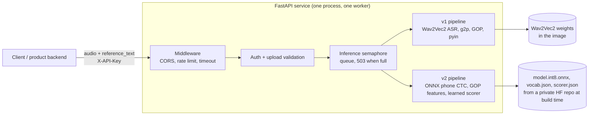
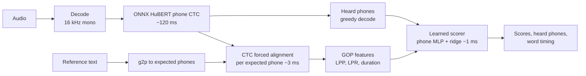

<!-- doc-id: readme | rev: 078fdfd7 -->
<div align="center">

# 🗣️ Pronunciation Validation Service

**Phoneme-level English pronunciation scoring over a simple REST API.**
Upload a recording and the sentence the speaker should have said; get per-phone, per-word and overall scores with the heard phones and word timing.


-EE4C2C?logo=pytorch&logoColor=white)


[Quick start](#-quick-start) · [API](#-api) · [How v2 works](#-how-v2-works) · [Results](#-results) · [Docs](#-documentation)

**Languages:** [English](README.md) · [Tiếng Việt](languages/vi/README.md) · [中文](languages/zh/README.md) · [日本語](languages/ja/README.md) · [Español](languages/es/README.md)

</div>

---

## ✨ What it does

Given `audio` + `reference_text`, the service returns:

- **IPA comparison**: expected vs heard phone for every phoneme of every word
- **Scores**: accuracy, completeness, fluency, prosody and an overall score (0-100) with a level and feedback text
- **Word error types**: `None`, `Mispronunciation`, `Omission`, `Insertion`, `UnexpectedBreak`, `MissingBreak`
- **Word timing** (v2): `start_ms` / `end_ms` for every word

Two pipelines run side by side, with the same request and response shape:

| | **v1** `/api/v1/evaluate` | **v2** `/api/v2/evaluate` |
| --- | --- | --- |
| Idea | Transcribe words with Wav2Vec2, compare text, hand-tuned formulas | Score each *expected phone* with a phone-level model; a learned scorer maps it to expert-style scores |
| Phone model | Wav2Vec2 letters (A-Z) | HuBERT-base phone CTC (41 IPA phones), ONNX INT8 |
| Scores | Formulas (55% IPA + 45% GOP, Azure-style overall) | Trained on speechocean762 expert scores |
| Latency p50 (3.4 s clip, 4 vCPU) | 381 ms | **125 ms** |
| Memory after load (each alone) | 796 MB | **430 MB** |
| Phone-score correlation with experts (adults) | 0.03 | **0.63** |

v1 is unchanged and stays available. See [docs/scoring-v2.md](docs/scoring-v2.md) for why v2 exists and [docs/api.md](docs/api.md#post-apiv2evaluate) for the differences in the response.

## 🏗️ Architecture



More diagrams (v1 vs v2, request sequence, startup): [docs/architecture.md](docs/architecture.md).

## 🔬 How v2 works



1. A phone CTC model (fine-tuned on native LibriSpeech only) gives per-frame phone posteriors.
2. The reference text becomes expected phones (g2p); numpy CTC forced alignment finds where each one should be.
3. Per-phone goodness-of-pronunciation features (log posterior of the expected phone, how much better another phone fits, duration) and the greedy-decoded heard phones feed a small scorer trained on speechocean762.
4. Silence and audio with no decodable speech return a zero-score response instead of a guess.

Timings are for a 3.4 s clip, INT8, 4 vCPU, on a dev box. Full description: [docs/scoring-v2.md](docs/scoring-v2.md).

## 🚀 Quick start

```bash
python3.11 -m venv .venv && source .venv/bin/activate      # Windows: .venv\Scripts\activate
pip install -r requirements.txt
cp .env.example .env                                       # set API_KEY (>= 32 chars) or DEBUG=true
python main.py                                             # http://localhost:8000/docs
```

The v1 model downloads from Hugging Face on first start. **v2 needs three files** in `data/models/hubert-phone-ctc/` (`model.int8.onnx`, `vocab.json`, `scorer.json`); without them `/api/v2/evaluate` answers `503` and v1 is unaffected.

```bash
# fetch the v2 files from the private repo (needs a Hugging Face read token)
huggingface-cli login
huggingface-cli download dris1153/pronunciation-v2 model.int8.onnx vocab.json scorer.json --local-dir data/models/hubert-phone-ctc
```

Or build them yourself: [docs/training.md](docs/training.md).

```bash
curl -X POST http://localhost:8000/api/v2/evaluate \
  -H "X-API-Key: $API_KEY" \
  -F "audio=@recording.wav" -F "reference_text=hello world"
```

```jsonc
{
  "reference_text": "hello world",
  "transcribed_text": "jɛloʊ wɝd",            // v2: the heard IPA string
  "results": {
    "word_details": [{
      "word": "hello", "expected_ipa": "həloʊ", "actual_ipa": "jɛloʊ",
      "start_ms": 160, "end_ms": 440, "error_type": "Mispronunciation",
      "phoneme_details": [{ "expected_ipa": "h", "actual_ipa": "j", "is_correct_ipa": false, "gop_score": 67.56 }]
    }]
  },
  "accuracy_score": 57.26, "fluency_score": 74.69, "prosody_score": 68.98, "overall_score": 55.8, "level": "fair"
}
```

(abridged; real output for a synthetic "yellow word" clip, full example in [docs/api.md](docs/api.md))

### Docker

```bash
docker build --build-arg V2_MODEL_REPO=dris1153/pronunciation-v2 --secret id=hf_token,env=HF_TOKEN -t pronunciation-validator .
docker run -p 8000:8000 -e API_KEY=<32+ char key> -e DEBUG=false pronunciation-validator
```

Railway, Coolify/nixpacks, sizing and the model-publishing flow: [docs/deployment.md](docs/deployment.md).

## 📡 API

| Endpoint | Auth | Purpose |
| --- | --- | --- |
| `POST /api/v2/evaluate` | 🔒 | Pronunciation score, phoneme-native pipeline, with word timing |
| `POST /api/v1/evaluate` | 🔒 | Pronunciation score, original Wav2Vec2 pipeline |
| `GET /api/v1/text-analysis` | 🔒 | Text to IPA with per-word phonemes |
| `POST /api/v1/transcribe` | 🔒 | Audio to text, no scoring |
| `GET /api/v1/model-info` | - | Service metadata and limits |
| `GET /health` | - | Liveness |

🔒 = `X-API-Key` header. Limits: 10 MB upload, 30 s audio, wav / mp3 / ogg / flac / webm. Interactive docs at `/docs`. Calling from a backend with per-user rate limits: [docs/internal-integration.md](docs/internal-integration.md). Reference: [docs/api.md](docs/api.md).

## 📊 Results

speechocean762 test split (2500 utterances, Mandarin-L1 learners), Pearson correlation with expert scores, adults (18+):

| | v1 | **v2** |
| --- | --- | --- |
| Utterance total | 0.62 | **0.85** |
| Utterance fluency | 0.63 | **0.88** |
| Utterance prosodic | 0.11 | **0.85** |
| Word accuracy | 0.02 | **0.64** |
| Phone accuracy | 0.03 | **0.63** |
| Mispronunciation detection F1 | 0.27 | **0.54** |

Phone model: 1.86% phone error rate on LibriSpeech test-clean. INT8 changes every metric by 0.004 or less.

> ⚠️ **Honest limits.** All evaluation speakers are Mandarin-L1; **Vietnamese-L1 accuracy has not been measured** and no open Vietnamese-L1 dataset with pronunciation scores was found ([data plan](docs/evaluation.md#data-plan-for-vietnamese-learners)). The score curve was tuned on five synthetic clips. Speed numbers come from a dev box; re-run `debugs/benchmark.py` on your host. Details: [docs/evaluation.md](docs/evaluation.md).

## 🧰 Tech stack

| Component | Technology |
| --- | --- |
| Web | FastAPI, Uvicorn, Pydantic v2, slowapi |
| v2 phone model | HuBERT-base fine-tuned for phone CTC, ONNX Runtime (INT8), numpy alignment and scorer (no PyTorch) |
| v1 | Wav2Vec2-base-960h (PyTorch, CPU), librosa pyin prosody |
| Text to phones | g2p_en + NLTK, 41-symbol IPA inventory |
| Training | PyTorch + Transformers on a GPU, offline only (`training/`) |
| Ops | Docker, Railway / Coolify, loguru, Hugging Face Hub for model artifacts |

## 📁 Project layout

```
app/            FastAPI app: api/ (routes, auth, upload), core/ (config), models/ (schemas),
                services/ (v1 pipeline, shared alignment + scoring rules, v2/ phone pipeline), utils/
training/       Offline training and ONNX export of the v2 models (own CUDA venv)
scripts/        speechocean762 evaluation harness, sanity set, Hugging Face upload
debugs/         Latency / memory benchmark (v1 and v2)
tests/          pytest suite (~460 tests) + synthetic sanity recordings
docs/           Documentation
```

## 📚 Documentation

| | |
| --- | --- |
| [API reference](docs/api.md) | Endpoints, auth, errors, examples |
| [Architecture](docs/architecture.md) | Diagrams and code layout |
| [Scoring v2](docs/scoring-v2.md) · [v1](docs/scoring-v1.md) | How scores are produced |
| [Evaluation](docs/evaluation.md) | Quality, latency, memory, tests, data plan |
| [Training](docs/training.md) | Train, export and publish the v2 models |
| [Configuration](docs/configuration.md) · [Deployment](docs/deployment.md) | Environment variables, Docker, Railway, Coolify |
| [Internal integration](docs/internal-integration.md) | Backend-to-service usage, moving a client to v2 |

Index of all pages: [docs/README.md](docs/README.md). There is also a bilingual single-page version in [`index.html`](index.html).

## 🧪 Testing

```bash
pytest tests/ -v
```

Tests that need the real v2 model files skip themselves when the files are absent. Two v1 sanity cases (`poor_001`, `poor_002`) are known failures (v1 scores those clips just above their band); v2 passes both.

## 🤝 Contributing

Keep files under about 200 lines, follow the existing structure (`docs/structure.md`), and run the tests before pushing. English docs are the source of truth for the translations in [`languages/`](languages/README.md): after editing one, run `python scripts/docs_sync.py bump` (rules in [AGENTS.md](AGENTS.md)). Changes to scoring need a before/after run of the speechocean762 harness ([docs/evaluation.md](docs/evaluation.md)).

## 📄 License and credits

Licensed under the [Apache License 2.0](LICENSE). Copyright 2026 dris1153. Redistributions must keep the [NOTICE](NOTICE) file.

Built on HuBERT and wav2vec 2.0 (Meta AI, Apache-2.0), g2p_en, and trained and evaluated with LibriSpeech and speechocean762 (both CC BY 4.0). Full credits and citations: [NOTICE](NOTICE).
