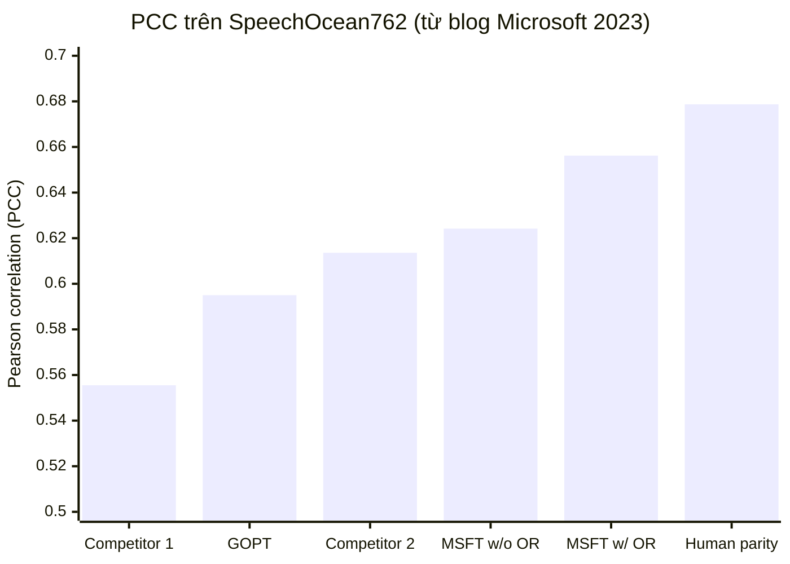

# Báo cáo nghiên cứu sâu về thuật toán Azure Pronunciation Assessment

## Tóm tắt điều hành

Dịch vụ Pronunciation Assessment trong Azure Speech (truy cập qua Azure AI Foundry) là một hệ thống đánh giá phát âm dựa trên ASR (Automatic Speech Recognition) nhằm cung cấp phản hồi đa chiều: **Accuracy (độ đúng phát âm), Fluency (độ trôi chảy), Completeness (độ đầy đủ so với tham chiếu), Prosody (ngữ điệu/nhịp điệu)** và **PronScore** (điểm tổng hợp) — với hỗ trợ cả **kịch bản có văn bản tham chiếu (scripted/reading)** và **không tham chiếu trước (unscripted/speaking)**. citeturn2view1turn17view0turn16view0

Về mặt kỹ thuật, tài liệu và bài viết kỹ thuật của Microsoft cho thấy kiến trúc cốt lõi là một pipeline “ASR + căn chỉnh (alignment) + chấm điểm (scoring)” nhưng **một số chi tiết nội bộ (cấu trúc acoustic model cụ thể, cách dùng lexicon/LM ở mức độ nào, tham số ngưỡng/weight nội bộ ngoài công thức PronScore công bố)** không được công khai; các điểm này được ghi rõ là **không xác định** trong báo cáo. citeturn17view0turn2view1turn16view0

Các nguồn chính thức mô tả rõ: (i) Pronunciation Assessment sử dụng **một phiên bản mô hình Speech-to-Text (STT) riêng** để đảm bảo tính nhất quán/độ chính xác khi chấm phát âm; (ii) có chế độ **streaming liên tục** (thời lượng có thể “không giới hạn” qua Speech SDK) và hướng dẫn xử lý audio >30s bằng “continuous mode” (kèm các ràng buộc như EnableMiscue không hỗ trợ trong continuous mode theo mô tả); (iii) REST “short audio” hỗ trợ truyền audio dạng chunked để giảm latency. citeturn17view0turn2view3

Về thuật toán, các bài blog kỹ thuật của Microsoft (2023) nêu rõ việc dùng **Goodness of Pronunciation (GOP)** làm đặc trưng nền tảng, kết hợp **Hierarchical Transformer** và **Ordinal Regression** để tăng tương quan với giám khảo người, đồng thời khai thác đặc trưng theo nhiều tầng “senone–phoneme–word” (ám chỉ pipeline dựa trên acoustic model kiểu hybrid/HMM-state vì khái niệm “senone”). citeturn8view4turn8view1turn8view2

Dữ liệu benchmark công khai trực tiếp “Azure PA vs Google/AWS” gần như **không có**; tuy nhiên Microsoft công bố (a) trong đánh giá nội bộ, **tương quan Pearson > 0.5** giữa điểm máy và giám khảo người; (b) trên bộ dữ liệu SpeechOcean762, mô hình “MSFT w/ OR” đạt **PCC 0.6562** (Human parity ~0.6787) và vượt một số đối thủ thương mại được ẩn danh. citeturn3view0turn8view1turn9view0

So sánh cạnh tranh: **Google Cloud Speech-to-Text** và **Amazon Transcribe** là ASR cloud mạnh (đa ngôn ngữ, streaming/batch, time offsets, confidence…) nhưng **không phải** dịch vụ pronunciation assessment “đóng gói” sẵn như Azure PA; để đánh giá phát âm thường phải xây thêm tầng forced alignment + GOP/prosody scoring. Open-source (Kaldi/ESPnet/CMU Sphinx) cung cấp đầy đủ “mảnh ghép” thuật toán (forced alignment, GOP, CTC-segmentation, CTC-based forced alignment…) nhưng đòi hỏi chi phí kỹ thuật/triển khai cao hơn và chất lượng phụ thuộc mạnh vào model/ dữ liệu/ tối ưu hoá. citeturn23search10turn23search15turn22search3turn33view0turn31view0turn29view1

## Mục lục

- [Mục tiêu, ứng dụng và phạm vi dịch vụ](#mục-tiêu-ứng-dụng-và-phạm-vi-dịch-vụ)  
- [Kiến trúc tổng quan và pipeline xử lý](#kiến-trúc-tổng-quan-và-pipeline-xử-lý)  
- [Phân tích thuật toán và thành phần kỹ thuật](#phân-tích-thuật-toán-và-thành-phần-kỹ-thuật)  
- [So sánh, benchmarks, giới hạn và khuyến nghị](#so-sánh-benchmarks-giới-hạn-và-khuyến-nghị)  

## Mục tiêu, ứng dụng và phạm vi dịch vụ

Pronunciation Assessment hướng tới mục tiêu **đánh giá phát âm và năng lực nói** theo cách “gần tương tự giám khảo bản ngữ”, cung cấp phản hồi ở nhiều mức (phoneme/word/full text; trong một số ngữ cảnh có cả syllable), phục vụ các kịch bản **CALL/CAPT** (computer-assisted language learning / pronunciation training) và đánh giá đọc/nói trong giáo dục. citeturn2view1turn16view0turn4search9

Các trường hợp sử dụng điển hình gồm: người học luyện phát âm và nhận phản hồi tức thời; giáo viên/edtech đánh giá nhiều người học theo thời gian thực; tích hợp vào sản phẩm như công cụ luyện đọc/diễn thuyết (được Microsoft nêu như ví dụ ứng dụng). citeturn2view1turn16view0turn8view0

Về phạm vi ngôn ngữ, tài liệu “Language support” cho biết Pronunciation Assessment hỗ trợ **33 locale** và mỗi locale dùng được ở mọi vùng Speech-to-Text; trong danh sách có **vi-VN**. citeturn20view1

Về dữ liệu huấn luyện/độ bao phủ người nói, tài liệu minh bạch của Microsoft nêu model được huấn luyện với **100,000+ giờ** dữ liệu người nói bản ngữ; blog GA cũng mô tả dữ liệu huấn luyện có đa dạng “accent/region/age” và phục vụ cả người học không bản ngữ lẫn bản ngữ. citeturn2view1turn16view0

## Kiến trúc tổng quan và pipeline xử lý

### Pipeline tổng quát

Pipeline xử lý có thể quy về chuỗi: **thu âm → tiền xử lý → nhận dạng (ASR) → căn chỉnh (alignment) → chấm điểm (scoring) → tổng hợp & trả phản hồi**. Các mô tả chính thức cho thấy kết quả trả về chứa dấu thời gian Offset/Duration ở mức word/syllable/phoneme, hàm ý hệ thống thực hiện một dạng căn chỉnh theo thời gian giữa tín hiệu và đơn vị ngôn ngữ. citeturn21view0turn2view1

```mermaid
flowchart LR
  A[Thu âm / Upload audio\n(mic, file, stream)] --> B[Tiền xử lý tín hiệu\n(resample/normalize/VAD/denoise tùy ngữ cảnh)]
  B --> C[ASR (Speech-to-Text)\nAcoustic model + decoder]
  C --> D[Căn chỉnh\nForced alignment / alignment dựa trên ASR]
  D --> E[Chấm điểm đa mức\nPhoneme/Word/Full text]
  E --> F[Thành phần điểm\nAccuracy, Fluency, Completeness, Prosody, PronScore]
  F --> G[Phản hồi chi tiết\nErrorType, NBestPhonemes,\nOffset/Duration, JSON]
```

Các ràng buộc đầu vào quan trọng: REST “short audio” yêu cầu Content-Type audio/wav (PCM 16kHz) hoặc ogg/opus; tài liệu limitations khuyến nghị **chất lượng 16kHz trở lên**, môi trường ít noise và 1 người nói/1 lần đánh giá. citeturn2view3turn3view0

### Chế độ thời gian thực và xử lý liên tục

- **Speech SDK streaming mode:** tài liệu nêu streaming “uninterrupted” và thời lượng ghi có thể “không giới hạn” miễn là không dừng; đây là chế độ phù hợp cho phản hồi gần thời gian thực. citeturn17view0  
- **Continuous mode cho audio dài:** tài liệu khuyến nghị nếu audio >30s thì dùng continuous mode; đồng thời ghi rõ trong continuous mode, **EnableMiscue không được hỗ trợ** và nếu cần nhãn Omission/Insertion thì phải tự so khớp kết quả nhận dạng với reference text trong ứng dụng. citeturn17view0  
- **REST short audio:** hỗ trợ gửi audio “chunked transfer” và Microsoft khuyến nghị streaming upload để giảm latency. citeturn2view3  

image_group{"layout":"carousel","aspect_ratio":"16:9","query":["Speech Service Update Hierarchical Transformer for Pronunciation Assessment architecture figure","Microsoft Pronunciation Assessment prosody score unexpected break missing break screenshot","Azure Speech pronunciation assessment JSON phoneme syllable nbest phonemes example"],"num_per_query":1}

## Phân tích thuật toán và thành phần kỹ thuật

### Căn chỉnh bắt buộc và vai trò của forced alignment

Trong các hệ thống chấm phát âm kiểu GOP kinh điển, **forced alignment** dùng transcript (orthographic/phonetic) để xác định biên thời gian từng phoneme/word, từ đó tính score theo từng đoạn. Một nghiên cứu về GOP trên trẻ em mô tả pipeline GOP gồm (1) **phonetic segmentation** bằng forced alignment và (2) tính **phoneme log-likelihoods** bằng acoustic model; đồng thời nhấn mạnh alignment error có thể ảnh hưởng điểm tự động. citeturn37view0

Trong literature CAPT, Kanters et al. mô tả GOP thực hiện **forced recognition** (biết transcript) và **free recognition** (dự đoán chuỗi phoneme khả dĩ nhất), sau đó lấy chênh lệch log-prob để tạo GOP score; cuối cùng dùng **threshold** để quyết định mispronunciation. citeturn36view0

Ở phía Azure, dù Microsoft không công bố thuật toán forced alignment chi tiết, kết quả JSON của Pronunciation Assessment trả Offset/Duration đến mức phoneme và có “Syllables/Phonemes/NBestPhonemes”, cho thấy hệ thống thực hiện căn chỉnh và đánh giá theo phân đoạn thời gian. citeturn21view0turn2view1  
**Chi tiết thuật toán forced alignment nội bộ (HMM-Viterbi vs CTC alignment vs hybrid) là không xác định** trong tài liệu chính thức; tuy nhiên blog “Hierarchical Transformer” dùng khái niệm “senone” và “aligner block” nối senone–phoneme, gợi ý mạnh tới hệ thống dựa trên acoustic model có trạng thái (hybrid). citeturn8view1turn8view2

### Chấm điểm ở mức phoneme và nguyên lý GOP

Azure mô tả **AccuracyScore** phản ánh mức khớp phoneme so với bản ngữ; điểm syllable/word/full text được tổng hợp từ **phoneme-level accuracy** và “refined with assessment objectives”. citeturn2view1turn13search11

Blog kỹ thuật của Microsoft nêu Pronunciation Assessment tận dụng **GOP** làm đặc trưng quan trọng và phụ thuộc chất lượng acoustic model STT: “leverage the high-quality GOP feature” nhờ STT mạnh và dữ liệu huấn luyện quy mô lớn. citeturn8view4

Về mặt học thuật, Witt & Young (GOP gốc) là likelihood-based metric; các nghiên cứu sau nhấn mạnh GOP phụ thuộc căn chỉnh và có thể cần threshold theo phoneme/speaker. citeturn24search17turn36view0  
Nghiên cứu Interspeech 2024 giải thích: GOP truyền thống dựa HMM-GMM, GOP-DNN dựa trung bình log-posterior, và chất lượng GOP bị ảnh hưởng mạnh bởi thông tin căn chỉnh (t1,t2); mispronunciation (đặc biệt insertion/deletion) có thể gây alignment errors, tạo sai lệch điểm. citeturn27view0

Một điểm kỹ thuật rất “đặc thù Azure” là khả năng trả về **NBestPhonemes**: với mỗi expected phoneme, hệ thống trả danh sách ứng viên phoneme “thực tế đã nói” kèm score; đây là dạng **phoneme-level confidence / posterior candidates** giúp chẩn đoán cụ thể lỗi (ví dụ expected /ɛ/ nhưng ứng viên /ə/ score cao hơn). citeturn21view0

### Fluency, Prosody và các đặc trưng siêu đoạn (suprasegmental)

Microsoft định nghĩa:
- **FluencyScore:** mức “giống bản ngữ” về cách dùng **silent breaks** giữa từ. citeturn2view1turn2view4  
- **ProsodyScore:** tự nhiên ở **stress, intonation, speaking speed, rhythm**; là tuỳ chọn và hiện được ghi rõ chỉ khả dụng ở **en-US** trong hướng dẫn SDK/portal. citeturn2view1turn17view0turn3view1  

Portal Foundry mô tả thêm các **error types** cho prosody như *Unexpected break, Missing break, Monotone* (phản ánh sai nhịp ngắt, thiếu ngắt, đơn điệu). citeturn3view1

Ở mức mô hình, blog “Hierarchical Transformer” mô tả word-level features gồm **word posterior score, sentence-level SNR, duration**, và thống kê (consonant/vowel attributes); phoneme feature gồm **phoneme score và duration**; senone feature gồm **senone score và status**. Điều này cho thấy Fluency/Prosody trong hệ thống có khả năng dùng các đặc trưng thời lượng, khoảng dừng, SNR, và tín hiệu xác suất hậu nghiệm (posterior). citeturn8view1turn8view2

### Acoustic model (ASR), lexicon, language model và confidence

**Acoustic model / STT backend.** Microsoft nêu rõ Pronunciation Assessment dùng một **phiên bản STT model riêng** (khác standard STT model) để đảm bảo chấm phát âm nhất quán/chính xác. citeturn17view0  
Blog kỹ thuật cũng khẳng định hệ thống tận dụng acoustic model của STT để trích “senone/phoneme/word features”. citeturn8view2  
**Kiến trúc cụ thể (Conformer/Transformer hybrid, hay end-to-end thuần) là không xác định** trong tài liệu; nhưng việc dùng “senone” là chỉ dấu điển hình của hệ HMM-state. citeturn8view2

**Lexicon / phonetic lexicons.** Azure cho phép xuất phoneme theo **SAPI/IPA** và mô tả rõ locale nào có “phoneme name” (en-US IPA; en-US & zh-CN SAPI). citeturn21view0  
Tuy nhiên, **từ điển phát âm (lexicon) dùng trong decoding/alignment nội bộ** (ví dụ multiple pronunciations, G2P, biến thể accent…) là **không xác định** trong tài liệu công khai. Bối cảnh học thuật cho thấy forced alignment và ASR truyền thống thường dựa lexicon; ví dụ CMU Sphinx forced alignment chọn pronunciation alternative trong dictionary. citeturn33view0

**Language model (LM).** Trong FAQ pricing của Azure Speech, Microsoft mô tả LM là phân phối xác suất trên chuỗi từ và giúp chọn giữa các chuỗi “nghe giống nhau”; đồng thời Azure có khả năng custom speech để tăng độ chính xác ASR, từ đó gián tiếp tác động đến pronunciation assessment (vì PA phụ thuộc chất lượng transcription/alignment). citeturn6view0turn3view0turn19view0

**Confidence measures.** Kết quả JSON minh hoạ cho thấy STT trả về NBest với trường **Confidence**, và PA trả **NBestPhonemes** với score cho từng ứng viên phoneme. citeturn21view0  
Ở mức mô hình, word posterior score được Microsoft nêu như feature đầu vào cho mô hình chấm điểm. citeturn8view1

### Handling non-native accents và robustness với noise

Microsoft thừa nhận chất lượng PA phụ thuộc vào **STT transcription accuracy** và “inter-rater agreement” giữa hệ thống và giám khảo người; đồng thời khuyến nghị audio chất lượng cao, mic gần, môi trường ít noise, một người nói, không trộn ngôn ngữ. citeturn3view0  
Tài liệu limitations cũng nói trong môi trường ồn/multiple speakers, “confidence of the evaluation” có thể giảm; và khuyến nghị thực tế là yêu cầu người nói lặp lại nếu score dưới một ngưỡng nhất định. citeturn3view0  
Blog kỹ thuật nhấn mạnh sentence-level SNR là feature; điều này phù hợp với hướng tiếp cận robustness: SNR/noise-aware features có thể được dùng để điều chỉnh hoặc “calibrate” score. citeturn8view1

Với accent không bản ngữ, Microsoft nêu dữ liệu huấn luyện 100k+ giờ đa accent/region/age, nhằm tăng tính ổn định cho nhiều nhóm người dùng (kids ↔ adults; non-native ↔ native). citeturn16view0turn2view1  
Tuy vậy, trong nghiên cứu GOP hiện đại, alignment error và mismatch acoustic model có thể bị “phóng đại” ở nhóm giọng lệch chuẩn (trẻ em, L2), dẫn đến rủi ro sai lệch điểm nếu không kiểm soát. citeturn37view0turn27view0

### Công thức PronScore và các tham số/điều chỉnh công khai

Microsoft công bố công thức tổng hợp **PronScore** theo cách “sắp xếp các sub-scores từ thấp lên cao rồi gán trọng số”, làm cho điểm tổng nhạy với khía cạnh yếu nhất (min-ish weighted). Cụ thể:  

- **Reading (scripted):**  
  - Có Prosody: `PronScore = 0.4*s0 + 0.2*s1 + 0.2*s2 + 0.2*s3`  
  - Không Prosody: `PronScore = 0.6*s0 + 0.2*s1 + 0.2*s2`  
- **Speaking (unscripted; không có Completeness):**  
  - Có Prosody: `PronScore = 0.6*s0 + 0.2*s1 + 0.2*s2`  
  - Không Prosody: `PronScore = 0.6*s0 + 0.4*s1` citeturn21view0  

Các tham số cấu hình quan trọng (SDK/REST) gồm:  
- `ReferenceText` (có/không tuỳ scripted vs unscripted), `GradingSystem` (FivePoint/HundredMark), `Granularity` (Phoneme/Word/FullText), `EnableMiscue`, `EnableProsodyAssessment`, `PhonemeAlphabet` (IPA/SAPI), `NBestPhonemeCount`, `Dimension` (Basic/Comprehensive), `ScenarioId` (custom point system). citeturn17view0turn2view3turn2view5turn21view0  

Ngoài ra, tài liệu best-practice khuyến nghị chọn **threshold** theo bối cảnh (ví dụ người lớn cần ngưỡng nghiêm hơn trẻ em) — nhưng **giá trị threshold/weight nội bộ cho mispronunciation detection** ngoài PronScore formula là **không xác định**. citeturn3view0  

## So sánh, benchmarks, giới hạn và khuyến nghị

### Bảng so sánh kỹ thuật

| Thuộc tính | Azure Pronunciation Assessment | Google Cloud Speech-to-Text (xây PA bổ sung) | Amazon Transcribe (xây PA bổ sung) | Open-source (Kaldi/ESPnet/CMU Sphinx; tự xây) |
|---|---|---|---|---|
| Alignment (căn chỉnh) | Có timestamp đến mức phoneme/word trong JSON; chi tiết thuật toán alignment nội bộ **không xác định**; có dấu hiệu “senone–phoneme aligner block”. citeturn21view0turn8view2 | STT có time offsets; forced alignment với reference text phải tự triển khai (ví dụ DP/CTC-seg). citeturn23search10turn29view0 | STT streaming/recorded; để alignment kiểu CAPT phải tự triển khai. citeturn24search0 | Có nhiều lựa chọn: HMM forced alignment (Sphinx3_align, MFA/Kaldi), CTC-segmentation, CTC forced alignment. citeturn33view0turn25search3turn29view0turn31view0 |
| Scoring unit | Phoneme/word/full text; (syllable + spoken phoneme candidates chủ yếu en-US). citeturn21view0turn3view1 | Chủ yếu word/subword transcript; nếu làm PA thì thường phoneme/GOP (tự làm). citeturn27view0turn36view0 | Chủ yếu word transcript + confidence; PA phoneme-level là tự làm. citeturn23search15turn27view0 | Có GOP phone-level (Kaldi), threshold scoring (Sphinx), CTC-based GOP vector/scalar. citeturn22search3turn33view1turn27view0 |
| Output metrics | Accuracy/Fluency/Completeness/Prosody/PronScore; ErrorType (Insertion/Omission…), NBestPhonemes. citeturn2view1turn17view0turn21view0 | Transcript, word time offsets; pronunciation metrics **không có sẵn** (tự suy ra nếu xây). citeturn23search10turn24search5 | Transcript, word-level confidence, diarization, custom vocab…; pronunciation metrics **không có sẵn**. citeturn23search15turn24search0 | Tuỳ thiết kế: GOP/PLLR, AUC-ROC/PCC, thresholds; có thể xuất mọi mức nếu tự xây. citeturn37view0turn36view0turn33view1 |
| Ngôn ngữ | 33 locale (có vi-VN); prosody chỉ en-US theo mô tả. citeturn20view1turn17view0turn3view1 | 125+ ngôn ngữ theo trang sản phẩm; danh sách chi tiết trong docs. citeturn23search4turn23search0 | “100+ languages” theo trang sản phẩm; bảng chi tiết trong docs. citeturn23search15turn23search2 | Tuỳ model/dataset; có thể mở rộng nhưng cần dữ liệu & huấn luyện. citeturn9view0turn31view0 |
| Latency | Có streaming; REST khuyến nghị chunked transfer để giảm latency; số liệu ms **không xác định**. citeturn17view0turn2view3 | Có streaming; stream giới hạn thời lượng (ví dụ 5 phút/stream) và gửi gần real-time; latency ms **không xác định**. citeturn23search5 | Có streaming và batch; latency ms **không xác định**. citeturn24search0turn23search15 | Phụ thuộc triển khai (CPU/GPU, RTF, batching); có thể tối ưu mạnh nhưng không “mặc định”. citeturn31view0turn29view1 |
| SDKs | Speech SDK nhiều ngôn ngữ; Go không hỗ trợ PA theo tài liệu. citeturn17view0turn21view0 | Có client libraries nhưng chi tiết ngôn ngữ SDK **không xác định** trong phạm vi trích dẫn hiện có. citeturn23search0 | Có AWS SDK; chi tiết ngôn ngữ SDK **không xác định** trong phạm vi trích dẫn hiện có. citeturn23search15 | Mã nguồn mở phong phú; tích hợp qua CLI/Python/C++ tuỳ dự án. citeturn22search3turn25search3turn31view0 |
| Giá | Baseline = Speech-to-Text; Prosody là add-on; giá số cụ thể theo trang pricing động nên **không xác định** từ bản trích xuất tĩnh. citeturn3view1turn17view0turn6view0 | Tính phí theo thời lượng audio xử lý, theo increments; mức giá cụ thể theo bậc/region **không trích được** trong phạm vi này. citeturn23search1 | Có bảng giá theo phút và tier (ví dụ T1 250k phút $0.024/min…); có biến thể batch/streaming/add-ons. citeturn23search3 | Chi phí = compute + vận hành + huấn luyện; “giá dịch vụ” không áp dụng. citeturn31view0turn29view1 |
| Khả năng tuỳ chỉnh | Nhiều tham số (granularity, NBestPhonemeCount, IPA/SAPI, ScenarioId…); nội bộ scoring model không mở. citeturn17view0turn2view3turn21view0 | Có model adaptation và cấu hình STT; PA phải tự xây nên tuỳ chỉnh rất rộng (nhưng tự chịu trách nhiệm). citeturn23search4turn23search10 | Có custom vocabulary/custom language models; PA phải tự xây. citeturn23search15 | Toàn quyền tuỳ chỉnh (alignment/scoring/threshold/LM), đổi lại độ phức tạp cao. citeturn33view1turn27view0turn29view0 |

### Benchmarks công khai và biểu đồ

**Tương quan với giám khảo người (mức tổng quát).** Tài liệu limitations của Microsoft nêu trong đánh giá của họ, Pronunciation Assessment đạt **Pearson correlation > 0.5** với giám khảo người (được diễn giải là mức “high” theo bảng hướng dẫn). citeturn3view0

**Benchmark mô hình (SpeechOcean762).** Blog “Hierarchical Transformer” công bố bảng PCC trên SpeechOcean762 với so sánh GOPT và 2 đối thủ thương mại ẩn danh, cùng mô hình Microsoft có/không ordinal regression và “human parity”. citeturn8view1turn9view0  
Lưu ý quan trọng: bảng này là benchmark cho hệ thống/mô hình mô tả trong blog; **không có khẳng định công khai rằng các con số PCC này đúng y hệt cho endpoint Azure PA hiện hành**, nên cần coi là “tham khảo kỹ thuật”, không phải SLA chất lượng. citeturn8view1turn17view0


citeturn8view1

### Đề xuất thiết kế thí nghiệm đánh giá (khi thiếu benchmark head-to-head Azure vs Google/AWS)

Do thiếu dữ liệu công khai “đấu trực diện” giữa Azure PA và các lựa chọn Google/AWS (vốn không cung cấp PA packaged sẵn), một thiết kế thí nghiệm thực dụng nên tách thành 2 lớp: **(A) Chất lượng ASR** và **(B) Chất lượng PA (score correlation / error detection)**. Lý do: Microsoft cũng nhấn mạnh PA phụ thuộc STT accuracy. citeturn3view0

**Dataset gợi ý (có công khai):**
- **SpeechOcean762**: 5000 utterances, 250 non-native speakers, có annotation sentence/word/phoneme bởi 5 experts; phù hợp đo PCC phoneme/word/sentence. citeturn9view0turn27view1  
- Nhóm forced alignment/độ bền căn chỉnh: có thể dùng TEDlium v2 alignment benchmark theo Kürzinger et al. nếu cần đánh giá alignment layer (không trực tiếp PA score). citeturn29view1  

**Metrics khuyến nghị:**
- **Pearson/Spearman correlation** giữa điểm máy và điểm người (tổng, theo word/phoneme), kèm CI và kiểm định khác biệt tương quan (ví dụ Fisher z-transform). (Microsoft dùng Pearson như chuẩn so sánh người-máy). citeturn3view0turn8view1  
- **AUC-ROC** / EER / F1 cho bài toán MDD nhị phân (đúng/sai phoneme), như thực hành trong nghiên cứu GOP/CTC. citeturn27view1turn36view0  
- **Calibration** của confidence (ECE/Brier) nếu hệ thống trả confidence (NBestPhonemes, word confidence). citeturn21view0  

**Protocol:**
1. Chuẩn hoá audio (16kHz, mono), kiểm soát noise level; tách các điều kiện SNR khác nhau để đo robustness. citeturn3view0turn8view1  
2. Với Azure PA (scripted): dùng ReferenceText chuẩn; với hướng Google/AWS: chạy STT lấy time offsets, sau đó thực hiện forced alignment + GOP/CTC-GOP nội bộ để tạo score tương đương (đảm bảo cùng scoring rubric). citeturn23search10turn27view0turn29view0  
3. Thực hiện đánh giá theo speaker-stratified split để tránh leakage (đặc biệt với L2). citeturn9view0  

**Kiểm định thống kê:**
- So sánh PCC: Fisher z-test; bootstrap CI theo speaker. citeturn8view1turn3view0  
- So sánh AUC: DeLong test; bootstrap. citeturn27view1  
- Mixed-effects modeling để tách ảnh hưởng alignment error vs acoustic deviation (hữu ích khi phân tích sai khác score). citeturn37view0  

### Giới hạn/rủi ro đã được nêu và rủi ro suy luận kỹ thuật

**Giới hạn được nêu chính thức:**
- Không hỗ trợ mixed-lingual và multi-speaker; chất lượng giảm khi mic xa/ồn; môi trường ồn có thể làm giảm confidence đánh giá. citeturn3view0  
- Prosody và một số tính năng chi tiết chỉ hỗ trợ en-US theo tài liệu. citeturn17view0turn3view1  

**Rủi ro kỹ thuật suy luận (cần tự kiểm chứng trong triển khai):**
- Sai lệch do alignment error: literature cho thấy pipeline GOP nhạy với segmentation/time boundaries; mispronunciation có thể làm alignment sai lệch mạnh (đặc biệt insertion/deletion). citeturn27view0turn37view0  
- Sai lệch theo nhóm người nói (trẻ em, accent mạnh): khác biệt acoustic so với training distribution có thể làm tăng WER và kéo theo PA score lệch. citeturn37view0turn3view0  

### Đề xuất cải tiến kỹ thuật khả thi (không đòi hỏi “mở” mô hình Azure)

Các cải tiến dưới đây tập trung vào **ứng dụng tích hợp Azure PA**, không yêu cầu can thiệp mô hình server-side:

1. **Segment & retry policy theo confidence/score:** dùng NBest Confidence và/hoặc score thấp để yêu cầu người học lặp lại; đây cũng là gợi ý trong limitations (“repeat if below a certain threshold”). citeturn3view0turn21view0  
2. **Chuẩn hoá audio & kiểm soát môi trường:** enforce 16kHz mono, VAD client-side, giảm noise; vì chất lượng PA phụ thuộc audio quality và noise. citeturn2view3turn3view0  
3. **Chọn locale theo accent mục tiêu:** Microsoft gợi ý thử nhiều locale (ví dụ es-ES vs es-MX) để chọn mô hình phù hợp nhất; có thể áp dụng tương tự cho các ngôn ngữ nhiều biến thể. citeturn20view1turn17view0  
4. **Chiến lược scoring minh bạch:** PronScore có công thức đã công bố; ứng dụng nên hiển thị breakdown để người học hiểu “điểm thấp nhất đang kéo điểm tổng”. citeturn21view0  
5. **Đánh giá bền vững với lỗi insertion/deletion:** nếu dùng continuous mode (audio >30s) mà EnableMiscue không hỗ trợ, cần tự làm alignment text-level (ví dụ WER-based alignment) để tránh thiếu nhãn Omission/Insertion; hoặc chia đoạn <30s khi hợp lệ. citeturn17view0  
6. **Prosody only en-US: fallback thiết kế sản phẩm:** nếu không dùng en-US, tránh UI phụ thuộc prosody; hoặc tách module prosody sang mô hình nội bộ/khác (nếu cần) — vì availability bị giới hạn. citeturn17view0turn3view1  

### Kết luận ngắn gọn

Azure Pronunciation Assessment là giải pháp “đóng gói” tương đối hoàn chỉnh cho đánh giá phát âm dựa trên ASR, cung cấp output đa mức và nhiều tham số cấu hình; Microsoft công khai một phần quan trọng của logic tổng hợp điểm (PronScore) và công bố bằng chứng tương quan với giám khảo người ở mức >0.5 Pearson, cùng benchmark PCC chi tiết trên SpeechOcean762 trong blog kỹ thuật. citeturn21view0turn3view0turn8view1turn2view1  
Dù vậy, các chi tiết nội bộ như thuật toán forced alignment cụ thể, cấu trúc acoustic model triển khai trong production, và một số tham số threshold/weight nội bộ là **không xác định**; do đó đánh giá thực tế nên dựa trên thí nghiệm có kiểm soát với dữ liệu mục tiêu. citeturn3view0turn17view0turn37view0

### Checklist hành động tiếp theo

- Xác định kịch bản: scripted (có ReferenceText) hay unscripted; chọn locale mục tiêu (ví dụ vi-VN). citeturn17view0turn20view1  
- Chuẩn hoá audio pipeline (16kHz mono; giảm noise; mic gần). citeturn2view3turn3view0  
- Chọn Granularity (Phoneme/Word/FullText), bật EnableMiscue khi cần nhãn omission/insertion (lưu ý ràng buộc continuous mode). citeturn17view0turn21view0  
- Quyết định dùng Prosody hay không (hiện en-US); thiết kế UX fallback nếu không có prosody. citeturn17view0turn3view1  
- Đặt policy threshold theo lứa tuổi/đối tượng; triển khai retry nếu score thấp. citeturn3view0  
- Thiết kế benchmark nội bộ: chọn dataset (SpeechOcean762 hoặc dữ liệu riêng), metrics (PCC/AUC), bootstrap CI và kiểm định (Fisher z/DeLong). citeturn9view0turn8view1turn27view1  
- Theo dõi drift (accent/noise/device), audit công bằng theo nhóm người dùng và báo cáo sai lệch. citeturn3view0turn37view0  

### Nguồn chính thức ưu tiên và bài báo liên quan (kèm link)

```text
Microsoft/Azure (chính thức)
- Azure AI Foundry: Pronunciation assessment: https://ai.azure.com/explore/aiservices/speech/pronunciationassessment
- Microsoft Learn: Use pronunciation assessment (SDK, tham số, ví dụ JSON, công thức PronScore): https://learn.microsoft.com/en-us/azure/ai-services/speech-service/how-to-pronunciation-assessment
- Microsoft Learn: Transparency note & use cases: https://learn.microsoft.com/en-us/azure/foundry/responsible-ai/speech-service/pronunciation-assessment/transparency-note-pronunciation-assessment
- Microsoft Learn: Characteristics & limitations (Pearson correlation, best practices): https://learn.microsoft.com/en-us/azure/foundry/responsible-ai/speech-service/pronunciation-assessment/characteristics-and-limitations-pronunciation-assessment
- Microsoft Learn: Speech-to-text REST API for short audio (Pronunciation-Assessment header, chunked transfer): https://learn.microsoft.com/en-us/azure/ai-services/speech-service/rest-speech-to-text-short
- Microsoft Learn: Language support (33 locale PA, có vi-VN): https://learn.microsoft.com/en-us/azure/ai-services/speech-service/language-support
- Microsoft TechCommunity (kỹ thuật): Hierarchical Transformer for Pronunciation Assessment (PCC table, kiến trúc): https://techcommunity.microsoft.com/blog/azure-ai-foundry-blog/speech-service-update-%E2%80%93-hierarchical-transformer-for-pronunciation-assessment/3740866
- Microsoft TechCommunity: Speech Pronunciation Assessment is Generally Available (MDD, hierarchical, 100k+ hours): https://techcommunity.microsoft.com/blog/azure-ai-foundry-blog/speech-pronunciation-assessment-is-generally-available/3740894
- Azure Samples: Speech SDK samples repo: https://github.com/Azure-Samples/cognitive-services-speech-sdk
- Azure sample (Python) xây JSON header: https://github.com/Azure-Samples/Cognitive-Speech-TTS/blob/master/PronunciationAssessment/Python/sample.py

Google Cloud
- Speech-to-Text supported languages: https://docs.cloud.google.com/speech-to-text/docs/speech-to-text-supported-languages
- Get word timestamps (time offsets): https://docs.cloud.google.com/speech-to-text/docs/v1/async-time-offsets
- Streaming quotas/limits (stream time limit): https://docs.cloud.google.com/speech-to-text/docs/quotas
- Pricing: https://cloud.google.com/speech-to-text/pricing

AWS
- Amazon Transcribe product page (features, word confidence, custom vocab/CLM, 100+ languages): https://aws.amazon.com/transcribe/
- Supported languages: https://docs.aws.amazon.com/transcribe/latest/dg/supported-languages.html
- Pricing: https://aws.amazon.com/transcribe/pricing/

Học thuật / open-source liên quan (forced alignment, GOP, CTC)
- How alignment error affects pronunciation scoring (PMC): https://pmc.ncbi.nlm.nih.gov/articles/PMC11977302/
- Kanters et al. 2009 (GOP algorithm study, thresholds): https://www.isca-archive.org/slate_2009/kanters09_slate.pdf
- Cao et al. Interspeech 2024 (CTC-based GOP, alignment-free): https://www.isca-archive.org/interspeech_2024/cao24b_interspeech.pdf
- Kürzinger et al. 2020 (CTC-segmentation + benchmark aligners): https://arxiv.org/pdf/2007.09127
- SpeechOcean762 paper (dataset + baseline): https://arxiv.org/pdf/2104.01378
- Kaldi GOP recipe README (gop_speechocean762): https://github.com/kaldi-asr/kaldi/blob/master/egs/gop_speechocean762/README.md
- ESPnet update (CTC-based forced alignment/VAD): https://www.merl.com/publications/docs/TR2021-073.pdf
- Srikanth et al. 2012 (CMU Sphinx forced alignment & scoring): https://aclanthology.org/W12-5808.pdf
```