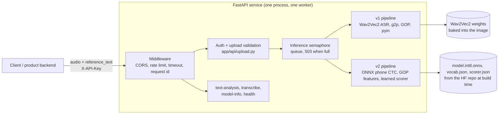
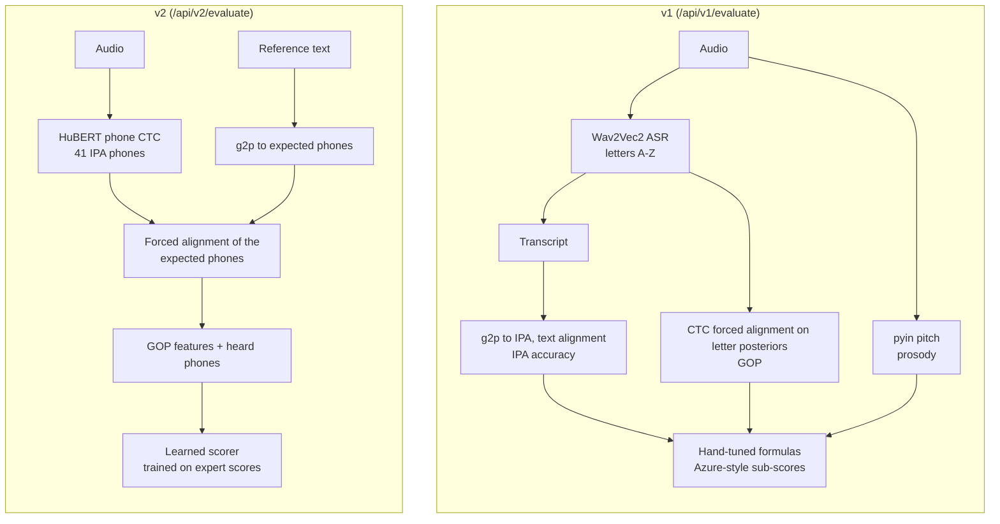
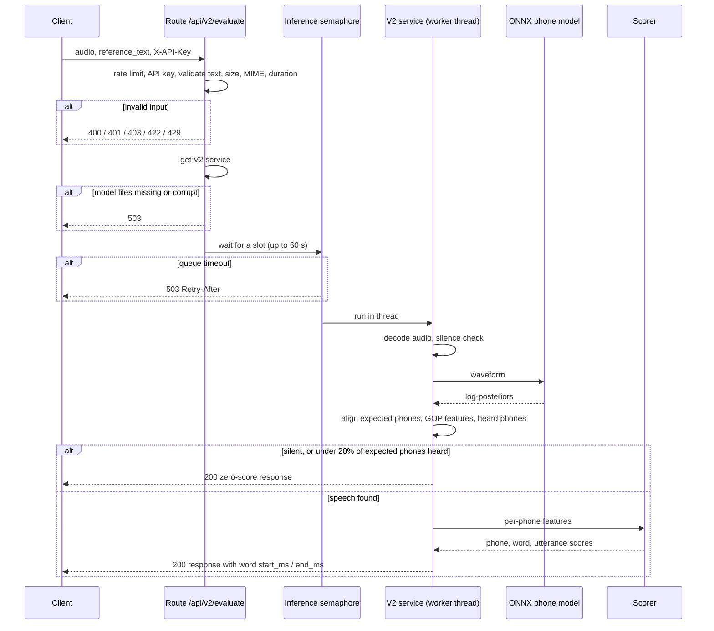
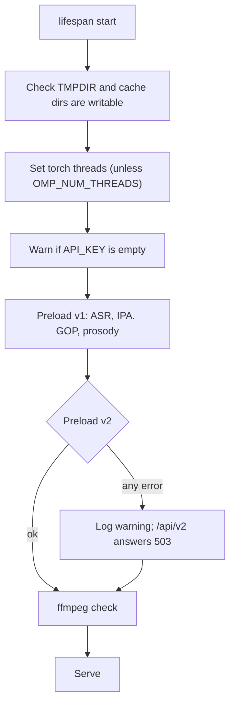

<!-- doc-id: docs-architecture | rev: ec588fa9 -->
# Architecture

## System overview



Everything runs in one process because the models are large and loaded once; extra uvicorn workers would each load their own copy. CPU inference is bounded by a semaphore (`MAX_CONCURRENT_INFERENCES`), and the blocking work runs in a worker thread so the event loop stays free.

## v1 and v2 side by side



| | v1 | v2 |
| --- | --- | --- |
| Unit scored | words recognised by ASR | each expected phone |
| Phone evidence | letter posteriors | phone posteriors |
| Scores | formulas (55% IPA + 45% GOP, sorted-min overall) | learned from speechocean762 expert scores |
| Prosody / fluency | pyin pitch, speech rate, pauses | learned from alignment features (no pitch tracker) |
| Runtime | PyTorch | ONNX Runtime (INT8), no PyTorch in the v2 code |
| Latency p50 (3.4 s clip, 4 vCPU) | 381 ms | 125 ms |

## One v2 request



Value errors from the service (audio too short, reference with no pronounceable word) become `400`; anything unexpected becomes `500` with a generic message.

## Startup



A broken v1 model stops startup; a broken or missing v2 model never does.

## Code layout

```
app/
  application.py            FastAPI factory + lifespan (model preload)
  api/
    routes/                 health, ipa, model_info, pronunciation (v1), pronunciation_v2, transcribe
    dependencies.py         API key, service lookup (v1, v2 with 503)
    middleware.py           CORS, rate limit, timeout, exception handlers
    upload.py               upload + reference text validation shared by v1 and v2
  core/                     config (pydantic-settings), concurrency, constants, logging
  models/schemas.py         Pydantic schemas (v1 and additive V2 subclasses)
  services/
    pronunciation_service.py  v1 orchestrator
    asr_service.py, gop_service.py, ipa_service.py, prosody_service.py   v1 components
    phoneme_align.py        phone similarity groups + DP alignment (no torch, shared)
    scoring_rules.py        level/feedback, error types, break detection (no torch, shared)
    v2/
      phone_model.py        ONNX session -> log-posteriors
      ctc_align.py          numpy CTC forced alignment
      gop_features.py       GOP features, heard phones
      scorer.py             numpy phone MLP + word/utterance ridge
      analyser.py           audio + text -> V2Analysis
      pronunciation_v2_service.py   response assembly, gates, score curve
  utils/                    audio I/O, text normalisation
training/                   offline training and export (own CUDA venv, not imported by app/)
scripts/                    evaluation harness, sanity set, HF upload
debugs/                     benchmark and diagnostics
tests/                      pytest suite (+ synthetic sanity recordings)
```

Details per file: [structure.md](structure.md). The v1 request flow in text form: [workflow.md](workflow.md).
