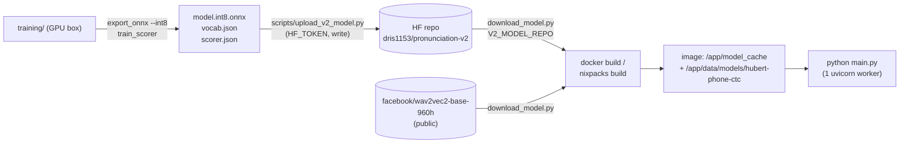

<!-- doc-id: docs-deployment | rev: 19243a73 -->
# Deployment

One container serves both pipelines. v1 weights come from Hugging Face public repos; the v2 files (`model.int8.onnx`, `vocab.json`, `scorer.json`) come from a Hugging Face repo (`dris1153/pronunciation-v2`, public). Both are baked into the image at build time (no persistent volumes needed).



## One-time: publish the v2 files

Needs a Hugging Face account and a token with **write** access.

```powershell
$env:HF_TOKEN = "hf_xxx"          # write token, never commit it
python scripts/upload_v2_model.py --repo dris1153/pronunciation-v2
```

The script creates the repo as private if it does not exist (it never changes the visibility of an existing repo) and uploads the three files from `data/models/hubert-phone-ctc/`. The published repo is public, so builds need no token; for a private repo, create a separate **read** token for builds.

## Docker

```bash
# v1 only (v2 endpoint will answer 503)
docker build -t pronunciation-validator .

# v1 + v2 (the model repo is public, no token needed)
docker build --build-arg V2_MODEL_REPO=dris1153/pronunciation-v2 -t pronunciation-validator .

# private model repo: the token travels as a BuildKit secret, so it never lands in an image layer
docker build \
  --build-arg V2_MODEL_REPO=<org>/<private-repo> \
  --secret id=HF_TOKEN,env=HF_TOKEN \
  -t pronunciation-validator .

docker run -p 8000:8000 -e API_KEY=<32+ char key> -e DEBUG=false pronunciation-validator
```

What the image does: `python:3.11-slim` + ffmpeg/libsndfile, CPU-only PyTorch (v1), `requirements.txt` (includes `onnxruntime` for v2), runs `download_model.py` (v1 model, then v2 files when `V2_MODEL_REPO` is set), switches to a non-root user, starts `python main.py`. `.dockerignore` excludes `data/` and `.venv-train/`, so local datasets never enter the build context.

> **Status:** the Dockerfile build has been run on Coolify (Docker build pack): it downloads the v2 files and v2 loads at startup. The nixpacks path has not been run. If you build with a token, check `docker history` once to confirm it is not in a layer.

## Railway

`railway.toml` uses the Dockerfile builder, health check `GET /health` (120 s timeout) and restart on failure (3 retries). `PORT` is injected by Railway and read by pydantic-settings. Set `API_KEY`, `DEBUG=false` and the rest in the dashboard.

For v2, set `V2_MODEL_REPO` as a build variable. Only a private repo also needs `HF_TOKEN` exposed to the build. Railway mounts build secrets by **service variable name**, which is why the Dockerfile secret id is `HF_TOKEN`. If no secret is mounted, the `HF_TOKEN` build arg is used instead. Leave `V2_MODEL_REPO` unset to ship v1 only.

## Coolify / nixpacks

`nixpacks.toml` installs CPU PyTorch and `requirements.txt`, bakes the v1 model, then runs `python download_model.py --v2-only`. Set `V2_MODEL_REPO` as a **build variable**; add `HF_TOKEN` only for a private repo (nixpacks can persist build variables into its generated image, so use a read-only token and rotate it if the image is ever shared). The app starts as `appuser` via `su`.

## Sizing and runtime rules

| Topic | Guidance |
| --- | --- |
| Workers | **One** uvicorn worker. Every worker loads its own copy of all models |
| RAM | Measured RSS after load: v1 alone 796 MB, v1 + v2 INT8 together 1030 MB, v2 alone ~430 MB, growing to 600-660 MB after requests (ONNX arena). Combined RSS after requests was not measured; budget about 2 GB for the combined process |
| CPU | 4 vCPU: `MAX_CONCURRENT_INFERENCES=2`. 2 vCPU: leave auto. Behind Docker `--cpus`/Railway set `OMP_NUM_THREADS` |
| Health | `GET /health` is public. It reports v1 load state only; a missing v2 model shows up as `503` on `/api/v2/evaluate`, and as a warning in the startup log |
| Failure isolation | A missing or corrupt v2 model never prevents startup; v1 keeps serving |
| Before switching clients | Run `python debugs/benchmark.py --api v2 --int8 --cpus 4` on the real host. Speed numbers in [evaluation.md](evaluation.md) are from a dev box |

Environment variables: [configuration.md](configuration.md).
