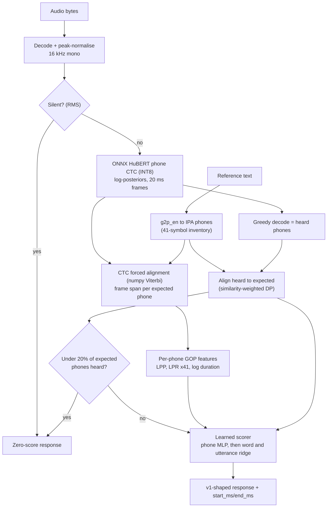

# Scoring v2 (phoneme-native pipeline)

How `POST /api/v2/evaluate` scores speech. Instead of transcribing words and comparing text (v1), a phone-level CTC model scores each **expected** phone directly, and a small learned model turns those signals into expert-style scores.

## Model

- **Backbone:** `facebook/hubert-base-ls960` (Apache-2.0), fine-tuned for a 41-symbol IPA vocabulary plus blank, using the same symbol set as the g2p mapping (`_ARPABET_TO_IPA`). Convolutional front-end frozen, bf16, 25 000 steps (about 2 h on one GPU).
- **Training data:** LibriSpeech `train-clean-100` only (native speech). L2 audio with canonical labels is deliberately never used: the model would learn to forgive mispronunciations.
- **Quality:** phone error rate 1.86% on all of LibriSpeech test-clean (2620 utterances, 191 317 phones). By length, PER stays 1.2-2.6% up to 35 s. Labels come from g2p, so this measures agreement with g2p output on native read speech, not accuracy on accented speech.
- **Runtime:** ONNX Runtime on CPU, dynamic INT8 on MatMul only (360 MB -> 116 MB); INT8 vs FP32 changes every speechocean762 metric by 0.004 or less. No PyTorch import under `app/services/v2/`.
- **Input contract:** 16 kHz mono float32, peak-normalised, no mean/variance normalisation (training and serving must match).

## Features and alignment

For every expected phone, forced alignment gives a frame span. From the span:

| Feature | Meaning |
| --- | --- |
| `LPP` | mean log-posterior of the expected phone over its span |
| `LPR_k` (41) | `LPP` minus the mean log-posterior of every other phone k: how much better another phone fits |
| `log_dur` | log of the phone's duration up to the next phone |

The scorer also sees: `exp(LPP)`, clipped `LPP`, the phone identity, whether the heard phone is missing / a same-group substitution / another substitution, neighbour phones' `LPP`, and the word's mean and minimum `LPP` (93 inputs per phone).

Heard phones come from a greedy CTC decode of the whole utterance, aligned to the expected phones with a Levenshtein DP that charges less for same-group swaps (`app/services/phoneme_align.py`). Phones heard but not expected are attached to the preceding word as insertions.

## Scorer

| Level | Model | Output |
| --- | --- | --- |
| Phone | MLP 2 x 128 on 93 features | score 0-2 (as speechocean762 phone accuracy) |
| Word | ridge on 11 aggregates of its phones | 0-10 |
| Utterance | ridge on 17 aggregates (phone/word score stats, mismatch, deletion and insertion ratios, phones per second, pause gaps) | accuracy, fluency, prosodic, total, each 0-10 |
| Completeness | rule | share of expected phones heard |

Trained on speechocean762 train (2500 utterances) with speaker-grouped out-of-fold stacking; ridge strengths, early stopping and the flag threshold use train only. Weights are plain JSON (`scorer.json`, ~620 KB) evaluated with numpy.

## From model output to response

- **Curve:** utterance scores are raised to `100 x (s/10)^1.4`. The scorer predicts on the expert scale (mostly 6-10); the curve maps it onto the stricter scale v1 used so clearly wrong clips land below 60. The exponent was tuned on five synthetic clips and should be recalibrated on real learner audio. It moves speechocean762 utterance correlations by 0.005 or less.
- **`is_correct_ipa`:** phone score below **1.48** (of 2) is flagged. This verdict gives mispronunciation F1 0.54 on adults, against 0.31 for "heard != expected", because many differently-heard phones are accent-neutral variants. `actual_ipa` stays the raw heard phone.
- **Word error types:** `Omission` when no phone of the word was heard, `Mispronunciation` when the word score is below 60, then `UnexpectedBreak` / `MissingBreak` from the aligned word gaps (same rules and thresholds as v1, `app/services/scoring_rules.py`).
- **Gates:** silence (RMS) and "fewer than 20% of expected phones heard" return the zero-score response, because the scorer extrapolates on noise. On speechocean762 test the lowest heard share in real speech is 0.31.

## Results (speechocean762 test, 2500 utterances)

Pearson correlation with expert scores unless noted. Adults = speakers aged 18+ (1220 utterances).

| | v1 adults | **v2 adults** | v2 all speakers |
| --- | --- | --- | --- |
| Utterance total | 0.619 | **0.852** | 0.779 |
| Utterance accuracy | 0.669 | **0.829** | 0.749 |
| Utterance fluency | 0.630 | **0.876** | 0.817 |
| Utterance prosodic | 0.108 | **0.853** | 0.796 |
| Word accuracy | 0.020 | **0.643** | 0.591 |
| Phone accuracy | 0.033 | **0.630** | 0.590 |
| Mispronunciation F1 (precision / recall) | 0.269 (0.16 / 0.88) | **0.537** (0.48 / 0.60) | 0.480 (0.40 / 0.59) |

Mispronounced = expert phone score below 1.0 (4% of phones). Numbers are for the FP32 model with the final scorer; INT8 differs by 0.004 or less, and curve mapping by 0.005 or less.

## Limits

- **L1 mismatch:** every speaker in the training and evaluation corpus has Mandarin as L1. Behaviour on Vietnamese learners is unmeasured; see [evaluation.md](evaluation.md) for the data plan.
- Scores for audio between 20 and 30 s are untested on the scorer side (speechocean762 clips are short); the phone model itself is fine there.
- A reference with more than ~300 phones (100 words) is the practical ceiling; the alignment is quadratic in phone count.
- Geminate phones across a word boundary (`that time`) collapse in CTC, so one /t/ can be reported as missing.

Training and export commands: [training.md](training.md).
