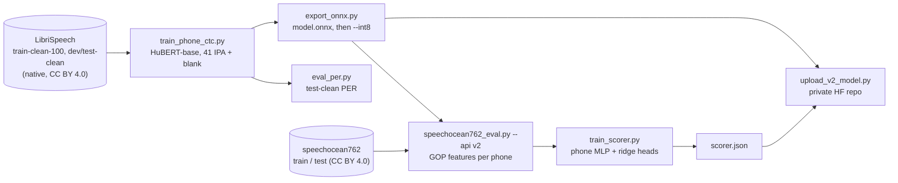

# Training the v2 models

Offline work lives in [`training/`](../training/) and never ships in the service image. It uses its own CUDA venv (`.venv-train`) so the service venv stays CPU-only. Quick command list: [training/README.md](../training/README.md). This page explains what is trained, on what, and why.



## 1. Phone CTC model

| | |
| --- | --- |
| Base | `facebook/hubert-base-ls960` (Apache-2.0) |
| Vocabulary | the service's 41 IPA symbols + CTC blank; labels = transcript -> `g2p_en` -> IPA |
| Data | LibriSpeech `train-clean-100` (28 539 utterances); dev and test from `dev-clean` / `test-clean` |
| Why native only | training on L2 audio with canonical labels would teach the model to accept mispronunciations |
| Optimiser | AdamW, body LR 5e-5, head LR 1e-3, 1000 head-only steps, 10% warm-up then linear decay |
| Batching | about 100 s of audio per micro-batch, 2 accumulation steps, length-bucketed (HuBERT-base has no attention mask), bf16 autocast, frozen conv feature encoder |
| Run | 25 000 steps, about 124 min, peak 3.7 GB VRAM; best-dev-PER checkpoint kept |
| Result | PER 1.86% on all of test-clean |

Utterances up to 20 s are used for training (the corpus has one longer). The served model handles up to 30 s with no measurable loss (PER by length is in [scoring-v2.md](scoring-v2.md)).

```bash
.venv-train/Scripts/python -m training.train_phone_ctc --steps 25000 --dev-limit 600 --workers 4
.venv-train/Scripts/python -m training.eval_per --split test-clean
.venv-train/Scripts/python -m training.export_onnx           # model.onnx, checks parity vs torch (< 1e-3)
.venv-train/Scripts/python -m training.export_onnx --int8    # model.int8.onnx
```

The model file contract (16 kHz mono, peak-normalised, no mean/variance normalisation) must match `app/services/v2/phone_model.py`.

## 2. Scorer

Features come from running the service's own v2 analyser on speechocean762, so training and serving cannot drift:

```bash
python scripts/speechocean762_eval.py --api v2 --split train --out data/so762-v2-train.jsonl --report data/so762-v2-train-report.json
python scripts/speechocean762_eval.py --api v2 --split test  --out data/so762-v2-test.jsonl  --report data/so762-v2-test-report.json
.venv/Scripts/python -m training.train_scorer       # writes data/models/hubert-phone-ctc/scorer.json
```

Without `scorer.json` the harness still writes the per-phone features (scores are zeros), which is all training needs.

- **Phone MLP** (2 x 128, dropout 0.2): trained on speaker-held-out folds; epoch chosen on 10% of speakers.
- **Word and utterance ridge heads:** stacked on out-of-fold phone scores so they never see in-sample predictions.
- **Flag threshold** (phone score 1.48): the value that maximises mispronunciation F1 on out-of-fold train predictions.
- **Test split:** used once, for the report. Nothing is tuned on it.
- **Input scaling:** z-scores are clipped to +/-10 (rare-phone one-hots otherwise reach |z| ~ 200 and destroy the fit).
- A plain ridge model for the phone head reached phone PCC 0.546 / MDD F1 0.443 on adults, just under the target; the MLP gives 0.630 / 0.537.

## 3. Publishing

`scripts/upload_v2_model.py` uploads `model.int8.onnx`, `vocab.json` and `scorer.json` to the private Hugging Face repo that image builds download from ([deployment.md](deployment.md)). Whenever the phone model or the feature layout changes, retrain the scorer: `scorer.json` is tied to the exact feature order of the code that produced it (there is no version stamp yet).

## Licences and data

LibriSpeech and speechocean762 are CC BY 4.0 (credit in [NOTICE](../NOTICE)); the trained model is a derivative of HuBERT-base (Apache-2.0). L2-ARCTIC is **not** used: it is CC BY-NC. speechocean762 is Mandarin-L1, so a Vietnamese-L1 collection and annotation effort is the main open item ([evaluation.md](evaluation.md)).
