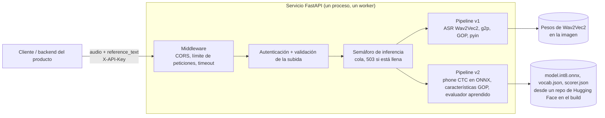
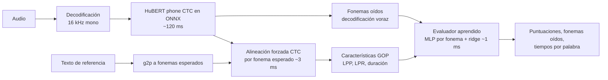

<!-- doc-id: readme | lang: es | source-rev: 1429d642 -->

> 🌐 **Traducción al español** de [`README.md`](../../README.md) (rev `1429d642`). La versión en inglés es la oficial: si difieren, prevalece el inglés. Traducción automática, sin revisión de un hablante nativo.

<div align="center">

# 🗣️ Pronunciation Validation Service

**Puntuación de la pronunciación del inglés a nivel de fonema mediante una API REST sencilla.**
Sube una grabación y la frase que el hablante debía decir; obtén puntuaciones por fonema, por palabra y globales, junto con los fonemas oídos y los tiempos por palabra. Pensado para estudiantes de inglés, sea cual sea su lengua materna.


-EE4C2C?logo=pytorch&logoColor=white)


[Inicio rápido](#-inicio-rápido) · [API](#-api) · [Cómo funciona v2](#-cómo-funciona-v2) · [Resultados](#-resultados) · [Documentación](#-documentación)

**Idiomas:** [English](../../README.md) · [Tiếng Việt](../vi/README.md) · [中文](../zh/README.md) · [日本語](../ja/README.md) · [Español](README.md)

</div>

---

## ✨ Qué hace

Dados `audio` + `reference_text`, el servicio devuelve:

- **Comparación IPA**: fonema esperado frente a fonema oído para cada fonema de cada palabra
- **Puntuaciones**: precisión, completitud, fluidez, prosodia y una puntuación global (0-100) con un nivel y un texto de retroalimentación
- **Tipos de error por palabra**: `None`, `Mispronunciation`, `Omission`, `Insertion`, `UnexpectedBreak`, `MissingBreak`
- **Tiempos por palabra** (v2): `start_ms` / `end_ms` para cada palabra

Dos pipelines funcionan en paralelo, con la misma forma de petición y de respuesta:

| | **v1** `/api/v1/evaluate` | **v2** `/api/v2/evaluate` |
| --- | --- | --- |
| Idea | Transcribe palabras con Wav2Vec2, compara texto, fórmulas ajustadas a mano | Puntúa cada *fonema esperado* con un modelo a nivel de fonema; un evaluador aprendido lo traduce a puntuaciones al estilo de los expertos |
| Modelo de fonemas | Letras de Wav2Vec2 (A-Z) | HuBERT-base phone CTC (41 fonemas IPA), ONNX INT8 |
| Puntuaciones | Fórmulas (55% IPA + 45% GOP, global al estilo Azure) | Entrenado con las puntuaciones de expertos de speechocean762 |
| Latencia p50 (clip de 3.4 s, 4 vCPU) | 381 ms | **125 ms** |
| Memoria tras la carga (cada uno por separado) | 796 MB | **430 MB** |
| Correlación de la puntuación por fonema con los expertos (adultos) | 0.03 | **0.63** |

v1 no cambia y sigue disponible. Consulta [docs/scoring-v2.md](docs/scoring-v2.md) para saber por qué existe v2 y [docs/api.md](docs/api.md#post-apiv2evaluate) para ver las diferencias en la respuesta.

## 🏗️ Arquitectura



Más diagramas (v1 frente a v2, secuencia de una petición, arranque): [docs/architecture.md](docs/architecture.md).

## 🔬 Cómo funciona v2



1. Un modelo phone CTC (ajustado únicamente con habla nativa de LibriSpeech) da las probabilidades a posteriori de los fonemas en cada fotograma.
2. El texto de referencia se convierte en fonemas esperados (g2p); la alineación forzada CTC en numpy encuentra dónde debería estar cada uno.
3. Las características de bondad de pronunciación (goodness-of-pronunciation) por fonema (log-posterior del fonema esperado, cuánto mejor encaja otro fonema, duración) y los fonemas oídos decodificados de forma voraz alimentan un evaluador pequeño entrenado con speechocean762.
4. El silencio y el audio sin habla decodificable devuelven una respuesta de puntuación cero en lugar de una conjetura.

Los tiempos corresponden a un clip de 3.4 s, INT8, 4 vCPU, en una máquina de desarrollo. Descripción completa: [docs/scoring-v2.md](docs/scoring-v2.md).

## 🚀 Inicio rápido

```bash
python3.11 -m venv .venv && source .venv/bin/activate      # Windows: .venv\Scripts\activate
pip install -r requirements.txt
cp .env.example .env                                       # set API_KEY (>= 32 chars) or DEBUG=true
python main.py                                             # http://localhost:8000/docs
```

El modelo v1 se descarga de Hugging Face en el primer arranque. **v2 necesita tres archivos** en `data/models/hubert-phone-ctc/` (`model.int8.onnx`, `vocab.json`, `scorer.json`); sin ellos `/api/v2/evaluate` responde `503` y v1 no se ve afectado.

```bash
# fetch the v2 files from the public Hugging Face repo (no token needed)
huggingface-cli download dris1153/pronunciation-v2 model.int8.onnx vocab.json scorer.json --local-dir data/models/hubert-phone-ctc
```

O genéralos tú mismo: [docs/training.md](docs/training.md).

```bash
curl -X POST http://localhost:8000/api/v2/evaluate \
  -H "X-API-Key: $API_KEY" \
  -F "audio=@recording.wav" -F "reference_text=hello world"
```

```jsonc
{
  "reference_text": "hello world",
  "transcribed_text": "jɛloʊ wɝd",            // v2: the heard IPA string
  "results": {
    "word_details": [{
      "word": "hello", "expected_ipa": "həloʊ", "actual_ipa": "jɛloʊ",
      "start_ms": 160, "end_ms": 440, "error_type": "Mispronunciation",
      "phoneme_details": [{ "expected_ipa": "h", "actual_ipa": "j", "is_correct_ipa": false, "gop_score": 67.56 }]
    }]
  },
  "accuracy_score": 57.26, "fluency_score": 74.69, "prosody_score": 68.98, "overall_score": 55.8, "level": "fair"
}
```

(abreviado; salida real de un clip sintético de "yellow word", ejemplo completo en [docs/api.md](docs/api.md))

### Docker

```bash
docker build --build-arg V2_MODEL_REPO=dris1153/pronunciation-v2 -t pronunciation-validator .
docker run -p 8000:8000 -e API_KEY=<32+ char key> -e DEBUG=false pronunciation-validator
```

Railway, Coolify/nixpacks, dimensionamiento y el flujo de publicación de modelos: [docs/deployment.md](docs/deployment.md).

## 📡 API

| Endpoint | Auth | Propósito |
| --- | --- | --- |
| `POST /api/v2/evaluate` | 🔒 | Puntuación de pronunciación, pipeline nativo de fonemas, con tiempos por palabra |
| `POST /api/v1/evaluate` | 🔒 | Puntuación de pronunciación, pipeline original con Wav2Vec2 |
| `GET /api/v1/text-analysis` | 🔒 | Texto a IPA con los fonemas de cada palabra |
| `POST /api/v1/transcribe` | 🔒 | Audio a texto, sin puntuación |
| `GET /api/v1/model-info` | - | Metadatos y límites del servicio |
| `GET /health` | - | Disponibilidad (liveness) |

🔒 = cabecera `X-API-Key`. Límites: subida de 10 MB, audio de 30 s, wav / mp3 / ogg / flac / webm. Documentación interactiva en `/docs`. Para llamar desde un backend con límites de peticiones por usuario: [docs/internal-integration.md](docs/internal-integration.md). Referencia: [docs/api.md](docs/api.md).

## 📊 Resultados

División de prueba de speechocean762 (2500 enunciados, estudiantes con L1 mandarín), correlación de Pearson con las puntuaciones de los expertos, adultos (18+):

| | v1 | **v2** |
| --- | --- | --- |
| Total del enunciado | 0.62 | **0.85** |
| Fluidez del enunciado | 0.63 | **0.88** |
| Prosodia del enunciado | 0.11 | **0.85** |
| Precisión de la palabra | 0.02 | **0.64** |
| Precisión del fonema | 0.03 | **0.63** |
| F1 de detección de errores de pronunciación | 0.27 | **0.54** |

Modelo de fonemas: 1.86% de tasa de error de fonemas en LibriSpeech test-clean. INT8 modifica cada métrica en 0.004 o menos.

> ⚠️ **Límites sinceros.** Todos los hablantes de evaluación tienen L1 mandarín, así que **la precisión con otras lenguas maternas no se ha medido**. El pipeline es agnóstico a la L1 por diseño (puntúa fonemas del inglés frente al texto de referencia y no tiene reglas específicas de ninguna L1), pero eso no está validado fuera del mandarín, y la única encuesta realizada hasta ahora (para vietnamita) no encontró ningún conjunto de datos abierto y de uso comercial con puntuaciones de pronunciación ([plan de datos](docs/evaluation.md#plan-de-datos-para-más-lenguas-maternas)). La curva de puntuación se ajustó con cinco clips sintéticos. Las cifras de velocidad vienen de una máquina de desarrollo; vuelve a ejecutar `debugs/benchmark.py` en tu host. Detalles: [docs/evaluation.md](docs/evaluation.md).

## 🧰 Stack tecnológico

| Componente | Tecnología |
| --- | --- |
| Web | FastAPI, Uvicorn, Pydantic v2, slowapi |
| Modelo de fonemas v2 | HuBERT-base ajustado para phone CTC, ONNX Runtime (INT8), alineación y evaluador en numpy (sin PyTorch) |
| v1 | Wav2Vec2-base-960h (PyTorch, CPU), prosodia con librosa pyin |
| Texto a fonemas | g2p_en + NLTK, inventario IPA de 41 símbolos |
| Entrenamiento | PyTorch + Transformers en una GPU, solo sin conexión (`training/`) |
| Operaciones | Docker, Railway / Coolify, loguru, Hugging Face Hub para los archivos del modelo |

## 📁 Estructura del proyecto

```
app/            FastAPI app: api/ (routes, auth, upload), core/ (config), models/ (schemas),
                services/ (v1 pipeline, shared alignment + scoring rules, v2/ phone pipeline), utils/
training/       Offline training and ONNX export of the v2 models (own CUDA venv)
scripts/        speechocean762 evaluation harness, sanity set, Hugging Face upload
debugs/         Latency / memory benchmark (v1 and v2)
tests/          pytest suite (~460 tests) + synthetic sanity recordings
docs/           Documentation
```

## 📚 Documentación

| | |
| --- | --- |
| [Referencia de la API](docs/api.md) | Endpoints, autenticación, errores, ejemplos |
| [Arquitectura](docs/architecture.md) | Diagramas y organización del código |
| [Puntuación v2](docs/scoring-v2.md) · [v1](docs/scoring-v1.md) | Cómo se producen las puntuaciones |
| [Evaluación](docs/evaluation.md) | Calidad, latencia, memoria, pruebas, plan de datos |
| [Entrenamiento](docs/training.md) | Entrenar, exportar y publicar los modelos v2 |
| [Configuración](docs/configuration.md) · [Despliegue](docs/deployment.md) | Variables de entorno, Docker, Railway, Coolify |
| [Integración interna](docs/internal-integration.md) | Uso de backend a servicio, migrar un cliente a v2 |

Índice de todas las páginas: [docs/README.md](docs/README.md). También hay una versión bilingüe de una sola página en [`index.html`](../../index.html).

## 🧪 Pruebas

```bash
pytest tests/ -v
```

Las pruebas que necesitan los archivos reales del modelo v2 se omiten solas cuando esos archivos no están. Dos casos de sanidad de v1 (`poor_001`, `poor_002`) son fallos conocidos (v1 puntúa esos clips justo por encima de su banda); v2 pasa ambos.

## 🤝 Contribuir

¿Eres nuevo? Empieza por [CONTRIBUTING.md](../../CONTRIBUTING.md) y un [good first issue](https://github.com/dris1153/pronunciation-service/labels/good%20first%20issue); se espera que todos sigan el [Código de conducta](../../CODE_OF_CONDUCT.md). Mantén los archivos por debajo de unas 200 líneas, sigue la estructura existente (`docs/structure.md`) y ejecuta las pruebas antes de hacer push. La documentación en inglés es la fuente de verdad de las traducciones en [`languages/`](../README.md): tras editar una, ejecuta `python scripts/docs_sync.py bump` (reglas en [AGENTS.md](../../AGENTS.md)). Los cambios en la puntuación requieren una ejecución antes/después del harness de speechocean762 ([docs/evaluation.md](docs/evaluation.md)).

## 📄 Licencia y créditos

Bajo la [Apache License 2.0](../../LICENSE). Copyright 2026 dris1153. Las redistribuciones deben conservar el archivo [NOTICE](../../NOTICE).

Construido sobre HuBERT y wav2vec 2.0 (Meta AI, Apache-2.0), g2p_en, y entrenado y evaluado con LibriSpeech y speechocean762 (ambos CC BY 4.0). Créditos completos y citas: [NOTICE](../../NOTICE).
