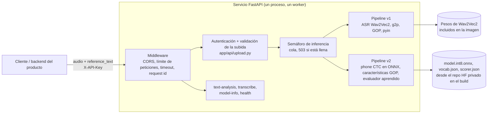
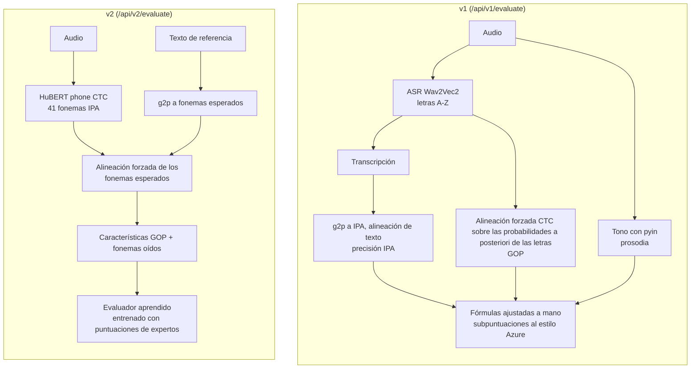
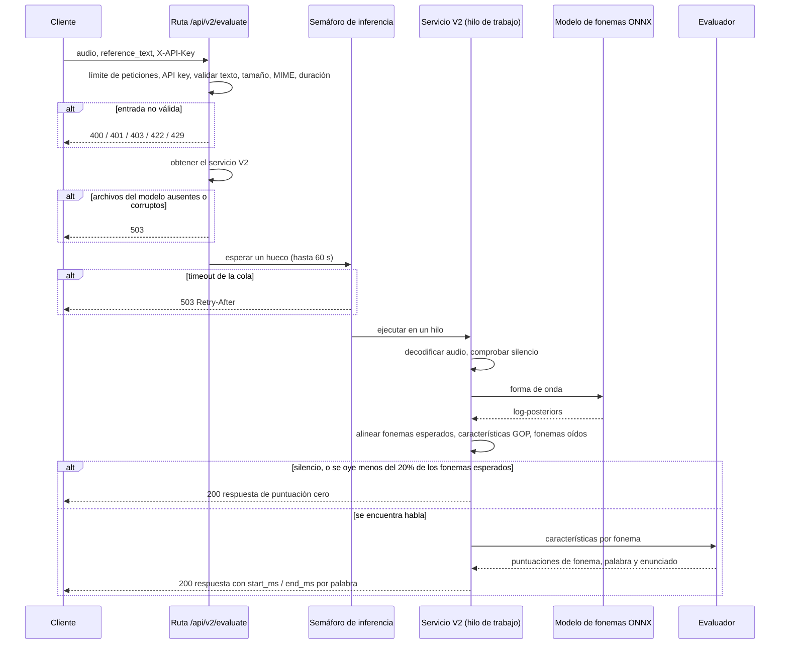
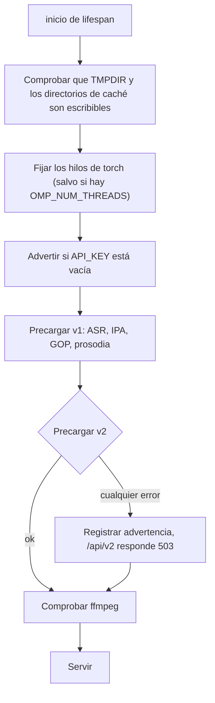

<!-- doc-id: docs-architecture | lang: es | source-rev: f54d8e3a -->

> 🌐 **Traducción al español** de [`docs/architecture.md`](../../../docs/architecture.md) (rev `f54d8e3a`). La versión en inglés es la oficial: si difieren, prevalece el inglés. Traducción automática, sin revisión de un hablante nativo.

# Arquitectura

## Visión general del sistema



Todo se ejecuta en un solo proceso porque los modelos son grandes y se cargan una única vez; cada worker adicional de uvicorn cargaría su propia copia. La inferencia en CPU está limitada por un semáforo (`MAX_CONCURRENT_INFERENCES`), y el trabajo bloqueante se ejecuta en un hilo de trabajo para que el bucle de eventos quede libre.

## v1 y v2 lado a lado



| | v1 | v2 |
| --- | --- | --- |
| Unidad puntuada | palabras reconocidas por el ASR | cada fonema esperado |
| Evidencia de fonemas | probabilidades a posteriori de letras | probabilidades a posteriori de fonemas |
| Puntuaciones | fórmulas (55% IPA + 45% GOP, global con mínimo ordenado) | aprendidas de las puntuaciones de expertos de speechocean762 |
| Prosodia / fluidez | tono con pyin, velocidad del habla, pausas | aprendidas de las características de alineación (sin detector de tono) |
| Runtime | PyTorch | ONNX Runtime (INT8), sin PyTorch en el código de v2 |
| Latencia p50 (clip de 3.4 s, 4 vCPU) | 381 ms | 125 ms |

## Una petición v2



Los errores de valor del servicio (audio demasiado corto, referencia sin ninguna palabra pronunciable) se convierten en `400`; cualquier error inesperado se convierte en `500` con un mensaje genérico.

## Arranque



Un modelo v1 defectuoso detiene el arranque; un modelo v2 defectuoso o ausente nunca lo hace.

## Organización del código

```
app/
  application.py            FastAPI factory + lifespan (model preload)
  api/
    routes/                 health, ipa, model_info, pronunciation (v1), pronunciation_v2, transcribe
    dependencies.py         API key, service lookup (v1, v2 with 503)
    middleware.py           CORS, rate limit, timeout, exception handlers
    upload.py               upload + reference text validation shared by v1 and v2
  core/                     config (pydantic-settings), concurrency, constants, logging
  models/schemas.py         Pydantic schemas (v1 and additive V2 subclasses)
  services/
    pronunciation_service.py  v1 orchestrator
    asr_service.py, gop_service.py, ipa_service.py, prosody_service.py   v1 components
    phoneme_align.py        phone similarity groups + DP alignment (no torch, shared)
    scoring_rules.py        level/feedback, error types, break detection (no torch, shared)
    v2/
      phone_model.py        ONNX session -> log-posteriors
      ctc_align.py          numpy CTC forced alignment
      gop_features.py       GOP features, heard phones
      scorer.py             numpy phone MLP + word/utterance ridge
      analyser.py           audio + text -> V2Analysis
      pronunciation_v2_service.py   response assembly, gates, score curve
  utils/                    audio I/O, text normalisation
training/                   offline training and export (own CUDA venv, not imported by app/)
scripts/                    evaluation harness, sanity set, HF upload
debugs/                     benchmark and diagnostics
tests/                      pytest suite (+ synthetic sanity recordings)
```

Detalles por archivo: [structure.md](structure.md). El flujo de una petición v1 en forma de texto: [workflow.md](workflow.md).
