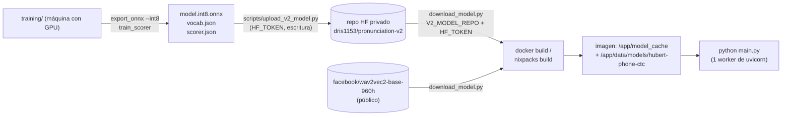

<!-- doc-id: docs-deployment | lang: es | source-rev: c9e42585 -->

> 🌐 **Traducción al español** de [`docs/deployment.md`](../../../docs/deployment.md) (rev `c9e42585`). La versión en inglés es la oficial: si difieren, prevalece el inglés. Traducción automática, sin revisión de un hablante nativo.

# Despliegue

Un único contenedor sirve ambos pipelines. Los pesos de v1 provienen de repos públicos de Hugging Face; los archivos de v2 (`model.int8.onnx`, `vocab.json`, `scorer.json`) provienen de un repo **privado** de Hugging Face. Ambos se incluyen en la imagen durante el build (no se necesitan volúmenes persistentes).



## Una sola vez: publicar los archivos v2

Necesitas una cuenta de Hugging Face y un token con acceso de **escritura**.

```powershell
$env:HF_TOKEN = "hf_xxx"          # write token, never commit it
python scripts/upload_v2_model.py --repo dris1153/pronunciation-v2
```

El script crea el repo como privado (no convierte en privado un repo público ya existente) y sube los tres archivos desde `data/models/hubert-phone-ctc/`. Crea un token de **lectura** aparte para los builds.

## Docker

```bash
# v1 only (v2 endpoint will answer 503)
docker build -t pronunciation-validator .

# v1 + v2: the token travels as a BuildKit secret, so it never lands in an image layer
docker build \
  --build-arg V2_MODEL_REPO=dris1153/pronunciation-v2 \
  --secret id=hf_token,env=HF_TOKEN \
  -t pronunciation-validator .

docker run -p 8000:8000 -e API_KEY=<32+ char key> -e DEBUG=false pronunciation-validator
```

Qué hace la imagen: `python:3.11-slim` + ffmpeg/libsndfile, PyTorch solo para CPU (v1), `requirements.txt` (incluye `onnxruntime` para v2), ejecuta `download_model.py` (modelo v1 y después los archivos v2 cuando `V2_MODEL_REPO` está definida), cambia a un usuario sin privilegios de root y arranca `python main.py`. `.dockerignore` excluye `data/` y `.venv-train/`, de modo que los conjuntos de datos locales nunca entran en el contexto de build.

> **Estado:** los pasos de descarga del Dockerfile y de nixpacks están escritos pero **aún no se han ejecutado de principio a fin**. Haz un build limpio con `V2_MODEL_REPO` y un token antes de depender de ellos, y luego revisa `docker history` en busca del token.

## Railway

`railway.toml` usa el builder de Dockerfile, la comprobación de estado `GET /health` (timeout de 120 s) y reinicio en caso de fallo (3 reintentos). Railway inyecta `PORT` y pydantic-settings lo lee. Define `API_KEY`, `DEBUG=false` y el resto en el panel.

Para v2, Railway debe exponer `HF_TOKEN` al build. Railway monta los secretos de build por **nombre de variable del servicio**, así que el id del secreto del Dockerfile (`hf_token`) quizá deba ser `HF_TOKEN` allí; compruébalo en el primer build real. Sin el token, el paso de v2 del build falla cuando `V2_MODEL_REPO` está definida; deja `V2_MODEL_REPO` sin definir para publicar solo v1.

## Coolify / nixpacks

`nixpacks.toml` instala PyTorch para CPU y `requirements.txt`, incluye el modelo v1 y luego ejecuta `python download_model.py --v2-only`. Define `V2_MODEL_REPO` y `HF_TOKEN` como **variables de build**. Nixpacks puede conservar las variables de build en la imagen que genera, así que usa un token de solo lectura y rótalo si la imagen llega a compartirse. La aplicación arranca como `appuser` mediante `su`.

## Dimensionamiento y reglas de ejecución

| Tema | Guía |
| --- | --- |
| Workers | **Un** worker de uvicorn. Cada worker carga su propia copia de todos los modelos |
| RAM | RSS medido tras la carga: v1 solo 796 MB, v1 + v2 INT8 juntos 1030 MB, v2 solo ~430 MB, y crece hasta 600-660 MB tras recibir peticiones (arena de ONNX). El RSS combinado tras las peticiones no se midió; presupuesta unos 2 GB para el proceso combinado |
| CPU | 4 vCPU: `MAX_CONCURRENT_INFERENCES=2`. 2 vCPU: déjalo en automático. Con `--cpus` de Docker o en Railway, define `OMP_NUM_THREADS` |
| Estado (health) | `GET /health` es público. Solo informa del estado de carga de v1; la ausencia del modelo v2 se manifiesta como `503` en `/api/v2/evaluate` y como una advertencia en el log de arranque |
| Aislamiento de fallos | Un modelo v2 ausente o corrupto nunca impide el arranque; v1 sigue sirviendo |
| Antes de migrar clientes | Ejecuta `python debugs/benchmark.py --api v2 --int8 --cpus 4` en el host real. Las cifras de velocidad de [evaluation.md](evaluation.md) provienen de una máquina de desarrollo |

Variables de entorno: [configuration.md](configuration.md).
