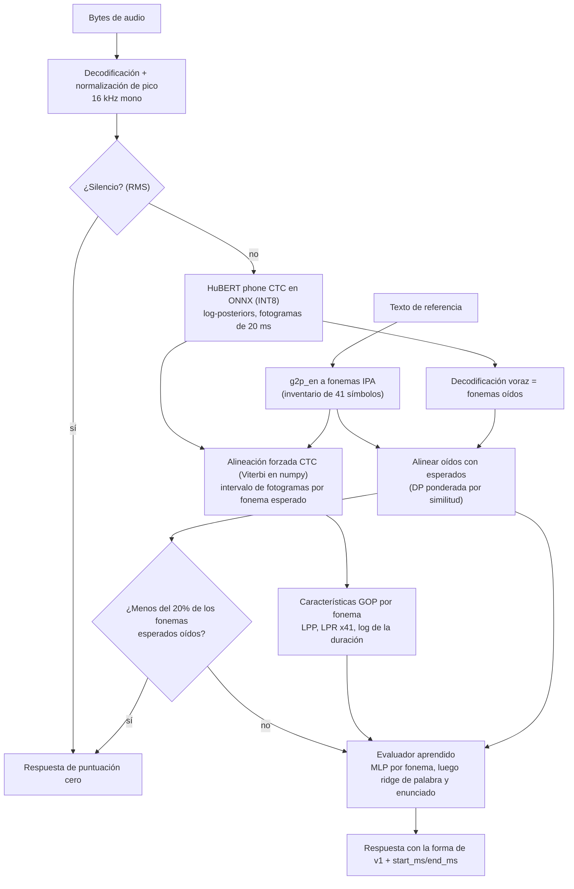

<!-- doc-id: docs-scoring-v2 | lang: es | source-rev: 4b5806b4 -->

> 🌐 **Traducción al español** de [`docs/scoring-v2.md`](../../../docs/scoring-v2.md) (rev `4b5806b4`). La versión en inglés es la oficial: si difieren, prevalece el inglés. Traducción automática, sin revisión de un hablante nativo.

# Puntuación v2 (pipeline nativo de fonemas)

Cómo puntúa el habla `POST /api/v2/evaluate`. En lugar de transcribir palabras y comparar texto (v1), un modelo CTC a nivel de fonema puntúa directamente cada fonema **esperado**, y un pequeño modelo aprendido convierte esas señales en puntuaciones al estilo de los expertos.

## Modelo

- **Backbone:** `facebook/hubert-base-ls960` (Apache-2.0), ajustado para un vocabulario IPA de 41 símbolos más blank, con el mismo conjunto de símbolos que el mapeo de g2p (`_ARPABET_TO_IPA`). Front-end convolucional congelado, bf16, 25 000 pasos (unas 2 h en una GPU).
- **Datos de entrenamiento:** solo LibriSpeech `train-clean-100` (habla nativa). Nunca se usa a propósito audio L2 con etiquetas canónicas: el modelo aprendería a perdonar los errores de pronunciación.
- **Calidad:** tasa de error de fonemas de 1.86% en todo LibriSpeech test-clean (2620 enunciados, 191 317 fonemas). Según la duración, el PER se mantiene en 1.2-2.6% hasta los 35 s. Las etiquetas provienen de g2p, así que esto mide la concordancia con la salida de g2p en habla nativa leída, no la precisión con habla acentuada.
- **Runtime:** ONNX Runtime en CPU, INT8 dinámico solo en MatMul (360 MB -> 116 MB); INT8 frente a FP32 modifica cada métrica de speechocean762 en 0.004 o menos. Ninguna importación de PyTorch bajo `app/services/v2/`.
- **Contrato de entrada:** 16 kHz mono float32, normalizado por pico, sin normalización de media/varianza (el entrenamiento y el servicio deben coincidir).

## Características y alineación

Para cada fonema esperado, la alineación forzada da un intervalo de fotogramas. A partir de ese intervalo:

| Característica | Significado |
| --- | --- |
| `LPP` | log-posterior medio del fonema esperado a lo largo de su intervalo |
| `LPR_k` (41) | `LPP` menos el log-posterior medio de cada otro fonema k: cuánto mejor encaja otro fonema |
| `log_dur` | log de la duración del fonema hasta el siguiente fonema |

El evaluador también ve: `exp(LPP)`, `LPP` recortado, la identidad del fonema, si el fonema oído falta / es una sustitución del mismo grupo / es otra sustitución, el `LPP` de los fonemas vecinos, y el `LPP` medio y mínimo de la palabra (93 entradas por fonema).

Los fonemas oídos provienen de una decodificación CTC voraz de todo el enunciado, alineada con los fonemas esperados mediante una DP de Levenshtein que penaliza menos los intercambios dentro del mismo grupo (`app/services/phoneme_align.py`). Los fonemas oídos pero no esperados se asocian a la palabra anterior como inserciones.

## Evaluador

| Nivel | Modelo | Salida |
| --- | --- | --- |
| Fonema | MLP 2 x 128 sobre 93 características | puntuación 0-2 (como la precisión de fonema de speechocean762) |
| Palabra | ridge sobre 11 agregados de sus fonemas | 0-10 |
| Enunciado | ridge sobre 17 agregados (estadísticas de puntuación de fonemas/palabras, razones de discrepancia, eliminación e inserción, fonemas por segundo, huecos de pausa) | precisión, fluidez, prosodia, total, cada una de 0-10 |
| Completitud | regla | proporción de fonemas esperados oídos |

Entrenado con la partición train de speechocean762 (2500 enunciados) con stacking out-of-fold agrupado por hablante; las intensidades de ridge, la parada temprana y el umbral de marcado usan solo train. Los pesos son JSON simple (`scorer.json`, ~620 KB) evaluado con numpy.

## De la salida del modelo a la respuesta

- **Curva:** las puntuaciones de enunciado se elevan a `100 x (s/10)^1.4`. El evaluador predice en la escala de los expertos (sobre todo 6-10); la curva la traslada a la escala más estricta que usaba v1 para que los clips claramente incorrectos queden por debajo de 60. El exponente se ajustó con cinco clips sintéticos y debería recalibrarse con audio real de estudiantes. Modifica las correlaciones de enunciado de speechocean762 en 0.005 o menos.
- **`is_correct_ipa`:** se marca un fonema con puntuación inferior a **1.48** (de 2). Este veredicto da un F1 de errores de pronunciación de 0.54 en adultos, frente a 0.31 con "oído != esperado", porque muchos fonemas oídos de forma distinta son variantes neutras en cuanto al acento. `actual_ipa` sigue siendo el fonema oído sin procesar.
- **Tipos de error por palabra:** `Omission` cuando no se oyó ningún fonema de la palabra, `Mispronunciation` cuando la puntuación de la palabra es inferior a 60, y después `UnexpectedBreak` / `MissingBreak` a partir de los huecos entre palabras alineadas (mismas reglas y umbrales que v1, `app/services/scoring_rules.py`).
- **Compuertas:** el silencio (RMS) y "menos del 20% de los fonemas esperados oídos" devuelven la respuesta de puntuación cero, porque el evaluador extrapola con el ruido. En la prueba de speechocean762, la menor proporción de fonemas oídos en habla real es 0.31.

## Resultados (prueba de speechocean762, 2500 enunciados)

Correlación de Pearson con las puntuaciones de los expertos salvo indicación contraria. Adultos = hablantes de 18+ años (1220 enunciados).

| | v1 adultos | **v2 adultos** | v2 todos los hablantes |
| --- | --- | --- | --- |
| Total del enunciado | 0.619 | **0.852** | 0.779 |
| Precisión del enunciado | 0.669 | **0.829** | 0.749 |
| Fluidez del enunciado | 0.630 | **0.876** | 0.817 |
| Prosodia del enunciado | 0.108 | **0.853** | 0.796 |
| Precisión de la palabra | 0.020 | **0.643** | 0.591 |
| Precisión del fonema | 0.033 | **0.630** | 0.590 |
| F1 de errores de pronunciación (precisión / recall) | 0.269 (0.16 / 0.88) | **0.537** (0.48 / 0.60) | 0.480 (0.40 / 0.59) |

Mal pronunciado = puntuación de fonema de los expertos inferior a 1.0 (4% de los fonemas). Las cifras son del modelo FP32 con el evaluador final; INT8 difiere en 0.004 o menos, y el mapeo por la curva en 0.005 o menos.

## Límites

- **Discrepancia de L1:** todos los hablantes del corpus de entrenamiento y evaluación tienen el mandarín como L1. El comportamiento con estudiantes vietnamitas no se ha medido; consulta [evaluation.md](evaluation.md) para el plan de datos.
- Las puntuaciones para audio de entre 20 y 30 s no se han probado en el lado del evaluador (los clips de speechocean762 son cortos); el modelo de fonemas en sí funciona bien ahí.
- Una referencia de más de ~300 fonemas (100 palabras) es el techo práctico; la alineación es cuadrática en el número de fonemas.
- Los fonemas geminados en el límite entre palabras (`that time`) se colapsan en CTC, de modo que una /t/ puede notificarse como ausente.

Comandos de entrenamiento y exportación: [training.md](training.md).
