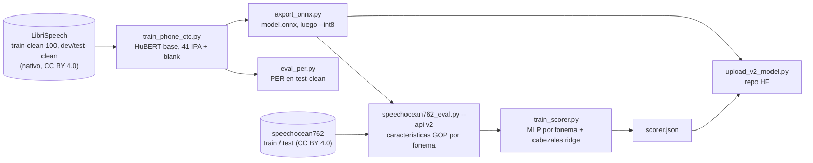

<!-- doc-id: docs-training | lang: es | source-rev: 9feeca07 -->

> 🌐 **Traducción al español** de [`docs/training.md`](../../../docs/training.md) (rev `9feeca07`). La versión en inglés es la oficial: si difieren, prevalece el inglés. Traducción automática, sin revisión de un hablante nativo.

# Entrenamiento de los modelos v2

El trabajo sin conexión vive en [`training/`](../training/) y nunca se incluye en la imagen del servicio. Usa su propio venv de CUDA (`.venv-train`) para que el venv del servicio siga siendo solo de CPU. Lista rápida de comandos: [training/README.md](../training/README.md). Esta página explica qué se entrena, con qué datos y por qué.



## 1. Modelo phone CTC

| | |
| --- | --- |
| Base | `facebook/hubert-base-ls960` (Apache-2.0) |
| Vocabulario | los 41 símbolos IPA del servicio + blank de CTC; etiquetas = transcripción -> `g2p_en` -> IPA |
| Datos | LibriSpeech `train-clean-100` (28 539 enunciados); dev y test de `dev-clean` / `test-clean` |
| Por qué solo nativo | entrenar con audio L2 y etiquetas canónicas enseñaría al modelo a aceptar errores de pronunciación |
| Optimizador | AdamW, LR del cuerpo 5e-5, LR de la cabeza 1e-3, 1000 pasos solo de la cabeza, 10% de warm-up y después decaimiento lineal |
| Lotes | unos 100 s de audio por micro-lote, 2 pasos de acumulación, agrupados por longitud (HuBERT-base no tiene máscara de atención), autocast bf16, codificador de características convolucional congelado |
| Ejecución | 25 000 pasos, unos 124 min, pico de 3.7 GB de VRAM; se conserva el checkpoint con mejor PER en dev |
| Resultado | PER de 1.86% en todo test-clean |

Para el entrenamiento se usan enunciados de hasta 20 s (el corpus tiene uno más largo). El modelo servido admite hasta 30 s sin pérdida medible (el PER por duración está en [scoring-v2.md](scoring-v2.md)).

```bash
.venv-train/Scripts/python -m training.train_phone_ctc --steps 25000 --dev-limit 600 --workers 4
.venv-train/Scripts/python -m training.eval_per --split test-clean
.venv-train/Scripts/python -m training.export_onnx           # model.onnx, checks parity vs torch (< 1e-3)
.venv-train/Scripts/python -m training.export_onnx --int8    # model.int8.onnx
```

El contrato del archivo del modelo (16 kHz mono, normalizado por pico, sin normalización de media/varianza) debe coincidir con `app/services/v2/phone_model.py`.

## 2. Evaluador

Las características salen de ejecutar el propio analizador v2 del servicio sobre speechocean762, de modo que el entrenamiento y el servicio no pueden desviarse:

```bash
python scripts/speechocean762_eval.py --api v2 --split train --out data/so762-v2-train.jsonl --report data/so762-v2-train-report.json
python scripts/speechocean762_eval.py --api v2 --split test  --out data/so762-v2-test.jsonl  --report data/so762-v2-test-report.json
.venv/Scripts/python -m training.train_scorer       # writes data/models/hubert-phone-ctc/scorer.json
```

Sin `scorer.json`, el harness igualmente escribe las características por fonema (las puntuaciones son ceros), que es todo lo que necesita el entrenamiento.

- **MLP por fonema** (2 x 128, dropout 0.2): entrenado con particiones que reservan hablantes; la época se elige con el 10% de los hablantes.
- **Cabezales ridge de palabra y enunciado:** apilados sobre puntuaciones de fonema out-of-fold para que nunca vean predicciones dentro de la muestra de entrenamiento.
- **Umbral de marcado** (puntuación de fonema 1.48): el valor que maximiza el F1 de errores de pronunciación sobre las predicciones out-of-fold de train.
- **Partición de prueba:** se usa una sola vez, para el informe. Nada se ajusta con ella.
- **Escalado de la entrada:** los z-scores se recortan a +/-10 (los one-hot de fonemas raros, de lo contrario, alcanzan |z| ~ 200 y destruyen el ajuste).
- Un modelo ridge simple para la cabeza de fonemas alcanzó un PCC de fonema de 0.546 / MDD F1 de 0.443 en adultos, justo por debajo del objetivo; el MLP da 0.630 / 0.537.

## 3. Publicación

`scripts/upload_v2_model.py` sube `model.int8.onnx`, `vocab.json` y `scorer.json` al repo de Hugging Face del que descargan los builds de la imagen ([deployment.md](deployment.md)). Siempre que cambien el modelo de fonemas o el diseño de características, reentrena el evaluador: `scorer.json` está atado al orden exacto de características del código que lo produjo (todavía no hay sello de versión).

## Licencias y datos

LibriSpeech y speechocean762 son CC BY 4.0 (créditos en [NOTICE](../../../NOTICE)); el modelo entrenado es un derivado de HuBERT-base (Apache-2.0). L2-ARCTIC **no** se usa: es CC BY-NC. speechocean762 es de L1 mandarín, así que recopilar y anotar a estudiantes con otras lenguas maternas es la principal tarea pendiente ([evaluation.md](evaluation.md)).
