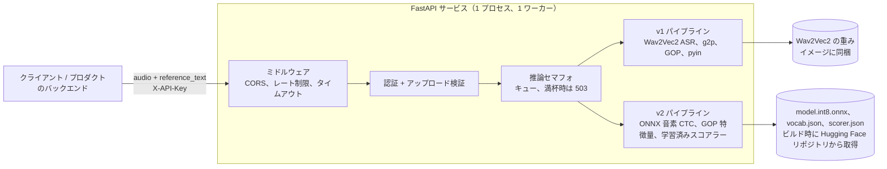
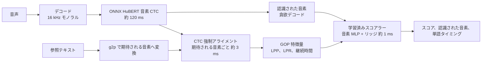

<!-- doc-id: readme | lang: ja | source-rev: 1429d642 -->

> 🌐 [`README.md`](../../README.md)（rev `1429d642`）の**日本語訳**です。英語版が正です。内容が異なる場合は英語版に従ってください。機械翻訳であり、ネイティブによる校閲は受けていません。

<div align="center">

# 🗣️ 発音検証サービス

**シンプルな REST API で提供する、音素レベルの英語発音採点。**
録音データと話者が言うべきだった文を送信すると、音素ごと・単語ごと・全体のスコアに加え、認識された音素と単語タイミングが返されます。母語を問わず、英語学習者のために作られています。


-EE4C2C?logo=pytorch&logoColor=white)


[クイックスタート](#-クイックスタート) · [API](#-api) · [v2 のしくみ](#-v2-のしくみ) · [結果](#-結果) · [ドキュメント](#-ドキュメント)

**言語:** [English](../../README.md) · [Tiếng Việt](../vi/README.md) · [中文](../zh/README.md) · [日本語](README.md) · [Español](../es/README.md)

</div>

---

## ✨ できること

`audio` と `reference_text` を渡すと、サービスは次の内容を返します。

- **IPA の比較**: 各単語のすべての音素について、期待される音素と認識された音素を比較
- **スコア**: 正確さ、完全性、流暢さ、韻律、総合スコア（0〜100）に加え、レベルとフィードバック文
- **単語のエラー種別**: `None`、`Mispronunciation`、`Omission`、`Insertion`、`UnexpectedBreak`、`MissingBreak`
- **単語タイミング**（v2）: すべての単語の `start_ms` / `end_ms`

2 つのパイプラインが並行して動作し、リクエストとレスポンスの形式は共通です。

| | **v1** `/api/v1/evaluate` | **v2** `/api/v2/evaluate` |
| --- | --- | --- |
| 考え方 | Wav2Vec2 で単語を書き起こし、テキストを比較。手動で調整した計算式を使用 | 音素レベルのモデルで*期待される音素*ごとに採点し、学習済みスコアラーが専門家と同じ基準のスコアに変換 |
| 音素モデル | Wav2Vec2 の文字（A-Z） | HuBERT-base 音素 CTC（41 個の IPA 音素）、ONNX INT8 |
| スコア | 計算式（55% IPA + 45% GOP、Azure 方式の総合スコア） | speechocean762 の専門家スコアで学習 |
| レイテンシ p50（3.4 秒のクリップ、4 vCPU） | 381 ms | **125 ms** |
| ロード後のメモリ（それぞれ単独） | 796 MB | **430 MB** |
| 専門家との音素スコア相関（成人） | 0.03 | **0.63** |

v1 は変更されず、引き続き利用できます。v2 が存在する理由は [docs/scoring-v2.md](docs/scoring-v2.md)、レスポンスの違いは [docs/api.md](docs/api.md#post-apiv2evaluate) を参照してください。

## 🏗️ アーキテクチャ



その他の図（v1 と v2 の比較、リクエストのシーケンス、起動）: [docs/architecture.md](docs/architecture.md)。

## 🔬 v2 のしくみ



1. 音素 CTC モデル（ネイティブの LibriSpeech のみでファインチューニング）が、フレームごとの音素事後確率を出力します。
2. 参照テキストは g2p で期待される音素になり、numpy による CTC 強制アライメントが各音素のあるべき位置を求めます。
3. 音素ごとの発音の良さ（goodness-of-pronunciation）特徴量（期待される音素の対数事後確率、他の音素がどれだけよく当てはまるか、継続時間）と、貪欲デコードで得た認識された音素を、speechocean762 で学習した小さなスコアラーに入力します。
4. 無音や、デコードできる発話がない音声には、推測ではなくゼロスコア応答を返します。

計測値は 3.4 秒のクリップ、INT8、4 vCPU、開発用マシンでのものです。詳しい説明: [docs/scoring-v2.md](docs/scoring-v2.md)。

## 🚀 クイックスタート

```bash
python3.11 -m venv .venv && source .venv/bin/activate      # Windows: .venv\Scripts\activate
pip install -r requirements.txt
cp .env.example .env                                       # set API_KEY (>= 32 chars) or DEBUG=true
python main.py                                             # http://localhost:8000/docs
```

v1 モデルは初回起動時に Hugging Face からダウンロードされます。**v2 には** `data/models/hubert-phone-ctc/` に **3 つのファイル**（`model.int8.onnx`、`vocab.json`、`scorer.json`）が必要です。これらがない場合、`/api/v2/evaluate` は `503` を返しますが、v1 には影響しません。

```bash
# fetch the v2 files from the public Hugging Face repo (no token needed)
huggingface-cli download dris1153/pronunciation-v2 model.int8.onnx vocab.json scorer.json --local-dir data/models/hubert-phone-ctc
```

自分でビルドすることもできます: [docs/training.md](docs/training.md)。

```bash
curl -X POST http://localhost:8000/api/v2/evaluate \
  -H "X-API-Key: $API_KEY" \
  -F "audio=@recording.wav" -F "reference_text=hello world"
```

```jsonc
{
  "reference_text": "hello world",
  "transcribed_text": "jɛloʊ wɝd",            // v2: the heard IPA string
  "results": {
    "word_details": [{
      "word": "hello", "expected_ipa": "həloʊ", "actual_ipa": "jɛloʊ",
      "start_ms": 160, "end_ms": 440, "error_type": "Mispronunciation",
      "phoneme_details": [{ "expected_ipa": "h", "actual_ipa": "j", "is_correct_ipa": false, "gop_score": 67.56 }]
    }]
  },
  "accuracy_score": 57.26, "fluency_score": 74.69, "prosody_score": 68.98, "overall_score": 55.8, "level": "fair"
}
```

（抜粋です。合成した「yellow word」のクリップに対する実際の出力で、完全な例は [docs/api.md](docs/api.md) を参照）

### Docker

```bash
docker build --build-arg V2_MODEL_REPO=dris1153/pronunciation-v2 -t pronunciation-validator .
docker run -p 8000:8000 -e API_KEY=<32+ char key> -e DEBUG=false pronunciation-validator
```

Railway、Coolify/nixpacks、サイジング、モデルの公開フロー: [docs/deployment.md](docs/deployment.md)。

## 📡 API

| エンドポイント | 認証 | 用途 |
| --- | --- | --- |
| `POST /api/v2/evaluate` | 🔒 | 発音スコア。音素ネイティブのパイプラインで、単語タイミング付き |
| `POST /api/v1/evaluate` | 🔒 | 発音スコア。従来の Wav2Vec2 パイプライン |
| `GET /api/v1/text-analysis` | 🔒 | テキストから IPA へ変換し、単語ごとの音素を返す |
| `POST /api/v1/transcribe` | 🔒 | 音声からテキストへ（採点なし） |
| `GET /api/v1/model-info` | - | サービスのメタデータと制限 |
| `GET /health` | - | 死活監視 |

🔒 = `X-API-Key` ヘッダーが必要。制限: アップロード 10 MB、音声 30 秒、wav / mp3 / ogg / flac / webm。インタラクティブなドキュメントは `/docs` にあります。ユーザーごとのレート制限を設けてバックエンドから呼び出す方法: [docs/internal-integration.md](docs/internal-integration.md)。リファレンス: [docs/api.md](docs/api.md)。

## 📊 結果

speechocean762 のテスト分割（2500 発話、中国語を母語とする学習者）における、専門家スコアとのピアソン相関（成人、18 歳以上）:

| | v1 | **v2** |
| --- | --- | --- |
| 発話の総合 | 0.62 | **0.85** |
| 発話の流暢さ | 0.63 | **0.88** |
| 発話の韻律 | 0.11 | **0.85** |
| 単語の正確さ | 0.02 | **0.64** |
| 音素の正確さ | 0.03 | **0.63** |
| 誤発音検出の F1 | 0.27 | **0.54** |

音素モデル: LibriSpeech test-clean で音素誤り率 1.86%。INT8 化による各指標の変化は 0.004 以下です。

> ⚠️ **正直な限界。** 評価に使った話者はすべて中国語を母語とする人なので、**他の母語での正確さは測定されていません**。このパイプラインは設計上、母語に依存しません（英語の音素を参照テキストと照らして採点し、母語ごとの専用ルールはありません）が、中国語を母語とする話者以外では検証されていません。これまでに行った唯一の調査（ベトナム語向け）でも、発音スコア付きで商用利用できる公開データセットは見つかりませんでした（[データ計画](docs/evaluation.md#他の母語向けのデータ計画)）。スコア曲線は 5 本の合成クリップで調整しました。速度の数値は開発用マシンのものなので、お使いのホストで `debugs/benchmark.py` を再実行してください。詳細: [docs/evaluation.md](docs/evaluation.md)。

## 🧰 技術スタック

| コンポーネント | 技術 |
| --- | --- |
| Web | FastAPI、Uvicorn、Pydantic v2、slowapi |
| v2 音素モデル | 音素 CTC 用にファインチューニングした HuBERT-base、ONNX Runtime（INT8）、numpy によるアライメントとスコアラー（PyTorch 不使用） |
| v1 | Wav2Vec2-base-960h（PyTorch、CPU）、librosa pyin による韻律 |
| テキストから音素へ | g2p_en + NLTK、41 記号の IPA インベントリ |
| 学習 | GPU 上の PyTorch + Transformers、オフライン専用（`training/`） |
| 運用 | Docker、Railway / Coolify、loguru、モデルファイル用の Hugging Face Hub |

## 📁 プロジェクト構成

```
app/            FastAPI app: api/ (routes, auth, upload), core/ (config), models/ (schemas),
                services/ (v1 pipeline, shared alignment + scoring rules, v2/ phone pipeline), utils/
training/       Offline training and ONNX export of the v2 models (own CUDA venv)
scripts/        speechocean762 evaluation harness, sanity set, Hugging Face upload
debugs/         Latency / memory benchmark (v1 and v2)
tests/          pytest suite (~460 tests) + synthetic sanity recordings
docs/           Documentation
```

## 📚 ドキュメント

| | |
| --- | --- |
| [API リファレンス](docs/api.md) | エンドポイント、認証、エラー、例 |
| [アーキテクチャ](docs/architecture.md) | 図とコード構成 |
| [スコアリング v2](docs/scoring-v2.md) · [v1](docs/scoring-v1.md) | スコアの算出方法 |
| [評価](docs/evaluation.md) | 品質、レイテンシ、メモリ、テスト、データ計画 |
| [学習](docs/training.md) | v2 モデルの学習、エクスポート、公開 |
| [設定](docs/configuration.md) · [デプロイ](docs/deployment.md) | 環境変数、Docker、Railway、Coolify |
| [内部連携](docs/internal-integration.md) | バックエンドからサービスを利用する方法、クライアントの v2 への移行 |

すべてのページの索引: [docs/README.md](docs/README.md)。バイリンガルの単一ページ版が [`index.html`](../../index.html) にもあります。

## 🧪 テスト

```bash
pytest tests/ -v
```

実際の v2 モデルファイルが必要なテストは、ファイルがない場合は自動的にスキップされます。v1 のサニティケース 2 件（`poor_001`、`poor_002`）は既知の失敗です（v1 はこれらのクリップを該当の帯域をわずかに上回るスコアで採点します）。v2 は両方に合格します。

## 🤝 コントリビュート

初めての方は、[CONTRIBUTING.md](../../CONTRIBUTING.md) を読み、[good first issue](https://github.com/dris1153/pronunciation-service/labels/good%20first%20issue) から始めてください。参加者は全員、[行動規範](../../CODE_OF_CONDUCT.md)に従うものとします。ファイルは約 200 行以内に収め、既存の構成（`docs/structure.md`）に従い、プッシュする前にテストを実行してください。英語のドキュメントが [`languages/`](../README.md) にある翻訳の原本です。編集したあとは `python scripts/docs_sync.py bump` を実行してください（ルールは [AGENTS.md](../../AGENTS.md)）。スコアリングを変更する場合は、speechocean762 ハーネスでの変更前後の実行結果が必要です（[docs/evaluation.md](docs/evaluation.md)）。

## 📄 ライセンスとクレジット

[Apache License 2.0](../../LICENSE) のもとで提供されます。Copyright 2026 dris1153。再配布の際は [NOTICE](../../NOTICE) ファイルを保持する必要があります。

HuBERT と wav2vec 2.0（Meta AI、Apache-2.0）、g2p_en をベースに構築し、LibriSpeech と speechocean762（どちらも CC BY 4.0）で学習・評価しています。完全なクレジットと引用: [NOTICE](../../NOTICE)。
