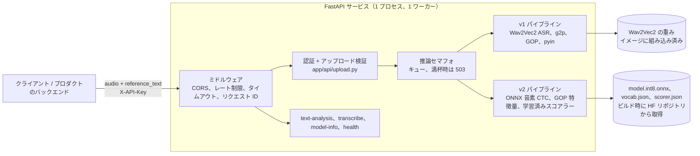
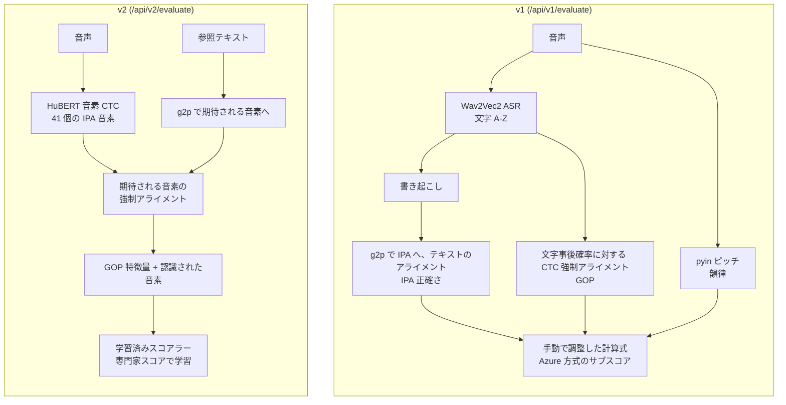
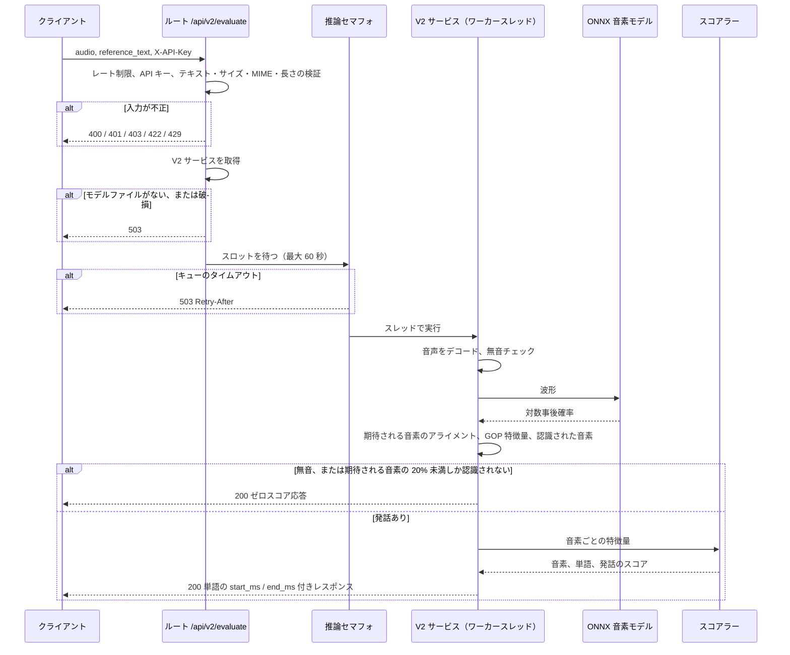
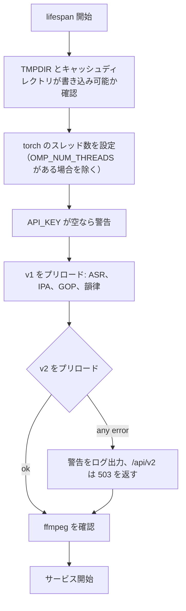

<!-- doc-id: docs-architecture | lang: ja | source-rev: ec588fa9 -->

> 🌐 [`docs/architecture.md`](../../../docs/architecture.md)（rev `ec588fa9`）の**日本語訳**です。英語版が正です。内容が異なる場合は英語版に従ってください。機械翻訳であり、ネイティブによる校閲は受けていません。

# アーキテクチャ

## システム概要



モデルは大きく、一度だけロードされるため、すべてが 1 つのプロセスで動作します。uvicorn のワーカーを増やすと、ワーカーごとにモデルのコピーをロードしてしまいます。CPU 推論はセマフォ（`MAX_CONCURRENT_INFERENCES`）で上限が決まり、ブロッキングする処理はワーカースレッドで実行されるため、イベントループは空いたままになります。

## v1 と v2 の比較



| | v1 | v2 |
| --- | --- | --- |
| 採点の単位 | ASR で認識された単語 | 期待される各音素 |
| 音素の根拠 | 文字の事後確率 | 音素の事後確率 |
| スコア | 計算式（55% IPA + 45% GOP、ソートした最小値による総合スコア） | speechocean762 の専門家スコアから学習 |
| 韻律 / 流暢さ | pyin ピッチ、発話速度、ポーズ | アライメント特徴量から学習（ピッチトラッカーなし） |
| ランタイム | PyTorch | ONNX Runtime（INT8）、v2 のコードに PyTorch はなし |
| レイテンシ p50（3.4 秒のクリップ、4 vCPU） | 381 ms | 125 ms |

## v2 リクエスト 1 件の流れ



サービスが返す値エラー（音声が短すぎる、発音可能な単語がない参照テキスト）は `400` になります。予期しないエラーは汎用的なメッセージ付きの `500` になります。

## 起動



v1 モデルに問題があると起動が止まりますが、v2 モデルが壊れている、またはない場合に起動が止まることはありません。

## コード構成

```
app/
  application.py            FastAPI factory + lifespan (model preload)
  api/
    routes/                 health, ipa, model_info, pronunciation (v1), pronunciation_v2, transcribe
    dependencies.py         API key, service lookup (v1, v2 with 503)
    middleware.py           CORS, rate limit, timeout, exception handlers
    upload.py               upload + reference text validation shared by v1 and v2
  core/                     config (pydantic-settings), concurrency, constants, logging
  models/schemas.py         Pydantic schemas (v1 and additive V2 subclasses)
  services/
    pronunciation_service.py  v1 orchestrator
    asr_service.py, gop_service.py, ipa_service.py, prosody_service.py   v1 components
    phoneme_align.py        phone similarity groups + DP alignment (no torch, shared)
    scoring_rules.py        level/feedback, error types, break detection (no torch, shared)
    v2/
      phone_model.py        ONNX session -> log-posteriors
      ctc_align.py          numpy CTC forced alignment
      gop_features.py       GOP features, heard phones
      scorer.py             numpy phone MLP + word/utterance ridge
      analyser.py           audio + text -> V2Analysis
      pronunciation_v2_service.py   response assembly, gates, score curve
  utils/                    audio I/O, text normalisation
training/                   offline training and export (own CUDA venv, not imported by app/)
scripts/                    evaluation harness, sanity set, HF upload
debugs/                     benchmark and diagnostics
tests/                      pytest suite (+ synthetic sanity recordings)
```

ファイルごとの詳細: [structure.md](structure.md)。v1 のリクエストフローをテキスト形式で説明したもの: [workflow.md](workflow.md)。
