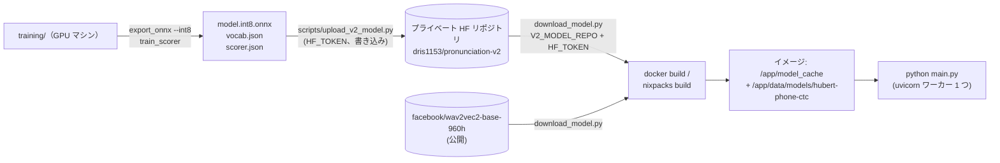

<!-- doc-id: docs-deployment | lang: ja | source-rev: c9e42585 -->

> 🌐 [`docs/deployment.md`](../../../docs/deployment.md)（rev `c9e42585`）の**日本語訳**です。英語版が正です。内容が異なる場合は英語版に従ってください。機械翻訳であり、ネイティブによる校閲は受けていません。

# デプロイ

1 つのコンテナで両方のパイプラインを提供します。v1 の重みは Hugging Face の公開リポジトリから、v2 のファイル（`model.int8.onnx`、`vocab.json`、`scorer.json`）は**プライベートな** Hugging Face リポジトリから取得します。どちらもビルド時にイメージに組み込まれます（永続ボリュームは不要です）。



## 初回のみ: v2 ファイルの公開

Hugging Face のアカウントと、**書き込み**権限のあるトークンが必要です。

```powershell
$env:HF_TOKEN = "hf_xxx"          # write token, never commit it
python scripts/upload_v2_model.py --repo dris1153/pronunciation-v2
```

このスクリプトはリポジトリをプライベートとして作成し（既存の公開リポジトリをプライベートに変更することはありません）、`data/models/hubert-phone-ctc/` の 3 つのファイルをアップロードします。ビルド用には別途**読み取り**トークンを作成してください。

## Docker

```bash
# v1 only (v2 endpoint will answer 503)
docker build -t pronunciation-validator .

# v1 + v2: the token travels as a BuildKit secret, so it never lands in an image layer
docker build \
  --build-arg V2_MODEL_REPO=dris1153/pronunciation-v2 \
  --secret id=hf_token,env=HF_TOKEN \
  -t pronunciation-validator .

docker run -p 8000:8000 -e API_KEY=<32+ char key> -e DEBUG=false pronunciation-validator
```

イメージの内容: `python:3.11-slim` + ffmpeg/libsndfile、CPU 専用の PyTorch（v1）、`requirements.txt`（v2 用の `onnxruntime` を含む）。`download_model.py` を実行し（v1 モデル、続いて `V2_MODEL_REPO` が設定されていれば v2 のファイル）、root 以外のユーザーに切り替えて `python main.py` を起動します。`.dockerignore` は `data/` と `.venv-train/` を除外するため、ローカルのデータセットがビルドコンテキストに入ることはありません。

> **状況:** Dockerfile と nixpacks のダウンロード手順は書かれていますが、**まだエンドツーエンドでは実行していません**。これらに頼る前に、`V2_MODEL_REPO` とトークンを指定してクリーンビルドを 1 回行い、その後 `docker history` にトークンが含まれていないか確認してください。

## Railway

`railway.toml` は Dockerfile ビルダー、ヘルスチェック `GET /health`（タイムアウト 120 秒）、失敗時の再起動（3 回リトライ）を使用します。`PORT` は Railway が注入し、pydantic-settings が読み取ります。`API_KEY`、`DEBUG=false` などはダッシュボードで設定してください。

v2 では、Railway がビルドに `HF_TOKEN` を渡す必要があります。Railway はビルドシークレットを**サービス変数名**でマウントするため、Dockerfile のシークレット ID（`hf_token`）は Railway 側では `HF_TOKEN` にする必要がある場合があります。最初の実ビルドで確認してください。`V2_MODEL_REPO` を設定した状態でトークンがないと、v2 のステップのビルドは失敗します。v1 のみを提供する場合は `V2_MODEL_REPO` を未設定にしてください。

## Coolify / nixpacks

`nixpacks.toml` は CPU 版 PyTorch と `requirements.txt` をインストールし、v1 モデルを組み込んでから `python download_model.py --v2-only` を実行します。`V2_MODEL_REPO` と `HF_TOKEN` は**ビルド変数**として設定してください。Nixpacks はビルド変数を生成されるイメージに残すことがあるため、読み取り専用のトークンを使い、イメージを共有した場合はトークンをローテーションしてください。アプリは `su` 経由で `appuser` として起動します。

## サイジングとランタイムのルール

| 項目 | 指針 |
| --- | --- |
| ワーカー | uvicorn ワーカーは **1 つ**。各ワーカーがすべてのモデルの独自のコピーをロードします |
| RAM | ロード後の RSS 実測値: v1 のみ 796 MB、v1 + v2 INT8 の合計 1030 MB、v2 のみ約 430 MB で、リクエスト処理後は 600〜660 MB まで増加します（ONNX アリーナ）。合算した場合のリクエスト処理後の RSS は未測定です。合算したプロセスには約 2 GB を見込んでください |
| CPU | 4 vCPU: `MAX_CONCURRENT_INFERENCES=2`。2 vCPU: 自動のままにします。Docker の `--cpus` や Railway の背後では `OMP_NUM_THREADS` を設定してください |
| ヘルス | `GET /health` は公開されています。報告するのは v1 のロード状態のみで、v2 モデルがない場合は `/api/v2/evaluate` の `503` と起動ログの警告に現れます |
| 障害の分離 | v2 モデルがない、または破損していても起動が妨げられることはなく、v1 は提供を続けます |
| クライアントを切り替える前に | 実際のホストで `python debugs/benchmark.py --api v2 --int8 --cpus 4` を実行してください。[evaluation.md](evaluation.md) の速度の数値は開発用マシンのものです |

環境変数: [configuration.md](configuration.md)。
