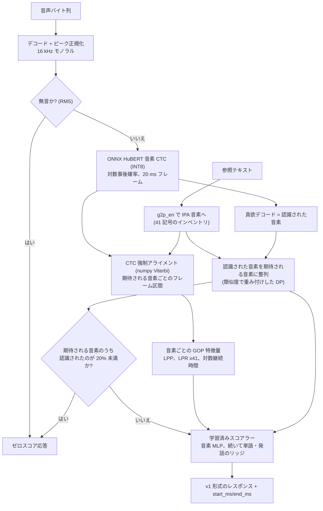

<!-- doc-id: docs-scoring-v2 | lang: ja | source-rev: 4b5806b4 -->

> 🌐 [`docs/scoring-v2.md`](../../../docs/scoring-v2.md)（rev `4b5806b4`）の**日本語訳**です。英語版が正です。内容が異なる場合は英語版に従ってください。機械翻訳であり、ネイティブによる校閲は受けていません。

# スコアリング v2（音素ネイティブのパイプライン）

`POST /api/v2/evaluate` が音声を採点するしくみを説明します。単語を書き起こしてテキストを比較する v1 とは異なり、音素レベルの CTC モデルが**期待される**各音素を直接採点し、小さな学習済みモデルがそれらの信号を専門家と同じ基準のスコアに変換します。

## モデル

- **バックボーン:** `facebook/hubert-base-ls960`（Apache-2.0）。g2p のマッピング（`_ARPABET_TO_IPA`）と同じ記号セットを使い、41 記号の IPA 語彙とブランクに対してファインチューニングしています。畳み込みフロントエンドは凍結、bf16、25 000 ステップ（GPU 1 枚で約 2 時間）。
- **学習データ:** LibriSpeech の `train-clean-100` のみ（ネイティブ音声）。正解ラベルが正規の発音になっている L2 音声は、意図的に一切使用していません。モデルが誤発音を許容するようになってしまうためです。
- **品質:** LibriSpeech test-clean 全体（2620 発話、191 317 音素）での音素誤り率は 1.86%。長さ別では、35 秒までは PER が 1.2〜2.6% にとどまります。ラベルは g2p から得ているため、これはネイティブの朗読音声における g2p の出力との一致度を測るものであり、アクセントのある音声での精度ではありません。
- **ランタイム:** CPU 上の ONNX Runtime、MatMul のみに動的 INT8 を適用（360 MB -> 116 MB）。INT8 と FP32 の差は、speechocean762 のすべての指標で 0.004 以下です。`app/services/v2/` 配下では PyTorch を import しません。
- **入力の仕様:** 16 kHz モノラル float32、ピーク正規化済み、平均/分散の正規化なし（学習時と推論時で一致させる必要があります）。

## 特徴量とアライメント

期待される各音素について、強制アライメントがフレーム区間を与えます。その区間から次の特徴量を求めます。

| 特徴量 | 意味 |
| --- | --- |
| `LPP` | 区間にわたる、期待される音素の対数事後確率の平均 |
| `LPR_k`（41 個） | `LPP` から、他のすべての音素 k の対数事後確率の平均を引いた値: 他の音素がどれだけよく当てはまるか |
| `log_dur` | 次の音素までの、その音素の継続時間の対数 |

スコアラーはさらに次も入力として受け取ります: `exp(LPP)`、クリップした `LPP`、音素の識別子、認識された音素が欠落しているか / 同じグループ内の置換か / それ以外の置換か、隣接する音素の `LPP`、単語の `LPP` の平均と最小値（音素あたり 93 入力）。

認識された音素は、発話全体に対する貪欲 CTC デコードから得られ、同じグループ内の入れ替えのコストを低くしたレーベンシュタイン DP で期待される音素に整列されます（`app/services/phoneme_align.py`）。認識されたものの期待されていない音素は、挿入として直前の単語に付与されます。

## スコアラー

| レベル | モデル | 出力 |
| --- | --- | --- |
| 音素 | 93 特徴量に対する MLP 2 x 128 | スコア 0-2（speechocean762 の音素の正確さと同じ） |
| 単語 | その単語の音素の 11 個の集計値に対するリッジ | 0-10 |
| 発話 | 17 個の集計値（音素/単語のスコア統計、不一致・脱落・挿入の比率、毎秒の音素数、ポーズの間隔）に対するリッジ | 正確さ、流暢さ、韻律、総合。それぞれ 0-10 |
| 完全性 | ルール | 期待される音素のうち認識された割合 |

speechocean762 の train（2500 発話）で、話者でグループ化した fold 外スタッキングにより学習しています。リッジの強度、早期終了、フラグのしきい値は train のみを使います。重みはプレーンな JSON（`scorer.json`、約 620 KB）で、numpy で評価されます。

## モデル出力からレスポンスへ

- **曲線:** 発話スコアは `100 x (s/10)^1.4` に変換されます。スコアラーは専門家のスケール（ほとんどが 6〜10）で予測します。この曲線はそれを v1 が使っていたより厳しいスケールに写像し、明らかに誤ったクリップが 60 未満になるようにします。指数は合成クリップ 5 件で調整したものなので、実際の学習者の音声で再キャリブレーションすべきです。speechocean762 の発話の相関は 0.005 以下しか動きません。
- **`is_correct_ipa`:** 音素スコアが **1.48**（2 点満点中）未満だとフラグが立ちます。この判定による成人での誤発音 F1 は 0.54 で、「認識された音 != 期待される音」の 0.31 を上回ります。異なる音として認識された音素の多くが、アクセント中立の変種であるためです。`actual_ipa` は認識された生の音素のままです。
- **単語のエラー種別:** その単語の音素が 1 つも認識されなければ `Omission`、単語スコアが 60 未満なら `Mispronunciation`、その後、アライメントされた単語間の隙間から `UnexpectedBreak` / `MissingBreak`（v1 と同じルールとしきい値、`app/services/scoring_rules.py`）。
- **ゲート:** 無音（RMS）と「期待される音素の 20% 未満しか認識されない」場合はゼロスコア応答を返します。スコアラーはノイズに対して外挿してしまうためです。speechocean762 のテストでは、実際の発話での認識された割合の最小値は 0.31 です。

## 結果（speechocean762 テスト、2500 発話）

特に記載がない限り、専門家スコアとのピアソン相関です。成人 = 18 歳以上の話者（1220 発話）。

| | v1 成人 | **v2 成人** | v2 全話者 |
| --- | --- | --- | --- |
| 発話の総合 | 0.619 | **0.852** | 0.779 |
| 発話の正確さ | 0.669 | **0.829** | 0.749 |
| 発話の流暢さ | 0.630 | **0.876** | 0.817 |
| 発話の韻律 | 0.108 | **0.853** | 0.796 |
| 単語の正確さ | 0.020 | **0.643** | 0.591 |
| 音素の正確さ | 0.033 | **0.630** | 0.590 |
| 誤発音 F1（適合率 / 再現率） | 0.269 (0.16 / 0.88) | **0.537** (0.48 / 0.60) | 0.480 (0.40 / 0.59) |

誤発音 = 専門家の音素スコアが 1.0 未満（音素の 4%）。数値は、最終版スコアラーを使った FP32 モデルのものです。INT8 との差は 0.004 以下、曲線による写像の差は 0.005 以下です。

## 限界

- **L1 のミスマッチ:** 学習・評価コーパスのすべての話者は、母語が中国語です。ベトナム語を母語とする学習者での挙動は未測定です。データ計画は [evaluation.md](evaluation.md) を参照してください。
- 20〜30 秒の音声に対するスコアは、スコアラー側では未検証です（speechocean762 のクリップは短いため）。音素モデル自体はその長さでも問題ありません。
- 約 300 音素（100 語）を超える参照テキストが、実用上の上限です。アライメントは音素数に対して二次の計算量になります。
- 単語の境界をまたぐ重複音素（`that time`）は CTC で 1 つにまとまるため、1 つの /t/ が欠落として報告されることがあります。

学習とエクスポートのコマンド: [training.md](training.md)。
