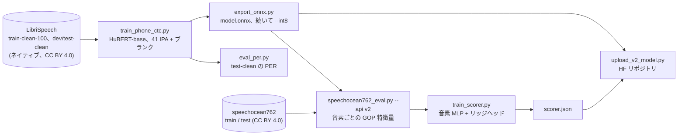

<!-- doc-id: docs-training | lang: ja | source-rev: 9feeca07 -->

> 🌐 [`docs/training.md`](../../../docs/training.md)（rev `9feeca07`）の**日本語訳**です。英語版が正です。内容が異なる場合は英語版に従ってください。機械翻訳であり、ネイティブによる校閲は受けていません。

# v2 モデルの学習

オフラインの作業は [`training/`](../training/) にあり、サービスのイメージには含まれません。サービスの venv を CPU 専用に保つため、独自の CUDA venv（`.venv-train`）を使います。コマンドの簡易一覧: [training/README.md](../training/README.md)。このページでは、何を、何で、なぜ学習するのかを説明します。



## 1. 音素 CTC モデル

| | |
| --- | --- |
| ベース | `facebook/hubert-base-ls960`（Apache-2.0） |
| 語彙 | サービスの 41 個の IPA 記号 + CTC ブランク。ラベル = 書き起こし -> `g2p_en` -> IPA |
| データ | LibriSpeech `train-clean-100`（28 539 発話）。dev と test は `dev-clean` / `test-clean` |
| ネイティブのみを使う理由 | 正解ラベルが正規の発音になっている L2 音声で学習すると、モデルが誤発音を許容するようになってしまう |
| オプティマイザ | AdamW、本体の LR 5e-5、ヘッドの LR 1e-3、ヘッドのみの 1000 ステップ、10% のウォームアップ後に線形減衰 |
| バッチ処理 | マイクロバッチあたり約 100 秒の音声、勾配累積 2 ステップ、長さによるバケット化（HuBERT-base にはアテンションマスクがない）、bf16 autocast、畳み込み特徴エンコーダは凍結 |
| 実行 | 25 000 ステップ、約 124 分、VRAM のピーク 3.7 GB。dev PER が最良のチェックポイントを保持 |
| 結果 | test-clean 全体で PER 1.86% |

学習には最大 20 秒の発話を使います（コーパスにはそれより長いものが 1 件あります）。提供されるモデルは 30 秒まで、測定できる劣化なしに処理できます（長さ別の PER は [scoring-v2.md](scoring-v2.md) にあります）。

```bash
.venv-train/Scripts/python -m training.train_phone_ctc --steps 25000 --dev-limit 600 --workers 4
.venv-train/Scripts/python -m training.eval_per --split test-clean
.venv-train/Scripts/python -m training.export_onnx           # model.onnx, checks parity vs torch (< 1e-3)
.venv-train/Scripts/python -m training.export_onnx --int8    # model.int8.onnx
```

モデルファイルの仕様（16 kHz モノラル、ピーク正規化、平均/分散の正規化なし）は、`app/services/v2/phone_model.py` と一致している必要があります。

## 2. スコアラー

特徴量は、サービス自身の v2 アナライザーを speechocean762 に対して実行して得ます。これにより、学習時と推論時でずれが生じることはありません。

```bash
python scripts/speechocean762_eval.py --api v2 --split train --out data/so762-v2-train.jsonl --report data/so762-v2-train-report.json
python scripts/speechocean762_eval.py --api v2 --split test  --out data/so762-v2-test.jsonl  --report data/so762-v2-test-report.json
.venv/Scripts/python -m training.train_scorer       # writes data/models/hubert-phone-ctc/scorer.json
```

`scorer.json` がなくても、ハーネスは音素ごとの特徴量を書き出します（スコアはゼロ）。学習に必要なのはそれだけです。

- **音素 MLP**（2 x 128、ドロップアウト 0.2）: 話者を分けた fold で学習します。エポックは、話者の 10% で選択します。
- **単語と発話のリッジヘッド:** fold 外の音素スコアの上にスタッキングするため、学習データ内の予測を見ることはありません。
- **フラグのしきい値**（音素スコア 1.48）: fold 外の train 予測での誤発音 F1 が最大になる値。
- **テスト分割:** レポートのために一度だけ使います。これに対しては何も調整しません。
- **入力のスケーリング:** z スコアは +/-10 にクリップします（まれな音素のワンホットは、そのままでは |z| が約 200 に達してフィッティングが破綻します）。
- 音素ヘッドに単純なリッジモデルを使った場合、成人での音素 PCC は 0.546、MDD F1 は 0.443 で、目標をわずかに下回りました。MLP では 0.630 / 0.537 になります。

## 3. 公開

`scripts/upload_v2_model.py` は、`model.int8.onnx`、`vocab.json`、`scorer.json` を、イメージのビルドがダウンロードする Hugging Face リポジトリへアップロードします（[deployment.md](deployment.md)）。音素モデルや特徴量のレイアウトが変わるたびに、スコアラーを再学習してください。`scorer.json` は、それを生成したコードの特徴量の順序に厳密に結びついています（バージョン識別はまだありません）。

## ライセンスとデータ

LibriSpeech と speechocean762 は CC BY 4.0 です（クレジットは [NOTICE](../../../NOTICE) を参照）。学習済みモデルは HuBERT-base（Apache-2.0）の派生物です。L2-ARCTIC は使用していません。これは CC BY-NC だからです。speechocean762 は中国語を母語とする話者のデータなので、他の母語の学習者を収集・アノテーションすることが主な未解決課題です（[evaluation.md](evaluation.md)）。
