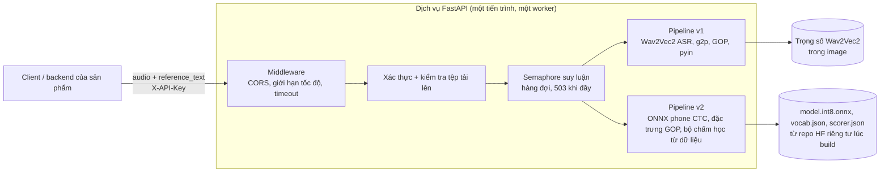
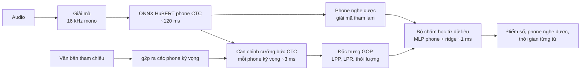

<!-- doc-id: readme | lang: vi | source-rev: 078fdfd7 -->

> 🌐 **Bản dịch tiếng Việt** của [`README.md`](../../README.md) (rev `078fdfd7`). Bản tiếng Anh là chuẩn: nếu hai bản khác nhau, hãy theo bản tiếng Anh. Bản dịch do máy thực hiện, chưa có người bản xứ rà soát.

<div align="center">

# 🗣️ Pronunciation Validation Service

**Chấm điểm phát âm tiếng Anh đến mức phoneme qua một REST API đơn giản.**
Tải lên một bản ghi âm và câu mà người nói lẽ ra phải đọc; nhận về điểm theo từng phone, từng từ và điểm tổng, kèm các phone nghe được và thời gian từng từ.


-EE4C2C?logo=pytorch&logoColor=white)


[Bắt đầu nhanh](#-bắt-đầu-nhanh) · [API](#-api) · [Cách v2 hoạt động](#-cách-v2-hoạt-động) · [Kết quả](#-kết-quả) · [Tài liệu](#-tài-liệu)

**Ngôn ngữ:** [English](../../README.md) · [Tiếng Việt](README.md) · [中文](../zh/README.md) · [日本語](../ja/README.md) · [Español](../es/README.md)

</div>

---

## ✨ Dịch vụ làm gì

Với đầu vào `audio` + `reference_text`, dịch vụ trả về:

- **So sánh IPA**: phone kỳ vọng so với phone nghe được cho mọi âm vị của mọi từ
- **Điểm số**: độ chính xác, độ đầy đủ, độ trôi chảy, ngữ điệu và điểm tổng (0-100) kèm mức đánh giá và nội dung nhận xét
- **Loại lỗi của từ**: `None`, `Mispronunciation`, `Omission`, `Insertion`, `UnexpectedBreak`, `MissingBreak`
- **Thời gian từng từ** (v2): `start_ms` / `end_ms` cho mọi từ

Hai pipeline chạy song song, với cùng dạng request và response:

| | **v1** `/api/v1/evaluate` | **v2** `/api/v2/evaluate` |
| --- | --- | --- |
| Ý tưởng | Phiên âm từ bằng Wav2Vec2, so sánh văn bản, công thức tinh chỉnh thủ công | Chấm từng *phone kỳ vọng* bằng model mức phone; một bộ chấm học từ dữ liệu ánh xạ sang điểm theo kiểu chuyên gia |
| Model phone | Chữ cái Wav2Vec2 (A-Z) | HuBERT-base phone CTC (41 phone IPA), ONNX INT8 |
| Điểm số | Công thức (55% IPA + 45% GOP, điểm tổng kiểu Azure) | Huấn luyện trên điểm chuyên gia của speechocean762 |
| Độ trễ p50 (clip 3.4 s, 4 vCPU) | 381 ms | **125 ms** |
| Bộ nhớ sau khi tải (mỗi bản chạy riêng) | 796 MB | **430 MB** |
| Tương quan điểm phone với chuyên gia (người lớn) | 0.03 | **0.63** |

v1 không thay đổi và vẫn khả dụng. Xem [docs/scoring-v2.md](docs/scoring-v2.md) để biết vì sao có v2 và [docs/api.md](docs/api.md#post-apiv2evaluate) để biết các khác biệt trong response.

## 🏗️ Kiến trúc



Thêm sơ đồ (v1 so với v2, trình tự xử lý request, khởi động): [docs/architecture.md](docs/architecture.md).

## 🔬 Cách v2 hoạt động



1. Một model phone CTC (chỉ tinh chỉnh trên LibriSpeech giọng bản xứ) cho ra xác suất hậu nghiệm của phone theo từng frame.
2. Văn bản tham chiếu được chuyển thành các phone kỳ vọng (g2p); căn chỉnh cưỡng bức CTC bằng numpy tìm vị trí mà mỗi phone lẽ ra phải nằm.
3. Các đặc trưng goodness-of-pronunciation theo từng phone (log hậu nghiệm của phone kỳ vọng, mức độ một phone khác khớp hơn, thời lượng) cùng các phone nghe được qua giải mã tham lam được đưa vào một bộ chấm nhỏ huấn luyện trên speechocean762.
4. Im lặng và audio không có tiếng nói giải mã được sẽ trả về phản hồi điểm 0 thay vì đoán.

Thời gian đo trên clip 3.4 s, INT8, 4 vCPU, trên máy dev. Mô tả đầy đủ: [docs/scoring-v2.md](docs/scoring-v2.md).

## 🚀 Bắt đầu nhanh

```bash
python3.11 -m venv .venv && source .venv/bin/activate      # Windows: .venv\Scripts\activate
pip install -r requirements.txt
cp .env.example .env                                       # set API_KEY (>= 32 chars) or DEBUG=true
python main.py                                             # http://localhost:8000/docs
```

Model v1 được tải từ Hugging Face ở lần khởi động đầu tiên. **v2 cần ba tệp** trong `data/models/hubert-phone-ctc/` (`model.int8.onnx`, `vocab.json`, `scorer.json`); nếu thiếu, `/api/v2/evaluate` trả về `503` và v1 không bị ảnh hưởng.

```bash
# fetch the v2 files from the private repo (needs a Hugging Face read token)
huggingface-cli login
huggingface-cli download dris1153/pronunciation-v2 model.int8.onnx vocab.json scorer.json --local-dir data/models/hubert-phone-ctc
```

Hoặc tự build các tệp này: [docs/training.md](docs/training.md).

```bash
curl -X POST http://localhost:8000/api/v2/evaluate \
  -H "X-API-Key: $API_KEY" \
  -F "audio=@recording.wav" -F "reference_text=hello world"
```

```jsonc
{
  "reference_text": "hello world",
  "transcribed_text": "jɛloʊ wɝd",            // v2: the heard IPA string
  "results": {
    "word_details": [{
      "word": "hello", "expected_ipa": "həloʊ", "actual_ipa": "jɛloʊ",
      "start_ms": 160, "end_ms": 440, "error_type": "Mispronunciation",
      "phoneme_details": [{ "expected_ipa": "h", "actual_ipa": "j", "is_correct_ipa": false, "gop_score": 67.56 }]
    }]
  },
  "accuracy_score": 57.26, "fluency_score": 74.69, "prosody_score": 68.98, "overall_score": 55.8, "level": "fair"
}
```

(rút gọn; đầu ra thật cho một clip tổng hợp "yellow word", ví dụ đầy đủ trong [docs/api.md](docs/api.md))

### Docker

```bash
docker build --build-arg V2_MODEL_REPO=dris1153/pronunciation-v2 --secret id=hf_token,env=HF_TOKEN -t pronunciation-validator .
docker run -p 8000:8000 -e API_KEY=<32+ char key> -e DEBUG=false pronunciation-validator
```

Railway, Coolify/nixpacks, định cỡ tài nguyên và quy trình công bố model: [docs/deployment.md](docs/deployment.md).

## 📡 API

| Endpoint | Xác thực | Mục đích |
| --- | --- | --- |
| `POST /api/v2/evaluate` | 🔒 | Điểm phát âm, pipeline thuần phoneme, kèm thời gian từng từ |
| `POST /api/v1/evaluate` | 🔒 | Điểm phát âm, pipeline Wav2Vec2 gốc |
| `GET /api/v1/text-analysis` | 🔒 | Văn bản sang IPA kèm các phoneme của từng từ |
| `POST /api/v1/transcribe` | 🔒 | Audio sang văn bản, không chấm điểm |
| `GET /api/v1/model-info` | - | Metadata và giới hạn của dịch vụ |
| `GET /health` | - | Kiểm tra dịch vụ còn sống |

🔒 = header `X-API-Key`. Giới hạn: tải lên 10 MB, audio 30 s, wav / mp3 / ogg / flac / webm. Tài liệu tương tác tại `/docs`. Gọi từ backend với giới hạn tốc độ theo từng người dùng: [docs/internal-integration.md](docs/internal-integration.md). Tham chiếu: [docs/api.md](docs/api.md).

## 📊 Kết quả

Tập test của speechocean762 (2500 câu nói, người học có L1 là tiếng Quan Thoại), tương quan Pearson với điểm chuyên gia, người lớn (18+):

| | v1 | **v2** |
| --- | --- | --- |
| Tổng điểm câu nói | 0.62 | **0.85** |
| Độ trôi chảy của câu nói | 0.63 | **0.88** |
| Ngữ điệu của câu nói | 0.11 | **0.85** |
| Độ chính xác của từ | 0.02 | **0.64** |
| Độ chính xác của phone | 0.03 | **0.63** |
| F1 phát hiện phát âm sai | 0.27 | **0.54** |

Model phone: tỷ lệ lỗi phone 1.86% trên LibriSpeech test-clean. INT8 làm thay đổi mỗi chỉ số không quá 0.004.

> ⚠️ **Giới hạn cần nói thẳng.** Tất cả người nói trong tập đánh giá đều có L1 là tiếng Quan Thoại; **độ chính xác với người học có L1 là tiếng Việt chưa được đo** và không tìm thấy bộ dữ liệu mở nào về người học có L1 tiếng Việt kèm điểm phát âm ([kế hoạch dữ liệu](docs/evaluation.md#kế-hoạch-dữ-liệu-cho-người-học-tiếng-việt)). Đường cong điểm được chỉnh trên năm clip tổng hợp. Số liệu tốc độ đo trên máy dev; hãy chạy lại `debugs/benchmark.py` trên máy chủ của bạn. Chi tiết: [docs/evaluation.md](docs/evaluation.md).

## 🧰 Công nghệ sử dụng

| Thành phần | Công nghệ |
| --- | --- |
| Web | FastAPI, Uvicorn, Pydantic v2, slowapi |
| Model phone v2 | HuBERT-base tinh chỉnh cho phone CTC, ONNX Runtime (INT8), căn chỉnh và bộ chấm bằng numpy (không dùng PyTorch) |
| v1 | Wav2Vec2-base-960h (PyTorch, CPU), ngữ điệu librosa pyin |
| Văn bản sang phone | g2p_en + NLTK, bộ 41 ký hiệu IPA |
| Huấn luyện | PyTorch + Transformers trên GPU, chỉ chạy offline (`training/`) |
| Vận hành | Docker, Railway / Coolify, loguru, Hugging Face Hub cho các tệp model |

## 📁 Cấu trúc dự án

```
app/            FastAPI app: api/ (routes, auth, upload), core/ (config), models/ (schemas),
                services/ (v1 pipeline, shared alignment + scoring rules, v2/ phone pipeline), utils/
training/       Offline training and ONNX export of the v2 models (own CUDA venv)
scripts/        speechocean762 evaluation harness, sanity set, Hugging Face upload
debugs/         Latency / memory benchmark (v1 and v2)
tests/          pytest suite (~460 tests) + synthetic sanity recordings
docs/           Documentation
```

## 📚 Tài liệu

| | |
| --- | --- |
| [Tham chiếu API](docs/api.md) | Endpoint, xác thực, lỗi, ví dụ |
| [Kiến trúc](docs/architecture.md) | Sơ đồ và cách tổ chức code |
| [Chấm điểm v2](docs/scoring-v2.md) · [v1](docs/scoring-v1.md) | Cách điểm số được tạo ra |
| [Đánh giá](docs/evaluation.md) | Chất lượng, độ trễ, bộ nhớ, test, kế hoạch dữ liệu |
| [Huấn luyện](docs/training.md) | Huấn luyện, export và công bố các model v2 |
| [Cấu hình](docs/configuration.md) · [Triển khai](docs/deployment.md) | Biến môi trường, Docker, Railway, Coolify |
| [Tích hợp nội bộ](docs/internal-integration.md) | Cách backend gọi dịch vụ, chuyển client sang v2 |

Mục lục toàn bộ các trang: [docs/README.md](docs/README.md). Ngoài ra còn có bản một trang song ngữ trong [`index.html`](../../index.html).

## 🧪 Kiểm thử

```bash
pytest tests/ -v
```

Các test cần tệp model v2 thật sẽ tự bỏ qua khi thiếu tệp. Hai trường hợp sanity của v1 (`poor_001`, `poor_002`) là lỗi đã biết (v1 chấm các clip đó cao hơn dải của chúng một chút); v2 đạt cả hai.

## 🤝 Đóng góp

Giữ mỗi tệp dưới khoảng 200 dòng, theo cấu trúc hiện có (`docs/structure.md`) và chạy test trước khi push. Tài liệu tiếng Anh là nguồn chuẩn cho các bản dịch trong [`languages/`](../README.md): sau khi sửa một tệp, chạy `python scripts/docs_sync.py bump` (quy tắc trong [AGENTS.md](../../AGENTS.md)). Các thay đổi về chấm điểm cần chạy bộ đánh giá speechocean762 trước và sau thay đổi ([docs/evaluation.md](docs/evaluation.md)).

## 📄 Giấy phép và ghi công

Cấp phép theo [Apache License 2.0](../../LICENSE). Bản quyền 2026 dris1153. Khi phân phối lại phải giữ nguyên tệp [NOTICE](../../NOTICE).

Xây dựng dựa trên HuBERT và wav2vec 2.0 (Meta AI, Apache-2.0), g2p_en, và được huấn luyện, đánh giá với LibriSpeech và speechocean762 (cùng CC BY 4.0). Ghi công và trích dẫn đầy đủ: [NOTICE](../../NOTICE).
