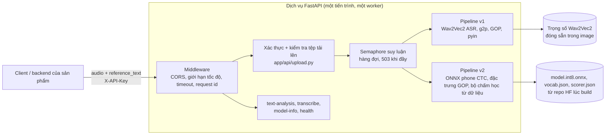
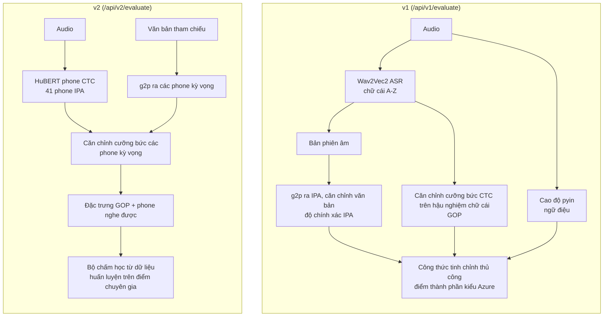
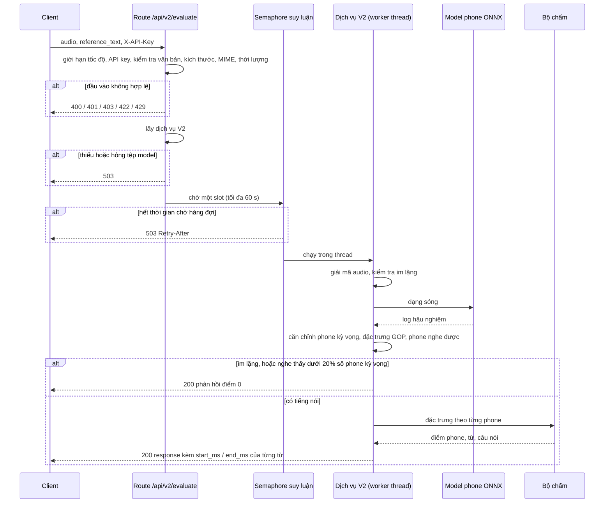
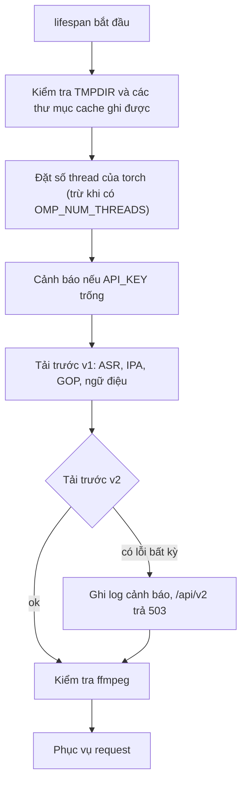

<!-- doc-id: docs-architecture | lang: vi | source-rev: ec588fa9 -->

> 🌐 **Bản dịch tiếng Việt** của [`docs/architecture.md`](../../../docs/architecture.md) (rev `ec588fa9`). Bản tiếng Anh là chuẩn: nếu hai bản khác nhau, hãy theo bản tiếng Anh. Bản dịch do máy thực hiện, chưa có người bản xứ rà soát.

# Kiến trúc

## Tổng quan hệ thống



Mọi thứ chạy trong một tiến trình vì các model lớn và chỉ được tải một lần; thêm worker uvicorn sẽ khiến mỗi worker tải một bản sao riêng. Suy luận trên CPU bị giới hạn bởi một semaphore (`MAX_CONCURRENT_INFERENCES`), và phần việc chặn chạy trong một worker thread để event loop luôn rảnh.

## v1 và v2 cạnh nhau



| | v1 | v2 |
| --- | --- | --- |
| Đơn vị được chấm | các từ do ASR nhận ra | từng phone kỳ vọng |
| Bằng chứng ở mức phone | hậu nghiệm chữ cái | hậu nghiệm phone |
| Điểm số | công thức (55% IPA + 45% GOP, điểm tổng lấy theo sorted-min) | học từ điểm chuyên gia của speechocean762 |
| Ngữ điệu / độ trôi chảy | cao độ pyin, tốc độ nói, quãng ngắt | học từ các đặc trưng căn chỉnh (không có bộ theo dõi cao độ) |
| Runtime | PyTorch | ONNX Runtime (INT8), không có PyTorch trong code v2 |
| Độ trễ p50 (clip 3.4 s, 4 vCPU) | 381 ms | 125 ms |

## Một request v2



Lỗi giá trị từ dịch vụ (audio quá ngắn, văn bản tham chiếu không có từ nào phát âm được) trở thành `400`; mọi lỗi không mong đợi trở thành `500` với thông báo chung chung.

## Khởi động



Model v1 hỏng sẽ dừng quá trình khởi động; model v2 hỏng hoặc thiếu thì không bao giờ làm vậy.

## Cách tổ chức code

```
app/
  application.py            FastAPI factory + lifespan (model preload)
  api/
    routes/                 health, ipa, model_info, pronunciation (v1), pronunciation_v2, transcribe
    dependencies.py         API key, service lookup (v1, v2 with 503)
    middleware.py           CORS, rate limit, timeout, exception handlers
    upload.py               upload + reference text validation shared by v1 and v2
  core/                     config (pydantic-settings), concurrency, constants, logging
  models/schemas.py         Pydantic schemas (v1 and additive V2 subclasses)
  services/
    pronunciation_service.py  v1 orchestrator
    asr_service.py, gop_service.py, ipa_service.py, prosody_service.py   v1 components
    phoneme_align.py        phone similarity groups + DP alignment (no torch, shared)
    scoring_rules.py        level/feedback, error types, break detection (no torch, shared)
    v2/
      phone_model.py        ONNX session -> log-posteriors
      ctc_align.py          numpy CTC forced alignment
      gop_features.py       GOP features, heard phones
      scorer.py             numpy phone MLP + word/utterance ridge
      analyser.py           audio + text -> V2Analysis
      pronunciation_v2_service.py   response assembly, gates, score curve
  utils/                    audio I/O, text normalisation
training/                   offline training and export (own CUDA venv, not imported by app/)
scripts/                    evaluation harness, sanity set, HF upload
debugs/                     benchmark and diagnostics
tests/                      pytest suite (+ synthetic sanity recordings)
```

Chi tiết từng tệp: [structure.md](structure.md). Luồng xử lý request v1 dạng văn bản: [workflow.md](workflow.md).
