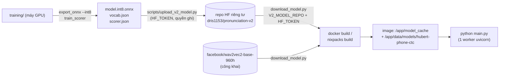

<!-- doc-id: docs-deployment | lang: vi | source-rev: c9e42585 -->

> 🌐 **Bản dịch tiếng Việt** của [`docs/deployment.md`](../../../docs/deployment.md) (rev `c9e42585`). Bản tiếng Anh là chuẩn: nếu hai bản khác nhau, hãy theo bản tiếng Anh. Bản dịch do máy thực hiện, chưa có người bản xứ rà soát.

# Triển khai

Một container phục vụ cả hai pipeline. Trọng số v1 đến từ các repo Hugging Face công khai; các tệp v2 (`model.int8.onnx`, `vocab.json`, `scorer.json`) đến từ một repo Hugging Face **riêng tư**. Cả hai được đóng sẵn vào image lúc build (không cần volume lưu trữ bền vững).



## Làm một lần: công bố các tệp v2

Cần một tài khoản Hugging Face và một token có quyền **ghi**.

```powershell
$env:HF_TOKEN = "hf_xxx"          # write token, never commit it
python scripts/upload_v2_model.py --repo dris1153/pronunciation-v2
```

Script tạo repo ở chế độ riêng tư (nó không chuyển một repo công khai đã có sang riêng tư) và tải lên ba tệp từ `data/models/hubert-phone-ctc/`. Hãy tạo một token **đọc** riêng cho các lần build.

## Docker

```bash
# v1 only (v2 endpoint will answer 503)
docker build -t pronunciation-validator .

# v1 + v2: the token travels as a BuildKit secret, so it never lands in an image layer
docker build \
  --build-arg V2_MODEL_REPO=dris1153/pronunciation-v2 \
  --secret id=hf_token,env=HF_TOKEN \
  -t pronunciation-validator .

docker run -p 8000:8000 -e API_KEY=<32+ char key> -e DEBUG=false pronunciation-validator
```

Image làm gì: `python:3.11-slim` + ffmpeg/libsndfile, PyTorch chỉ CPU (v1), `requirements.txt` (có `onnxruntime` cho v2), chạy `download_model.py` (model v1, rồi các tệp v2 khi `V2_MODEL_REPO` được đặt), chuyển sang người dùng không phải root, khởi động `python main.py`. `.dockerignore` loại `data/` và `.venv-train/`, nên các dataset local không bao giờ vào build context.

> **Trạng thái:** các bước tải trong Dockerfile và nixpacks đã được viết nhưng **chưa được chạy từ đầu đến cuối**. Hãy build sạch một lần với `V2_MODEL_REPO` và một token trước khi dựa vào chúng, rồi kiểm tra `docker history` xem có lộ token không.

## Railway

`railway.toml` dùng Dockerfile builder, health check `GET /health` (timeout 120 s) và khởi động lại khi lỗi (thử lại 3 lần). `PORT` do Railway gán và được pydantic-settings đọc. Hãy đặt `API_KEY`, `DEBUG=false` và các biến còn lại trong dashboard.

Với v2, Railway phải đưa `HF_TOKEN` vào lúc build. Railway mount build secret theo **tên service variable**, nên secret id trong Dockerfile (`hf_token`) có thể cần là `HF_TOKEN` ở đó; hãy kiểm chứng ở lần build thật đầu tiên. Không có token, bước build v2 sẽ thất bại khi `V2_MODEL_REPO` được đặt; để trống `V2_MODEL_REPO` nếu chỉ muốn chạy v1.

## Coolify / nixpacks

`nixpacks.toml` cài PyTorch CPU và `requirements.txt`, đóng sẵn model v1, rồi chạy `python download_model.py --v2-only`. Hãy đặt `V2_MODEL_REPO` và `HF_TOKEN` làm **build variable**. Nixpacks có thể lưu các build variable vào image nó sinh ra, nên hãy dùng token chỉ đọc và đổi token nếu image từng bị chia sẻ. Ứng dụng khởi động dưới tên `appuser` qua `su`.

## Định cỡ tài nguyên và quy tắc lúc chạy

| Chủ đề | Hướng dẫn |
| --- | --- |
| Worker | **Một** worker uvicorn. Mỗi worker tải một bản sao riêng của tất cả model |
| RAM | RSS đo được sau khi tải: chỉ v1 796 MB, v1 + v2 INT8 cùng nhau 1030 MB, chỉ v2 ~430 MB, tăng lên 600-660 MB sau các request (ONNX arena). RSS khi chạy chung sau các request chưa được đo; hãy dự trù khoảng 2 GB cho tiến trình chạy chung |
| CPU | 4 vCPU: `MAX_CONCURRENT_INFERENCES=2`. 2 vCPU: để tự động. Phía sau Docker `--cpus`/Railway hãy đặt `OMP_NUM_THREADS` |
| Health | `GET /health` là công khai. Nó chỉ báo trạng thái tải của v1; model v2 bị thiếu sẽ hiện ra là `503` ở `/api/v2/evaluate`, và là một cảnh báo trong log khởi động |
| Cô lập lỗi | Model v2 thiếu hoặc hỏng không bao giờ cản trở khởi động; v1 vẫn phục vụ |
| Trước khi chuyển client | Chạy `python debugs/benchmark.py --api v2 --int8 --cpus 4` trên máy chủ thật. Số liệu tốc độ trong [evaluation.md](evaluation.md) đo trên máy dev |

Biến môi trường: [configuration.md](configuration.md).
