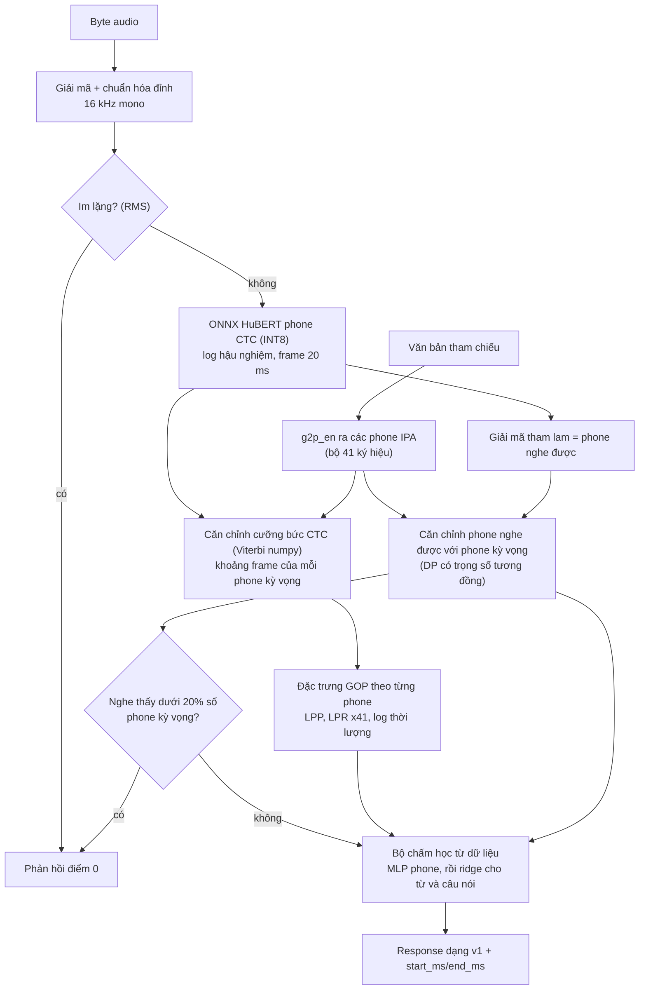

<!-- doc-id: docs-scoring-v2 | lang: vi | source-rev: 809ff2ba -->

> 🌐 **Bản dịch tiếng Việt** của [`docs/scoring-v2.md`](../../../docs/scoring-v2.md) (rev `809ff2ba`). Bản tiếng Anh là chuẩn: nếu hai bản khác nhau, hãy theo bản tiếng Anh. Bản dịch do máy thực hiện, chưa có người bản xứ rà soát.

# Chấm điểm v2 (pipeline thuần phoneme)

Cách `POST /api/v2/evaluate` chấm điểm giọng nói. Thay vì phiên âm từ rồi so sánh văn bản (v1), một model CTC mức phone chấm trực tiếp từng phone **kỳ vọng**, và một model học từ dữ liệu nhỏ biến các tín hiệu đó thành điểm theo kiểu chuyên gia.

## Model

- **Backbone:** `facebook/hubert-base-ls960` (Apache-2.0), tinh chỉnh cho từ vựng IPA 41 ký hiệu cộng blank, dùng cùng bộ ký hiệu với ánh xạ g2p (`_ARPABET_TO_IPA`). Phần conv đầu vào được đóng băng, bf16, 25 000 bước (khoảng 2 giờ trên một GPU).
- **Dữ liệu huấn luyện:** chỉ LibriSpeech `train-clean-100` (giọng bản xứ). Audio L2 với nhãn chuẩn cố ý không bao giờ được dùng: model sẽ học cách bỏ qua lỗi phát âm sai.
- **Chất lượng:** tỷ lệ lỗi phone 1.86% trên toàn bộ LibriSpeech test-clean (2620 câu nói, 191 317 phone). Theo độ dài, PER giữ ở mức 1.2-2.6% đến 35 s. Nhãn đến từ g2p, nên con số này đo mức độ khớp với đầu ra g2p trên giọng đọc bản xứ, không phải độ chính xác trên giọng có accent.
- **Runtime:** ONNX Runtime trên CPU, INT8 động chỉ trên MatMul (360 MB -> 116 MB); INT8 so với FP32 làm mọi chỉ số speechocean762 thay đổi không quá 0.004. Không import PyTorch dưới `app/services/v2/`.
- **Hợp đồng đầu vào:** 16 kHz mono float32, chuẩn hóa đỉnh, không chuẩn hóa mean/variance (huấn luyện và phục vụ phải khớp nhau).

## Đặc trưng và căn chỉnh

Với mỗi phone kỳ vọng, căn chỉnh cưỡng bức cho ra một khoảng frame. Từ khoảng đó:

| Đặc trưng | Ý nghĩa |
| --- | --- |
| `LPP` | log hậu nghiệm trung bình của phone kỳ vọng trên khoảng của nó |
| `LPR_k` (41) | `LPP` trừ đi log hậu nghiệm trung bình của mỗi phone k khác: một phone khác khớp hơn bao nhiêu |
| `log_dur` | log của thời lượng phone cho đến phone kế tiếp |

Bộ chấm còn thấy: `exp(LPP)`, `LPP` đã cắt, danh tính phone, việc phone nghe được là thiếu / thay bằng phone cùng nhóm / thay bằng phone khác, `LPP` của các phone lân cận, và `LPP` trung bình cùng nhỏ nhất của từ (93 đầu vào mỗi phone).

Phone nghe được đến từ giải mã CTC tham lam trên toàn bộ câu nói, căn chỉnh với các phone kỳ vọng bằng một DP Levenshtein tính phí thấp hơn cho việc đổi giữa các phone cùng nhóm (`app/services/phoneme_align.py`). Các phone được nghe nhưng không kỳ vọng được gắn vào từ đứng trước như phần chèn thêm.

## Bộ chấm

| Mức | Model | Đầu ra |
| --- | --- | --- |
| Phone | MLP 2 x 128 trên 93 đặc trưng | điểm 0-2 (như độ chính xác phone của speechocean762) |
| Từ | ridge trên 11 giá trị tổng hợp của các phone của nó | 0-10 |
| Câu nói | ridge trên 17 giá trị tổng hợp (thống kê điểm phone/từ, tỷ lệ lệch, bỏ sót và chèn thêm, số phone mỗi giây, khoảng ngắt) | độ chính xác, độ trôi chảy, ngữ điệu, tổng, mỗi loại 0-10 |
| Độ đầy đủ | quy tắc | tỷ lệ phone kỳ vọng đã được nghe thấy |

Huấn luyện trên tập train của speechocean762 (2500 câu nói) với stacking out-of-fold nhóm theo người nói; độ mạnh ridge, dừng sớm và ngưỡng gắn cờ chỉ dùng tập train. Trọng số là JSON thuần (`scorer.json`, ~620 KB) được tính bằng numpy.

## Từ đầu ra của model đến response

- **Đường cong:** điểm câu nói được nâng lên theo `100 x (s/10)^1.4`. Bộ chấm dự đoán trên thang chuyên gia (chủ yếu 6-10); đường cong ánh xạ nó sang thang chặt hơn mà v1 từng dùng để các clip sai rõ rệt rơi xuống dưới 60. Số mũ được chỉnh trên năm clip tổng hợp và cần hiệu chỉnh lại trên audio người học thật. Nó làm tương quan câu nói trên speechocean762 thay đổi không quá 0.005.
- **`is_correct_ipa`:** điểm phone dưới **1.48** (trên thang 2) bị gắn cờ. Kết luận này cho F1 phát hiện phát âm sai 0.54 ở người lớn, so với 0.31 của "nghe được != kỳ vọng", vì nhiều phone được nghe khác đi là các biến thể không ảnh hưởng giọng. `actual_ipa` vẫn là phone nghe được ở dạng thô.
- **Loại lỗi của từ:** `Omission` khi không nghe thấy phone nào của từ, `Mispronunciation` khi điểm từ dưới 60, sau đó là `UnexpectedBreak` / `MissingBreak` từ các khoảng trống giữa các từ đã căn chỉnh (cùng quy tắc và ngưỡng như v1, `app/services/scoring_rules.py`).
- **Cổng chặn:** im lặng (RMS) và "nghe thấy ít hơn 20% số phone kỳ vọng" trả về phản hồi điểm 0, vì bộ chấm ngoại suy trên nhiễu. Trên tập test speechocean762, tỷ lệ nghe thấy thấp nhất trong tiếng nói thật là 0.31.

## Kết quả (tập test speechocean762, 2500 câu nói)

Tương quan Pearson với điểm chuyên gia trừ khi có ghi chú khác. Người lớn = người nói từ 18 tuổi trở lên (1220 câu nói).

| | v1 người lớn | **v2 người lớn** | v2 mọi người nói |
| --- | --- | --- | --- |
| Tổng điểm câu nói | 0.619 | **0.852** | 0.779 |
| Độ chính xác của câu nói | 0.669 | **0.829** | 0.749 |
| Độ trôi chảy của câu nói | 0.630 | **0.876** | 0.817 |
| Ngữ điệu của câu nói | 0.108 | **0.853** | 0.796 |
| Độ chính xác của từ | 0.020 | **0.643** | 0.591 |
| Độ chính xác của phone | 0.033 | **0.630** | 0.590 |
| F1 phát hiện phát âm sai (precision / recall) | 0.269 (0.16 / 0.88) | **0.537** (0.48 / 0.60) | 0.480 (0.40 / 0.59) |

Phát âm sai = điểm phone của chuyên gia dưới 1.0 (4% số phone). Các số liệu dành cho model FP32 với bộ chấm cuối cùng; INT8 lệch không quá 0.004, và ánh xạ đường cong lệch không quá 0.005.

## Giới hạn

- **L1 không khớp:** mọi người nói trong kho dữ liệu huấn luyện và đánh giá đều có L1 là tiếng Quan Thoại. Hành vi với các ngôn ngữ mẹ đẻ khác chưa được đo; xem [evaluation.md](evaluation.md) để biết kế hoạch dữ liệu.
- Điểm cho audio dài từ 20 đến 30 s chưa được kiểm thử ở phía bộ chấm (các clip của speechocean762 ngắn); bản thân model phone thì ổn ở khoảng đó.
- Văn bản tham chiếu có hơn ~300 phone (100 từ) là mức trần thực tế; căn chỉnh có độ phức tạp bậc hai theo số phone.
- Các phone đôi (geminate) qua ranh giới từ (`that time`) bị gộp trong CTC, nên một /t/ có thể bị báo là thiếu.

Lệnh huấn luyện và export: [training.md](training.md).
