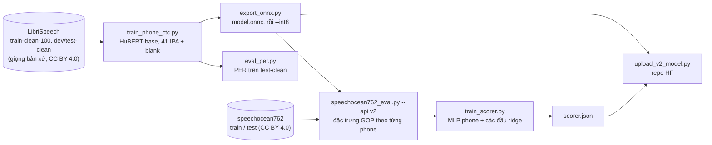

<!-- doc-id: docs-training | lang: vi | source-rev: 9feeca07 -->

> 🌐 **Bản dịch tiếng Việt** của [`docs/training.md`](../../../docs/training.md) (rev `9feeca07`). Bản tiếng Anh là chuẩn: nếu hai bản khác nhau, hãy theo bản tiếng Anh. Bản dịch do máy thực hiện, chưa có người bản xứ rà soát.

# Huấn luyện các model v2

Công việc offline nằm trong [`training/`](../training/) và không bao giờ được đưa vào image của dịch vụ. Nó dùng venv CUDA riêng (`.venv-train`) để venv của dịch vụ chỉ chạy CPU. Danh sách lệnh nhanh: [training/README.md](../training/README.md). Trang này giải thích huấn luyện cái gì, trên dữ liệu gì và vì sao.



## 1. Model phone CTC

| | |
| --- | --- |
| Nền | `facebook/hubert-base-ls960` (Apache-2.0) |
| Từ vựng | 41 ký hiệu IPA của dịch vụ + CTC blank; nhãn = transcript -> `g2p_en` -> IPA |
| Dữ liệu | LibriSpeech `train-clean-100` (28 539 câu nói); dev và test lấy từ `dev-clean` / `test-clean` |
| Vì sao chỉ giọng bản xứ | huấn luyện trên audio L2 với nhãn chuẩn sẽ dạy model chấp nhận các lỗi phát âm sai |
| Bộ tối ưu | AdamW, LR phần thân 5e-5, LR phần đầu 1e-3, 1000 bước chỉ huấn luyện phần đầu, 10% warm-up rồi giảm tuyến tính |
| Chia batch | khoảng 100 s audio mỗi micro-batch, 2 bước tích lũy, gom theo độ dài (HuBERT-base không có attention mask), bf16 autocast, bộ mã hóa đặc trưng conv bị đóng băng |
| Lần chạy | 25 000 bước, khoảng 124 phút, đỉnh 3.7 GB VRAM; giữ checkpoint có PER dev tốt nhất |
| Kết quả | PER 1.86% trên toàn bộ test-clean |

Các câu nói dài đến 20 s được dùng để huấn luyện (kho dữ liệu có một câu dài hơn). Model được phục vụ xử lý được đến 30 s mà không suy giảm đo được (PER theo độ dài có trong [scoring-v2.md](scoring-v2.md)).

```bash
.venv-train/Scripts/python -m training.train_phone_ctc --steps 25000 --dev-limit 600 --workers 4
.venv-train/Scripts/python -m training.eval_per --split test-clean
.venv-train/Scripts/python -m training.export_onnx           # model.onnx, checks parity vs torch (< 1e-3)
.venv-train/Scripts/python -m training.export_onnx --int8    # model.int8.onnx
```

Hợp đồng của tệp model (16 kHz mono, chuẩn hóa đỉnh, không chuẩn hóa mean/variance) phải khớp với `app/services/v2/phone_model.py`.

## 2. Bộ chấm

Đặc trưng đến từ việc chạy chính v2 analyser của dịch vụ trên speechocean762, nên huấn luyện và phục vụ không thể lệch nhau:

```bash
python scripts/speechocean762_eval.py --api v2 --split train --out data/so762-v2-train.jsonl --report data/so762-v2-train-report.json
python scripts/speechocean762_eval.py --api v2 --split test  --out data/so762-v2-test.jsonl  --report data/so762-v2-test-report.json
.venv/Scripts/python -m training.train_scorer       # writes data/models/hubert-phone-ctc/scorer.json
```

Không có `scorer.json`, harness vẫn ghi các đặc trưng theo từng phone (điểm số bằng 0), và đó là tất cả những gì huấn luyện cần.

- **MLP phone** (2 x 128, dropout 0.2): huấn luyện trên các fold tách riêng người nói; epoch được chọn trên 10% số người nói.
- **Các đầu ridge cho từ và câu nói:** xếp chồng (stacking) trên điểm phone out-of-fold để chúng không bao giờ thấy các dự đoán trong mẫu.
- **Ngưỡng gắn cờ** (điểm phone 1.48): giá trị tối đa hóa F1 phát hiện phát âm sai trên các dự đoán out-of-fold của tập train.
- **Tập test:** chỉ dùng một lần, cho báo cáo. Không có gì được chỉnh trên nó.
- **Co giãn đầu vào:** z-score được cắt về +/-10 (one-hot của các phone hiếm nếu không sẽ đạt |z| ~ 200 và phá hỏng việc fit).
- Một model ridge thuần cho đầu phone đạt PCC phone 0.546 / MDD F1 0.443 ở người lớn, chỉ thấp hơn mục tiêu một chút; MLP cho 0.630 / 0.537.

## 3. Công bố

`scripts/upload_v2_model.py` tải `model.int8.onnx`, `vocab.json` và `scorer.json` lên repo Hugging Face mà các lần build image tải về ([deployment.md](deployment.md)). Mỗi khi model phone hoặc bố cục đặc trưng thay đổi, hãy huấn luyện lại bộ chấm: `scorer.json` gắn với đúng thứ tự đặc trưng của đoạn code đã tạo ra nó (hiện chưa có dấu phiên bản).

## Giấy phép và dữ liệu

LibriSpeech và speechocean762 là CC BY 4.0 (ghi công trong [NOTICE](../../../NOTICE)); model đã huấn luyện là sản phẩm phái sinh của HuBERT-base (Apache-2.0). L2-ARCTIC **không** được dùng: nó là CC BY-NC. speechocean762 có L1 là tiếng Quan Thoại, nên việc thu thập và gán nhãn dữ liệu người học có tiếng mẹ đẻ khác là hạng mục mở chính ([evaluation.md](evaluation.md)).
