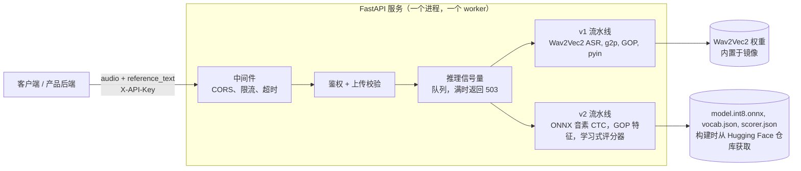
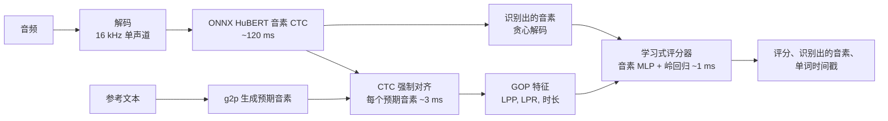

<!-- doc-id: readme | lang: zh | source-rev: 1429d642 -->

> 🌐 **中文翻译**，源文件 [`README.md`](../../README.md)（rev `1429d642`）。以英文版为准：若两者不一致，请以英文版为准。本译文由机器翻译，尚未经母语者审校。

<div align="center">

# 🗣️ 发音校验服务

**通过简单的 REST API 提供音素级英语发音评分。**
上传一段录音以及说话人本应说出的句子，即可获得逐音素、逐单词和整体评分，以及识别出的音素和单词时间戳。面向所有英语学习者，无论其母语是什么。


-EE4C2C?logo=pytorch&logoColor=white)


[快速开始](#-快速开始) · [API](#-api) · [v2 工作原理](#-v2-工作原理) · [结果](#-结果) · [文档](#-文档)

**语言：** [English](../../README.md) · [Tiếng Việt](../vi/README.md) · [中文](README.md) · [日本語](../ja/README.md) · [Español](../es/README.md)

</div>

---

## ✨ 功能简介

给定 `audio` + `reference_text`，服务将返回：

- **IPA 对比**：每个单词的每个音素的预期音素与识别出的音素
- **评分**：准确度、完整度、流利度、韵律和总分（0-100），以及等级和反馈文本
- **单词错误类型**：`None`、`Mispronunciation`、`Omission`、`Insertion`、`UnexpectedBreak`、`MissingBreak`
- **单词时间戳**（v2）：每个单词的 `start_ms` / `end_ms`

两条流水线并行运行，请求和响应结构相同：

| | **v1** `/api/v1/evaluate` | **v2** `/api/v2/evaluate` |
| --- | --- | --- |
| 思路 | 用 Wav2Vec2 转写单词、比较文本，使用手工调校的公式 | 用音素级模型为每个*预期音素*打分；学习式评分器将其映射为专家风格的评分 |
| 音素模型 | Wav2Vec2 字母 (A-Z) | HuBERT-base 音素 CTC（41 个 IPA 音素），ONNX INT8 |
| 评分 | 公式（55% IPA + 45% GOP，Azure 风格总分） | 基于 speechocean762 专家评分训练 |
| 延迟 p50（3.4 秒音频，4 vCPU） | 381 ms | **125 ms** |
| 加载后内存（各自单独运行） | 796 MB | **430 MB** |
| 音素评分与专家的相关性（成年人） | 0.03 | **0.63** |

v1 保持不变，仍然可用。v2 存在的原因见 [docs/scoring-v2.md](docs/scoring-v2.md)，响应中的差异见 [docs/api.md](docs/api.md#post-apiv2evaluate)。

## 🏗️ 架构



更多图表（v1 与 v2 对比、请求时序、启动流程）：[docs/architecture.md](docs/architecture.md)。

## 🔬 v2 工作原理



1. 音素 CTC 模型（仅在母语者的 LibriSpeech 上微调）给出每帧的音素后验概率。
2. 参考文本被转换为预期音素（g2p）；numpy 实现的 CTC 强制对齐找出每个音素应出现的位置。
3. 逐音素的发音良好度 (goodness-of-pronunciation) 特征（预期音素的对数后验概率、其他音素的拟合程度高出多少、时长）以及贪心解码得到的识别音素，输入一个在 speechocean762 上训练的小型评分器。
4. 静音以及没有可解码语音的音频会返回零分响应，而不是猜测一个结果。

耗时数据针对 3.4 秒音频、INT8、4 vCPU，在开发机上测得。完整说明：[docs/scoring-v2.md](docs/scoring-v2.md)。

## 🚀 快速开始

```bash
python3.11 -m venv .venv && source .venv/bin/activate      # Windows: .venv\Scripts\activate
pip install -r requirements.txt
cp .env.example .env                                       # set API_KEY (>= 32 chars) or DEBUG=true
python main.py                                             # http://localhost:8000/docs
```

v1 模型在首次启动时从 Hugging Face 下载。**v2 需要三个文件**，放在 `data/models/hubert-phone-ctc/` 中（`model.int8.onnx`、`vocab.json`、`scorer.json`）；缺少这些文件时 `/api/v2/evaluate` 返回 `503`，v1 不受影响。

```bash
# fetch the v2 files from the public Hugging Face repo (no token needed)
huggingface-cli download dris1153/pronunciation-v2 model.int8.onnx vocab.json scorer.json --local-dir data/models/hubert-phone-ctc
```

或者自行构建：[docs/training.md](docs/training.md)。

```bash
curl -X POST http://localhost:8000/api/v2/evaluate \
  -H "X-API-Key: $API_KEY" \
  -F "audio=@recording.wav" -F "reference_text=hello world"
```

```jsonc
{
  "reference_text": "hello world",
  "transcribed_text": "jɛloʊ wɝd",            // v2: the heard IPA string
  "results": {
    "word_details": [{
      "word": "hello", "expected_ipa": "həloʊ", "actual_ipa": "jɛloʊ",
      "start_ms": 160, "end_ms": 440, "error_type": "Mispronunciation",
      "phoneme_details": [{ "expected_ipa": "h", "actual_ipa": "j", "is_correct_ipa": false, "gop_score": 67.56 }]
    }]
  },
  "accuracy_score": 57.26, "fluency_score": 74.69, "prosody_score": 68.98, "overall_score": 55.8, "level": "fair"
}
```

（有删节；为合成的 "yellow word" 音频的真实输出，完整示例见 [docs/api.md](docs/api.md)）

### Docker

```bash
docker build --build-arg V2_MODEL_REPO=dris1153/pronunciation-v2 -t pronunciation-validator .
docker run -p 8000:8000 -e API_KEY=<32+ char key> -e DEBUG=false pronunciation-validator
```

Railway、Coolify/nixpacks、资源规格以及模型发布流程：[docs/deployment.md](docs/deployment.md)。

## 📡 API

| 端点 | 鉴权 | 用途 |
| --- | --- | --- |
| `POST /api/v2/evaluate` | 🔒 | 发音评分，音素原生流水线，含单词时间戳 |
| `POST /api/v1/evaluate` | 🔒 | 发音评分，原始 Wav2Vec2 流水线 |
| `GET /api/v1/text-analysis` | 🔒 | 文本转 IPA，含逐单词音素 |
| `POST /api/v1/transcribe` | 🔒 | 音频转文本，不评分 |
| `GET /api/v1/model-info` | - | 服务元数据和限制 |
| `GET /health` | - | 存活检查 |

🔒 = 需要 `X-API-Key` 请求头。限制：上传 10 MB，音频 30 秒，wav / mp3 / ogg / flac / webm。交互式文档位于 `/docs`。从后端调用并按用户限流：[docs/internal-integration.md](docs/internal-integration.md)。参考文档：[docs/api.md](docs/api.md)。

## 📊 结果

speechocean762 测试集（2500 条话语，母语为普通话的学习者），与专家评分的 Pearson 相关系数，成年人（18 岁以上）：

| | v1 | **v2** |
| --- | --- | --- |
| 话语总分 | 0.62 | **0.85** |
| 话语流利度 | 0.63 | **0.88** |
| 话语韵律 | 0.11 | **0.85** |
| 单词准确度 | 0.02 | **0.64** |
| 音素准确度 | 0.03 | **0.63** |
| 发音错误检测 F1 | 0.27 | **0.54** |

音素模型：在 LibriSpeech test-clean 上的音素错误率为 1.86%。INT8 对每项指标的影响不超过 0.004。

> ⚠️ **坦诚说明局限。** 所有评估说话人的母语均为普通话，因此**其他母语的准确度尚未测量**。该流程在设计上与母语无关（它将英语音素与参考文本逐一比对，没有针对特定母语的规则），但这一点尚未在普通话母语者之外得到验证；目前仅有的一次调研（针对越南语）也没有找到带发音评分、可商用的开放数据集（[数据计划](docs/evaluation.md#更多母语的数据计划)）。分数曲线是基于五段合成音频调出来的。速度数据来自开发机，请在你的主机上重新运行 `debugs/benchmark.py`。详情见 [docs/evaluation.md](docs/evaluation.md)。

## 🧰 技术栈

| 组件 | 技术 |
| --- | --- |
| Web | FastAPI, Uvicorn, Pydantic v2, slowapi |
| v2 音素模型 | 为音素 CTC 微调的 HuBERT-base，ONNX Runtime (INT8)，numpy 实现的对齐与评分器（不使用 PyTorch） |
| v1 | Wav2Vec2-base-960h (PyTorch, CPU)，librosa pyin 韵律 |
| 文本转音素 | g2p_en + NLTK，41 个符号的 IPA 音素集 |
| 训练 | 在 GPU 上使用 PyTorch + Transformers，仅离线进行（`training/`） |
| 运维 | Docker, Railway / Coolify, loguru，使用 Hugging Face Hub 存放模型文件 |

## 📁 项目结构

```
app/            FastAPI app: api/ (routes, auth, upload), core/ (config), models/ (schemas),
                services/ (v1 pipeline, shared alignment + scoring rules, v2/ phone pipeline), utils/
training/       Offline training and ONNX export of the v2 models (own CUDA venv)
scripts/        speechocean762 evaluation harness, sanity set, Hugging Face upload
debugs/         Latency / memory benchmark (v1 and v2)
tests/          pytest suite (~460 tests) + synthetic sanity recordings
docs/           Documentation
```

## 📚 文档

| | |
| --- | --- |
| [API 参考](docs/api.md) | 端点、鉴权、错误、示例 |
| [架构](docs/architecture.md) | 图表和代码结构 |
| [评分 v2](docs/scoring-v2.md) · [v1](docs/scoring-v1.md) | 评分如何产生 |
| [评估](docs/evaluation.md) | 质量、延迟、内存、测试、数据计划 |
| [训练](docs/training.md) | 训练、导出并发布 v2 模型 |
| [配置](docs/configuration.md) · [部署](docs/deployment.md) | 环境变量、Docker、Railway、Coolify |
| [内部集成](docs/internal-integration.md) | 后端到服务的用法，将客户端迁移到 v2 |

所有页面索引：[docs/README.md](docs/README.md)。另有双语单页版本，见 [`index.html`](../../index.html)。

## 🧪 测试

```bash
pytest tests/ -v
```

需要真实 v2 模型文件的测试在文件缺失时会自动跳过。两个 v1 健全性用例（`poor_001`、`poor_002`）是已知失败（v1 给这两段音频打的分刚好高于其档位）；v2 两个都通过。

## 🤝 贡献

初来乍到？请先阅读 [CONTRIBUTING.md](../../CONTRIBUTING.md)，并从一个 [good first issue](https://github.com/dris1153/pronunciation-service/labels/good%20first%20issue) 开始；每位参与者都需遵守[行为准则](../../CODE_OF_CONDUCT.md)。文件保持在约 200 行以内，遵循现有结构（`docs/structure.md`），并在推送前运行测试。英文文档是 [`languages/`](../README.md) 中各译文的权威来源：编辑后请运行 `python scripts/docs_sync.py bump`（规则见 [AGENTS.md](../../AGENTS.md)）。评分方面的改动需要在 speechocean762 评测脚本上做前后对比运行（[docs/evaluation.md](docs/evaluation.md)）。

## 📄 许可证与致谢

基于 [Apache License 2.0](../../LICENSE) 授权。版权所有 2026 dris1153。再分发时必须保留 [NOTICE](../../NOTICE) 文件。

基于 HuBERT 和 wav2vec 2.0（Meta AI，Apache-2.0）、g2p_en 构建，并使用 LibriSpeech 和 speechocean762（均为 CC BY 4.0）进行训练和评估。完整致谢和引用：[NOTICE](../../NOTICE)。
