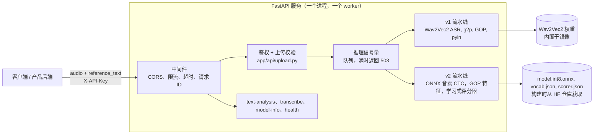
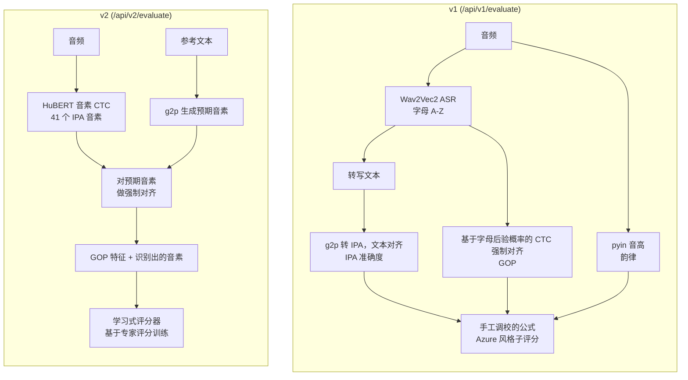
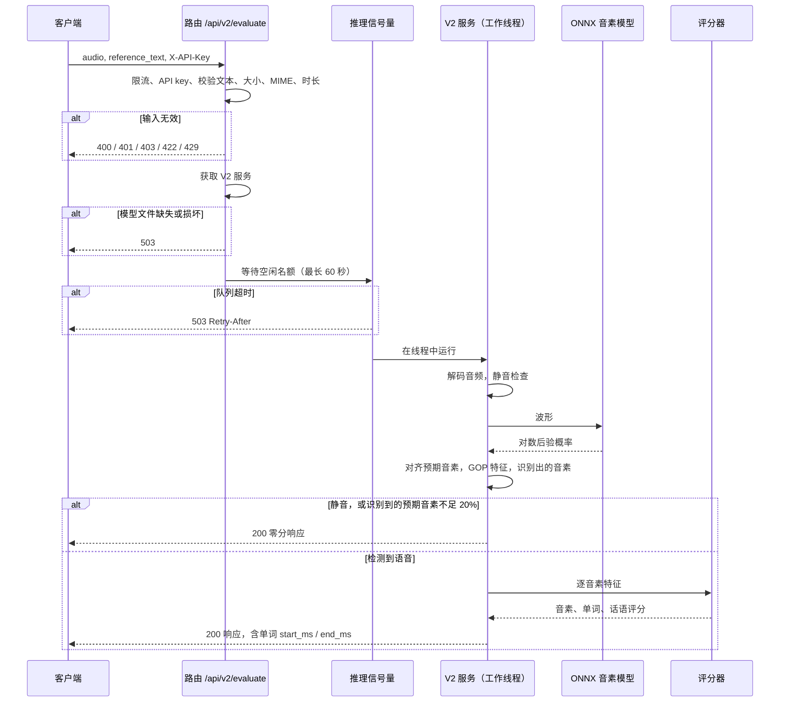
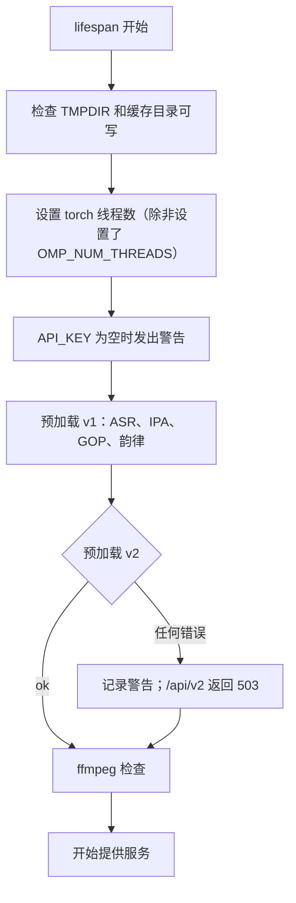

<!-- doc-id: docs-architecture | lang: zh | source-rev: ec588fa9 -->

> 🌐 **中文翻译**，源文件 [`docs/architecture.md`](../../../docs/architecture.md)（rev `ec588fa9`）。以英文版为准：若两者不一致，请以英文版为准。本译文由机器翻译，尚未经母语者审校。

# 架构

## 系统概览



所有组件都在一个进程中运行，因为模型很大且只加载一次；额外的 uvicorn worker 会各自加载一份副本。CPU 推理由信号量（`MAX_CONCURRENT_INFERENCES`）限制，阻塞型工作在工作线程中运行，因此事件循环保持空闲。

## v1 与 v2 对比



| | v1 | v2 |
| --- | --- | --- |
| 评分对象 | ASR 识别出的单词 | 每个预期音素 |
| 音素证据 | 字母后验概率 | 音素后验概率 |
| 评分 | 公式（55% IPA + 45% GOP，按排序取最小值得到总分） | 从 speechocean762 专家评分中学习 |
| 韵律 / 流利度 | pyin 音高、语速、停顿 | 从对齐特征中学习（没有音高跟踪器） |
| 运行时 | PyTorch | ONNX Runtime (INT8)，v2 代码中不使用 PyTorch |
| 延迟 p50（3.4 秒音频，4 vCPU） | 381 ms | 125 ms |

## 一次 v2 请求



服务产生的值错误（音频过短、参考文本中没有可发音的单词）会变成 `400`；任何意外错误会变成带通用消息的 `500`。

## 启动



v1 模型损坏会中止启动；v2 模型损坏或缺失则绝不会。

## 代码结构

```
app/
  application.py            FastAPI factory + lifespan (model preload)
  api/
    routes/                 health, ipa, model_info, pronunciation (v1), pronunciation_v2, transcribe
    dependencies.py         API key, service lookup (v1, v2 with 503)
    middleware.py           CORS, rate limit, timeout, exception handlers
    upload.py               upload + reference text validation shared by v1 and v2
  core/                     config (pydantic-settings), concurrency, constants, logging
  models/schemas.py         Pydantic schemas (v1 and additive V2 subclasses)
  services/
    pronunciation_service.py  v1 orchestrator
    asr_service.py, gop_service.py, ipa_service.py, prosody_service.py   v1 components
    phoneme_align.py        phone similarity groups + DP alignment (no torch, shared)
    scoring_rules.py        level/feedback, error types, break detection (no torch, shared)
    v2/
      phone_model.py        ONNX session -> log-posteriors
      ctc_align.py          numpy CTC forced alignment
      gop_features.py       GOP features, heard phones
      scorer.py             numpy phone MLP + word/utterance ridge
      analyser.py           audio + text -> V2Analysis
      pronunciation_v2_service.py   response assembly, gates, score curve
  utils/                    audio I/O, text normalisation
training/                   offline training and export (own CUDA venv, not imported by app/)
scripts/                    evaluation harness, sanity set, HF upload
debugs/                     benchmark and diagnostics
tests/                      pytest suite (+ synthetic sanity recordings)
```

各文件的详细说明：[structure.md](structure.md)。文字形式的 v1 请求流程：[workflow.md](workflow.md)。
