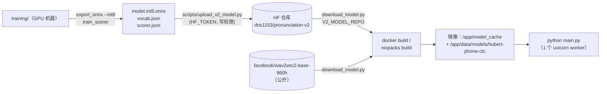

<!-- doc-id: docs-deployment | lang: zh | source-rev: 19243a73 -->

> 🌐 **中文翻译**，源文件 [`docs/deployment.md`](../../../docs/deployment.md)（rev `19243a73`）。以英文版为准：若两者不一致，请以英文版为准。本译文由机器翻译，尚未经母语者审校。

# 部署

一个容器同时服务两条流水线。v1 权重来自 Hugging Face 的公开仓库；v2 文件（`model.int8.onnx`、`vocab.json`、`scorer.json`）来自一个 Hugging Face 仓库（`dris1153/pronunciation-v2`，公开）。两者都在构建时打包进镜像（无需持久卷）。



## 一次性操作：发布 v2 文件

需要 Hugging Face 账号和具有**写**权限的令牌。

```powershell
$env:HF_TOKEN = "hf_xxx"          # write token, never commit it
python scripts/upload_v2_model.py --repo dris1153/pronunciation-v2
```

该脚本在仓库不存在时将其创建为私有（不会更改已有仓库的可见性），并上传 `data/models/hubert-phone-ctc/` 中的三个文件。已发布的仓库是公开的，因此构建无需令牌；若使用私有仓库，请为构建单独创建一个**读取**令牌。

## Docker

```bash
# v1 only (v2 endpoint will answer 503)
docker build -t pronunciation-validator .

# v1 + v2 (the model repo is public, no token needed)
docker build --build-arg V2_MODEL_REPO=dris1153/pronunciation-v2 -t pronunciation-validator .

# private model repo: the token travels as a BuildKit secret, so it never lands in an image layer
docker build \
  --build-arg V2_MODEL_REPO=<org>/<private-repo> \
  --secret id=HF_TOKEN,env=HF_TOKEN \
  -t pronunciation-validator .

docker run -p 8000:8000 -e API_KEY=<32+ char key> -e DEBUG=false pronunciation-validator
```

镜像的构建内容：`python:3.11-slim` + ffmpeg/libsndfile、仅 CPU 的 PyTorch（v1）、`requirements.txt`（包含供 v2 使用的 `onnxruntime`），运行 `download_model.py`（先下载 v1 模型，设置了 `V2_MODEL_REPO` 时再下载 v2 文件），切换到非 root 用户，启动 `python main.py`。`.dockerignore` 排除了 `data/` 和 `.venv-train/`，因此本地数据集不会进入构建上下文。

> **状态：** Dockerfile 构建已在 Coolify（Docker build pack）上运行过：它会下载 v2 文件，v2 在启动时成功加载。nixpacks 路径尚未运行。如果构建时使用了令牌，请运行一次 `docker history` 确认它没有留在任何镜像层中。

## Railway

`railway.toml` 使用 Dockerfile 构建器，健康检查为 `GET /health`（超时 120 秒），失败时重启（重试 3 次）。`PORT` 由 Railway 注入并由 pydantic-settings 读取。请在控制台中设置 `API_KEY`、`DEBUG=false` 及其余变量。

对于 v2，请将 `V2_MODEL_REPO` 设为构建变量。只有私有仓库才还需要把 `HF_TOKEN` 提供给构建。Railway 按**服务变量名**挂载构建 secret，这就是 Dockerfile 中的 secret id 为 `HF_TOKEN` 的原因。如果没有挂载 secret，则改用 `HF_TOKEN` 构建参数。若只想发布 v1，请不要设置 `V2_MODEL_REPO`。

## Coolify / nixpacks

`nixpacks.toml` 会安装 CPU 版 PyTorch 和 `requirements.txt`，打包 v1 模型，然后运行 `python download_model.py --v2-only`。将 `V2_MODEL_REPO` 设为**构建变量**；只有私有仓库才需要再加上 `HF_TOKEN`（nixpacks 可能把构建变量保留在生成的镜像中，因此请使用只读令牌，并在镜像曾被分享时轮换它）。应用通过 `su` 以 `appuser` 身份启动。

## 资源规格与运行规则

| 主题 | 指导 |
| --- | --- |
| Worker | **一个** uvicorn worker。每个 worker 都会加载全部模型的一份副本 |
| 内存 | 加载后实测 RSS：仅 v1 为 796 MB，v1 + v2 INT8 一起为 1030 MB，仅 v2 约 430 MB，处理请求后增长到 600-660 MB（ONNX arena）。合并进程在处理请求后的 RSS 未测量；请为合并进程预留约 2 GB |
| CPU | 4 vCPU：`MAX_CONCURRENT_INFERENCES=2`。2 vCPU：保持自动。在 Docker `--cpus`/Railway 下设置 `OMP_NUM_THREADS` |
| 健康检查 | `GET /health` 是公开的。它只报告 v1 的加载状态；v2 模型缺失会表现为 `/api/v2/evaluate` 返回 `503`，并在启动日志中给出警告 |
| 故障隔离 | v2 模型缺失或损坏绝不会阻止启动；v1 继续提供服务 |
| 切换客户端之前 | 在真实主机上运行 `python debugs/benchmark.py --api v2 --int8 --cpus 4`。[evaluation.md](evaluation.md) 中的速度数据来自开发机 |

环境变量：[configuration.md](configuration.md)。
