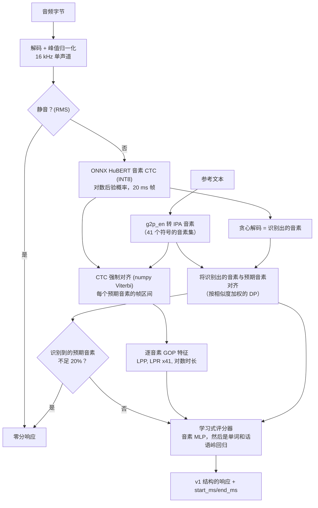

<!-- doc-id: docs-scoring-v2 | lang: zh | source-rev: 809ff2ba -->

> 🌐 **中文翻译**，源文件 [`docs/scoring-v2.md`](../../../docs/scoring-v2.md)（rev `809ff2ba`）。以英文版为准：若两者不一致，请以英文版为准。本译文由机器翻译，尚未经母语者审校。

# 评分 v2（音素原生流水线）

`POST /api/v2/evaluate` 如何为语音评分。它不转写单词再比较文本（v1），而是由音素级 CTC 模型直接为每个**预期**音素打分，再由一个小型学习模型把这些信号转换为专家风格的评分。

## 模型

- **主干：** `facebook/hubert-base-ls960`（Apache-2.0），针对 41 个符号的 IPA 词表加空白符进行微调，使用与 g2p 映射（`_ARPABET_TO_IPA`）相同的符号集。卷积前端冻结，bf16，25 000 步（在一块 GPU 上约 2 小时）。
- **训练数据：** 仅使用 LibriSpeech `train-clean-100`（母语者语音）。刻意从不使用带规范标签的 L2 音频：模型会因此学会原谅发音错误。
- **质量：** 在整个 LibriSpeech test-clean（2620 条话语，191 317 个音素）上的音素错误率为 1.86%。按长度划分，PER 在最长 35 秒内保持在 1.2-2.6%。标签来自 g2p，因此这衡量的是在母语朗读语音上与 g2p 输出的一致程度，而不是对带口音语音的准确度。
- **运行时：** CPU 上的 ONNX Runtime，仅对 MatMul 做动态 INT8（360 MB -> 116 MB）；INT8 与 FP32 相比，每项 speechocean762 指标的变化不超过 0.004。`app/services/v2/` 下不导入 PyTorch。
- **输入约定：** 16 kHz 单声道 float32，峰值归一化，不做均值/方差归一化（训练和服务必须一致）。

## 特征与对齐

对每个预期音素，强制对齐给出一个帧区间。基于该区间：

| 特征 | 含义 |
| --- | --- |
| `LPP` | 预期音素在其区间上的平均对数后验概率 |
| `LPR_k`（41 个） | `LPP` 减去其他每个音素 k 的平均对数后验概率：另一个音素的拟合程度高出多少 |
| `log_dur` | 该音素到下一个音素之前的时长的对数 |

评分器还会看到：`exp(LPP)`、截断后的 `LPP`、音素标识、识别出的音素是缺失 / 同组替换 / 其他替换、相邻音素的 `LPP`，以及该单词的平均和最小 `LPP`（每个音素 93 个输入）。

识别出的音素来自对整段话语的贪心 CTC 解码，并用 Levenshtein DP 与预期音素对齐，该 DP 对同组互换收取更低的代价（`app/services/phoneme_align.py`）。识别到但不在预期中的音素会作为插入附加到前一个单词上。

## 评分器

| 层级 | 模型 | 输出 |
| --- | --- | --- |
| 音素 | 对 93 个特征的 MLP 2 x 128 | 评分 0-2（与 speechocean762 音素准确度相同） |
| 单词 | 对其音素的 11 个聚合量做岭回归 | 0-10 |
| 话语 | 对 17 个聚合量（音素/单词评分统计、不匹配、删除和插入比例、每秒音素数、停顿间隙）做岭回归 | 准确度、流利度、韵律、总分，各 0-10 |
| 完整度 | 规则 | 被识别到的预期音素所占比例 |

在 speechocean762 训练集（2500 条话语）上训练，采用按说话人分组的 out-of-fold 堆叠；岭回归强度、早停和标记阈值仅使用训练集。权重是纯 JSON（`scorer.json`，约 620 KB），用 numpy 计算。

## 从模型输出到响应

- **曲线：** 话语评分按 `100 x (s/10)^1.4` 计算。评分器在专家评分尺度上预测（大多为 6-10）；该曲线将其映射到 v1 使用的更严格尺度，使明显错误的音频低于 60 分。该指数是在五条合成音频上调校的，应在真实学习者音频上重新校准。它对 speechocean762 话语相关系数的影响不超过 0.005。
- **`is_correct_ipa`：** 音素评分低于 **1.48**（满分 2）时被标记。该判定在成年人上的发音错误 F1 为 0.54，而“识别出的 != 预期的”为 0.31，因为许多识别结果不同的音素其实是与口音无关的变体。`actual_ipa` 仍保持原始的识别音素。
- **单词错误类型：** 该单词没有识别到任何音素时为 `Omission`，单词评分低于 60 时为 `Mispronunciation`，然后根据对齐后的单词间隙得出 `UnexpectedBreak` / `MissingBreak`（规则和阈值与 v1 相同，`app/services/scoring_rules.py`）。
- **关卡：** 静音 (RMS) 和“识别到的预期音素不足 20%”会返回零分响应，因为评分器在噪声上会外推。在 speechocean762 测试集中，真实语音里最低的识别比例是 0.31。

## 结果（speechocean762 测试集，2500 条话语）

除非另有说明，均为与专家评分的 Pearson 相关系数。成年人 = 18 岁以上的说话人（1220 条话语）。

| | v1 成年人 | **v2 成年人** | v2 所有说话人 |
| --- | --- | --- | --- |
| 话语总分 | 0.619 | **0.852** | 0.779 |
| 话语准确度 | 0.669 | **0.829** | 0.749 |
| 话语流利度 | 0.630 | **0.876** | 0.817 |
| 话语韵律 | 0.108 | **0.853** | 0.796 |
| 单词准确度 | 0.020 | **0.643** | 0.591 |
| 音素准确度 | 0.033 | **0.630** | 0.590 |
| 发音错误 F1（精确率 / 召回率） | 0.269 (0.16 / 0.88) | **0.537** (0.48 / 0.60) | 0.480 (0.40 / 0.59) |

发音错误 = 专家音素评分低于 1.0（占音素的 4%）。数值针对 FP32 模型和最终评分器；INT8 的差异在 0.004 以内，曲线映射的差异在 0.005 以内。

## 局限

- **L1 不匹配：** 训练和评估语料中的所有说话人，母语都是普通话。其他母语的表现尚未测量；数据计划见 [evaluation.md](evaluation.md)。
- 评分器一侧对 20 到 30 秒音频的评分未经测试（speechocean762 的音频都很短）；音素模型本身在这一范围内没有问题。
- 超过约 300 个音素（100 个单词）的参考文本是实际的上限；对齐的复杂度与音素数量呈平方关系。
- 跨单词边界的重复音素（`that time`）在 CTC 中会合并，因此一个 /t/ 可能被报告为缺失。

训练和导出命令：[training.md](training.md)。
