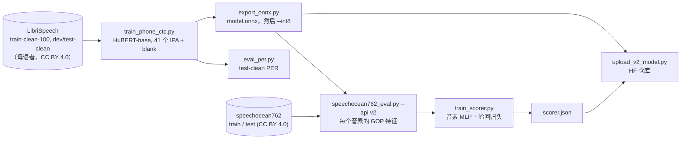

<!-- doc-id: docs-training | lang: zh | source-rev: 9feeca07 -->

> 🌐 **中文翻译**，源文件 [`docs/training.md`](../../../docs/training.md)（rev `9feeca07`）。以英文版为准：若两者不一致，请以英文版为准。本译文由机器翻译，尚未经母语者审校。

# 训练 v2 模型

离线工作位于 [`training/`](../training/)，从不随服务镜像发布。它使用自己的 CUDA 虚拟环境（`.venv-train`），因此服务的虚拟环境保持仅用 CPU。快速命令列表：[training/README.md](../training/README.md)。本页说明训练了什么、用什么数据训练以及原因。



## 1. 音素 CTC 模型

| | |
| --- | --- |
| 基础模型 | `facebook/hubert-base-ls960`（Apache-2.0） |
| 词表 | 服务使用的 41 个 IPA 符号 + CTC blank；标签 = 转写文本 -> `g2p_en` -> IPA |
| 数据 | LibriSpeech `train-clean-100`（28 539 条话语）；dev 和 test 来自 `dev-clean` / `test-clean` |
| 为什么只用母语者语音 | 在带规范标签的 L2 音频上训练会教会模型接受发音错误 |
| 优化器 | AdamW，主体学习率 5e-5，输出头学习率 1e-3，1000 步仅训练输出头，10% 预热然后线性衰减 |
| 批处理 | 每个微批次约 100 秒音频，2 步梯度累积，按长度分桶（HuBERT-base 没有 attention mask），bf16 autocast，冻结卷积特征编码器 |
| 运行 | 25 000 步，约 124 分钟，显存峰值 3.7 GB；保留 dev PER 最佳的检查点 |
| 结果 | 在整个 test-clean 上 PER 为 1.86% |

训练使用不超过 20 秒的话语（语料库中有一条更长的）。部署的模型可处理最长 30 秒，没有可测量的损失（按长度划分的 PER 见 [scoring-v2.md](scoring-v2.md)）。

```bash
.venv-train/Scripts/python -m training.train_phone_ctc --steps 25000 --dev-limit 600 --workers 4
.venv-train/Scripts/python -m training.eval_per --split test-clean
.venv-train/Scripts/python -m training.export_onnx           # model.onnx, checks parity vs torch (< 1e-3)
.venv-train/Scripts/python -m training.export_onnx --int8    # model.int8.onnx
```

模型文件约定（16 kHz 单声道，峰值归一化，不做均值/方差归一化）必须与 `app/services/v2/phone_model.py` 一致。

## 2. 评分器

特征来自在 speechocean762 上运行服务自己的 v2 分析器，因此训练和服务之间不会产生偏差：

```bash
python scripts/speechocean762_eval.py --api v2 --split train --out data/so762-v2-train.jsonl --report data/so762-v2-train-report.json
python scripts/speechocean762_eval.py --api v2 --split test  --out data/so762-v2-test.jsonl  --report data/so762-v2-test-report.json
.venv/Scripts/python -m training.train_scorer       # writes data/models/hubert-phone-ctc/scorer.json
```

没有 `scorer.json` 时，评测脚本仍会写出逐音素特征（评分为零），这正是训练所需要的全部。

- **音素 MLP**（2 x 128，dropout 0.2）：在按说话人留出的折上训练；用 10% 的说话人选择训练轮数。
- **单词和话语岭回归头：** 堆叠在 out-of-fold 的音素评分之上，因此它们从不接触样本内预测。
- **标记阈值**（音素评分 1.48）：使 out-of-fold 训练集预测上的发音错误 F1 最大化的值。
- **测试集：** 只使用一次，用于报告。没有任何东西是在它上面调校的。
- **输入缩放：** z 分数被截断到 +/-10（罕见音素的 one-hot 否则会达到 |z| ~ 200，毁掉拟合）。
- 音素头使用普通岭回归模型时，在成年人上的音素 PCC 为 0.546 / MDD F1 为 0.443，略低于目标；MLP 给出 0.630 / 0.537。

## 3. 发布

`scripts/upload_v2_model.py` 会把 `model.int8.onnx`、`vocab.json` 和 `scorer.json` 上传到镜像构建所下载的 Hugging Face 仓库（[deployment.md](deployment.md)）。每当音素模型或特征布局发生变化，都要重新训练评分器：`scorer.json` 与生成它的代码中的特征顺序严格绑定（目前还没有版本标记）。

## 许可证与数据

LibriSpeech 和 speechocean762 采用 CC BY 4.0（署名见 [NOTICE](../../../NOTICE)）；训练出的模型是 HuBERT-base（Apache-2.0）的衍生作品。未使用 L2-ARCTIC：它是 CC BY-NC。speechocean762 的母语是普通话，因此收集并标注其他母语学习者的数据是目前最主要的待办事项（[evaluation.md](evaluation.md)）。
